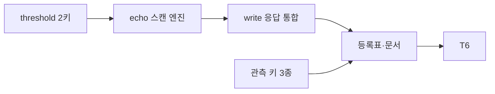

# flint v1.17.0 — 에코(echo): 만남 순간 판정·관측 키

**Spec path:** docs/plans/2026-11-21-flint-v1170.spec.md
**Detail:** tests · **Target-min:** 6
**Global constraints:** TDD·비간섭(스캔 실패 시 echo 생략·write 불변)·판정 주체는 에이전트(echo는 제안만)·주석 영어·개인 데이터 금지.

**리서치 근거** (v117-echo-research): bigramDice·BigramDiceMultiset·conflict_dup_threshold·BumpDailyFlatKey 전부 기존 — echo는 조합·이관. Mem0는 LLM 판정·Zep는 t_invalid — flint는 에이전트 판정+계약.

### T1 echo 스캔 엔진 · Complexity 3 · Est. context 24k
**Owns:** lib/knowledge/echo.go, lib/knowledge/echo_test.go
**계약:** `EchoScan(ctx, st wire.Store, topic, summary string) ([]EchoCandidate, error)` — active 지식 대상 bigramDice·BigramDiceMultiset 스코어 계산·상위 k(echo_top_k)·하한(echo_min_score) 필터·관계 구간화: ①multiset ≥ 0.6 = duplicates ②multiset < 0.6 AND 집합 bigramDice ≥ echo_min_score AND topic bigramDice ≥ echo_topic_match(0.4) = contradicts ③미달 = 제외. 입력 cap TruncateRunes(topic+summary, 4096) — suggestQueryMaxRunes 승계. 행 cap suggest_scan_cap(5000) 승계. 실패 시 (nil, err) — 호출측 조용히 생략.
**Produces:** `EchoScan(ctx context.Context, st wire.Store, topic, summary string) ([]EchoCandidate, error)` — `EchoCandidate{ID int, Topic string, Score float64, Relation string}`. e.g. `("데모 토픽", "같은 내용") -> [{ID:42, Score:0.85, Relation:"duplicates"}]`
**Test:** fast — 순수 스코어링·구간화·cap·필터. slow — 실DB 스캔.

### T2 write 응답 통합 · Complexity 3 · Est. context 22k
**Owns:** lib/knowledge/write.go, lib/knowledge/write_test.go, lib/cli/write_v1170_test.go
**계약:** write 파이프라인 dedup(hash 일치 NOOP) 직후·classify 전 EchoScan 호출. 정확-hash dedup 시 echo 생략(이미 응답 있음). **committedOutput**(신규 커밋 응답)에 `echo` 필드 추가(기존 스키마 확장·에이전트 하위 호환). DuplicateMeta 경로는 echo 생략. 스캔 실패 시 echo 필드 부재·write 정상 완료(§13).
**Consumes:** EchoScan (T1)
**Test:** 단위(echo 포함 응답·생략 경로·하위 호환) + e2e slow(신규 쓰기→echo 응답→중복 후보→approve).

### T3 threshold 2키 · Complexity 2 · Est. context 16k
**Owns:** lib/store/thresholds.go, lib/wire/threshold_meta.go, lib/wire/threshold_meta_test.go, docs/TUNING.md
**계약:** `echo_top_k`(기본 5)·`echo_min_score`(기본 0.3)·`echo_topic_match`(기본 0.4) 등록(46→49)·TUNING 행 3건. echo_min_score 0.3은 suggest_min_score 0.15 대비 상향 — write 경로는 스캔 비용 절감 위해 임계 강화(근거).
**Test:** 기본·오버라이드·frozen.

### T4 관측 키 3종 · Complexity 2 · Est. context 18k
**Owns:** lib/knowledge/approve.go, lib/knowledge/approve_test.go, lib/knowledge/survived.go
**계약:** approve 승격 경로(knowledge.origin 필드 조회 추가)에서 소스별 전환 카운터 — `correction_approved`(origin=correction)·`gap_approved`(origin=gap). curationCounterKinds 주석 갱신(8→11·"intake + review"로 원칙 확장)·`survived_sessions`(survived 세션 수 daily — maintain --decay-audit 실행 시 SurvivedCounts 결과에서 survived≥1인 id 수를 BumpDailyFlatKey로 스냅숏. 소비 주체=maintain). BumpDailyFlatKey 승계·curationCounterKinds 등록(8→11).
**Test:** 승격 시 카운트·비대상 소스 미카운트·PruneDaily 정리.

### T5 등록표·문서·버전 · Complexity 2 · Est. context 20k
**Owns:** lib/knowledge/pipeline.go, lib/knowledge/pipeline_test.go, VERSION, README.md, README.ko.md, flint-plugin/.claude-plugin/plugin.json, docs/HISTORY.md, docs/versions_test.go, docs/RUNBOOK.md
**계약:** ①pipeline.go에 echo 케이스 추가(관측·판정 지원·v1.17.0) — 8케이스 ②RUNBOOK 에코 절(개념·echo 필드 해석·판정 가이드·관측 키) ③버전 동기 v1.17.0·계약행 TestVersion01170Milestone{v1.17.0, echo}. release-gate.
**Test:** 등록표 정합·go test ./docs·release-gate OK v1.17.0.

**Review Focus:** state(스캔 경합·dedup 정합)·numeric(스코어 구간)·protocol(응답 스키마 하위 호환)·performance(cap·스캔 비용). 위험: echo 응답 과대(k 과다)·write 지연·에이전트 오남용.

**Probe entry:** run=go run ./cmd/flint write knowledge --source correction · run=go run ./cmd/flint read 데모 --limit 3

**Ruling:** echo는 제안만·판정은 에이전트 — 자동 supersede 금지(§5 승인 회로 승계·Letta 자기강화 회피) - 비용: 에이전트 순응도 의존.
**Ruling:** 정확-hash dedup 시 echo 생략 — 이미 DuplicateMeta 응답 존재·중복 방지 - 비용: 완전 일치에서 근사 정보 부재.
