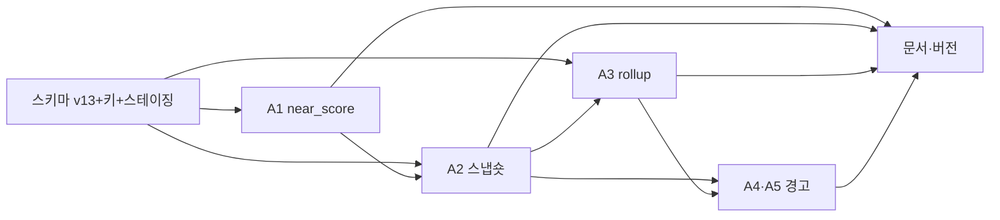

# flint v1.19.0 — 관측 기반 계층 A1~A5 (스키마 v13)

상태: active
**Spec path:** docs/plans/2026-11-22-flint-v1190.spec.md
**Detail:** tests · **Target-min:** 6
**Global constraints:** TDD·additive 스키마(DEFAULT 포함 ALTER)·주석 영어·개인 데이터 금지(합성 시드 DB만)·계측 테이블 명시 스테이징.

**리서치 근거** (v119-research): 스코어는 반환 전 버려짐(suggest.go:171-174 — 상위 3의 ID·Topic만 반환·min_score 미만 행은 :154-157에서 선별 전 버림)·bigramDice만 임계값 인과 유효(RRF는 read.go:554-600의 순위 합산 — 임계값과 무관)·LoadThresholds는 공통 인터셉트 아님(개별 커맨드별)·maybePruneAfterRead 24h 게이트가 독립 롤오버 모델(usage.go:314)·Prometheus 분자·분모 분리 집계·absent()는 등록표 기반 필요.

### T1 스키마 v13+키+스테이징 · Complexity 4 · Est. context 28k
**Owns:** lib/db/admin.go, lib/db/schema_gates.go, lib/sqlfs/schema.sql, lib/db/repo.go, lib/store/thresholds.go, lib/wire/threshold_meta.go, lib/db/admin_test.go
**계약:** EnsureSchemaV13 — ①read_events `near_score double precision NOT NULL DEFAULT 0`(v10 열 확장 선례) ②`threshold_snapshots`(열·(key, ts DESC) 인덱스)·`weekly_rollups`(PK (week_start, metric)) CREATE IF NOT EXISTS(v12 선례) ③레지스트리 1행·LatestSchemaVersion=13 ④schema.sql 신규 생성 경로 v13 종착상태 ⑤telemetryStageTables에 테이블 2종 추가(serial 채택 시 Seqs도) ⑥thresholds 키 3종(`weekly_rollups_retention_days`·`threshold_snapshots_retention_days`·`metering_freshness_warn_h`) 4곳 등록(필드·기본값·Parse·thresholdMetas) 한 커밋.
**Test:** v12→v13 업그레이드·신규 DB 직행·TestSchemaGatesContiguous·스테이징 목록 포함 가드·threshold_meta 동질.

### T2 A1 near_score 적립 · Complexity 3 · Est. context 20k
**Owns:** lib/query/suggest.go, lib/query/suggest_test.go, lib/knowledge/read.go, lib/knowledge/read_test.go, lib/db/usage.go
**계약:** SuggestSimilar가 min_score 필터 이전 스캔 최고치(scanMax)를 함께 반환(엔벨로프 필드 또는 별도 반환값 — 구현 선택). RecordReadEvent가 zero 행 전체(near 무관)에 scanMax를 INSERT(왕복 +0). 히트 행=0. 기존 near 이진 플래그 의미 불변.
**Consumes:** T1 스키마 열
**Test:** min_score 미만 zero 행 스캔 최고치 저장·히트 행 0·scanMax가 상위 k와 독립(후보 없는 행도 스코어 존재)·쿼리 본문 비저장 불변.

### T3 A2 임계값 스냅숏 · Complexity 3 · Est. context 22k
**Owns:** lib/db/snapshot.go, lib/db/snapshot_test.go, lib/db/usage.go
**계약:** 신규 파일에 게이트·비교·append 로직(1일 게이트 meta `last_threshold_snapshot_at` + 1h 프로세스 캐시 + 실패 조용히). RecordReadEvent 뒤 훅 1줄(usage.go). 만료 시 LoadThresholds 로드 — 직전 스냅숏((key, ts DESC) 인덱스)과 비교, 변경 행만 append. **최초 만료 시 전체 키 시딩**. 왕복 = 게이트 1+로드 1+직전 1+INSERT N.
**Consumes:** T1 테이블·키
**Test:** 게이트 1일 1회·최초 전체 시딩·이후 무변경 0행·변경분만 append·retention 만료 삭제·실패 조용히.

### T4 A3 주간 rollup · Complexity 3 · Est. context 22k
**Owns:** lib/db/rollup.go, lib/db/rollup_test.go, lib/db/usage.go
**계약:** 신규 파일에 게이트·집계·UPSERT(1일 게이트 `last_rollup_at`). 지난 주[UTC] raw에서 metric 3종(`zero_pct`·`fallback_pct`·`pair_pct` — 분자·분모 정의 report.go:117-127 준용) num·den 집계 후 UPSERT(재집계 멱등 캐시). **롤오버가 PruneReadEvents에 선행**(동일 흐름 집계 확정 후 만료 삭제). RecordReadEvent 뒤 훅 1줄(usage.go — T3 훅과 같은 지점).
**Consumes:** T1 테이블·키
**Test:** num·den 왕복·재집계 멱등·빈 주 0행·retention·PruneReadEvents 선행 순서·왕복 ≤5.

### T5 A4·A5 경고 · Complexity 3 · Est. context 24k
**Owns:** lib/ops/doctor.go, lib/ops/doctor_test.go, lib/ops/diagnosis.go, lib/ops/diagnosis_test.go, lib/db/usage.go, lib/knowledge/approve.go
**계약:** ①doctor 등록표 1행 `metering-freshness`(ThFn 주입형) — 이벤트 테이블 5종 max(각 시점 열 — recall_events는 recalled_at) + 게이트 meta 키 2종 = 7소스, 임계 `metering_freshness_warn_h`(T1 키). ②관측 키 등록 3곳(intake 10·curation 11 — RecordUsageCount kind와 별개 전용 키 공간 계약 approve.go:46-48·bytes 3)을 **집합 구분 유지 통합 레지스트리**(그룹별 슬라이스/맵 — flat 병합 금지)로 통합 후 diagnose 등록 대비 장기 미발화 차집합 경고. 합집합 24키 동질 가드.
**Consumes:** T1 키(`metering_freshness_warn_h`), T3 게이트 키, T4 게이트 키
**Test:** 등록표 동질(합집합 24키·그룹 구분 유지 — 각 함수는 자기 그룹만)·미발화 차집합 판정·오프라인 조용히·doctor 체크 1행 가드.

### T6 문서·버전 v1.19.0 · Complexity 2 · Est. context 18k
**Owns:** VERSION, README.md, README.ko.md, flint-plugin/.claude-plugin/plugin.json, docs/HISTORY.md, docs/METRICS.md, docs/TUNING.md, internal/doclint/versions_test.go
**계약:** v1.19.0 동기·METRICS에 metric 3종·신선도·커버리지 정의 병기(단일 소스)·TUNING §2 신규 키 3종(보존 2+신선도 1·rollup-retention 상호의존 주석)·계약행 TestVersion01190Milestone{v1.19.0, observability-foundation}. release-gate.
**Consumes:** T2 near_score, T3 스냅숏, T4 rollup, T5 경고
**Test:** go test ./internal/doclint·docs-sync·release-gate OK v1.19.0.

**Review Focus:** state(게이트·캐시·멱등·시딩)·numeric(num·den 정합·scanMax 범위)·protocol(마이그레이션 하위호환)·file(스테이징 누락·usage.go 직렬 편집). 위험: raw 만료와 롤오버 경쟁·등록표 통합의 집합 붕괴·T2~T4의 usage.go 인접 편집(taskgraph 직렬화로 완화).

**Probe entry:** run=go run ./cmd/flint doctor · run=go run ./cmd/flint report --text

**Ruling:** A1 = zero 행 전체 스캔 최고치(near 무관) — near=false 0 마스킹은 C1 counterfactual 왜곡 - 비용: near=true 전제 조건부 분석 불가(전 분포 저장으로 오히려 해소).
**Ruling:** A2 열 명명 near_score — score 단독은 RRF 순위 점수와 혼동 - 비용: 없음.
**Ruling:** A2 동기(fired) 캡처 이월 — B3 등록표(v1.23.0)가 소비 주체 - 비용: v1.19.0 변경 이유 식별 불가(값 변화만 기록).
**Ruling:** 독립 롤오버 채택·PruneDaily 편승 기각 — 첫 쓰기 훅은 write 없는 날 적립 생략 - 비용: 게이트 키 2종 추가.
**Ruling:** 최초 만료 전체 키 시딩 — B3/B4의 기저선 확보 - 비용: 첫 스냅숏 1회 대량 append.
**Ruling:** A4·A5 무저장 — 경고는 소비 시점 계산 - 비용: 이력 추적 불가(B4 경과 판정은 v1.24.0 저장).
**Ruling:** thresholds 키 3종 T1 편입 — 4곳 동질은 한 커밋이 원칙(스펙) - 비용: T1 소유 확대.
