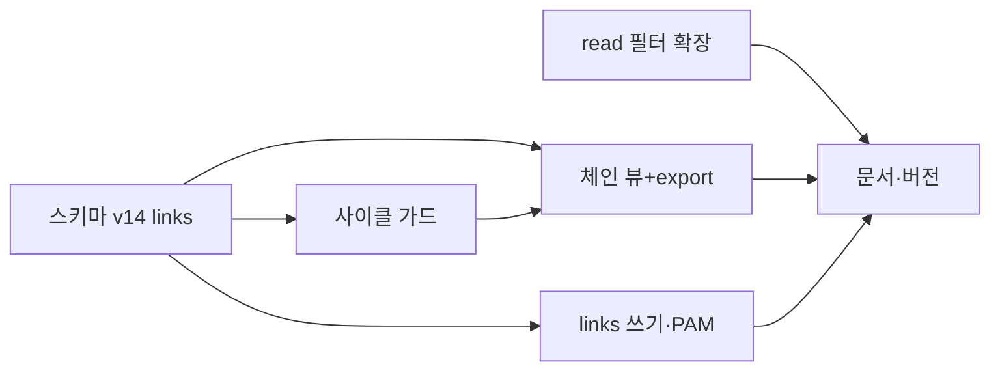

# flint v1.20.0 — 지식 스키마·검색 발전 (스키마 v14)

상태: active
**Spec path:** docs/plans/2026-11-22-flint-v1200.spec.md
**Detail:** tests · **Target-min:** 6
**Global constraints:** TDD·additive 스키마·주석 영어·개인 데이터 금지(합성 시드만)·관측 테이블과 audit 스테이징 구분(knowledge_links는 audit).

**리서치 근거** (v120-research): read 필터·재귀 뷰 둘 다 migration 0 실증(뷰는 views_hash 이중 게이트 — v0.41.0 선례)·kind 열명 3중 충돌(rec["kind"] 셀렉터·hot_view.kind·read --kind)·Doltgres 재귀 뷰 실측(경로배열 가드 종료·CYCLE 절 지원·UNION 무한 시 iteration limit 에러)·사이클 가드 부재 실증(maintain.go:899)·Zep/Graphiti·Mem0 관계 모델 관례.

### T1 스키마 v14 knowledge_links · Complexity 4 · Est. context 26k
**Owns:** lib/db/admin.go, lib/db/schema_gates.go, lib/sqlfs/schema.sql, lib/db/repo.go, lib/store/normalize.go, lib/store/normalize_test.go, lib/db/admin_test.go
**Components:** 2 · **LOC owned:** 110 · **Tests:** fast · **Model:** sonnet
**계약:** EnsureSchemaV14 — knowledge_links(id bigserial PK·from_id·to_id·relation·created_at·인덱스 (from_id)·(to_id)) + `knowledge.superseded_by` 인덱스 CREATE IF NOT EXISTS·레지스트리·LatestSchemaVersion=14·schema.sql 종착상태·auditStageTables에 knowledge_links 추가(테이블만 — 시퀀스는 잔류-무해 룰링 repo.go:554 승계). relation 어휘 상수 4종(refines·supports·contradicts·duplicates) — Normalize 검증·미등록 exit 3(거부 선례 colon-token). **hashVolatile에 relations 등록 — HashCanonical 제외(해시 불변).**
**Test:** v13→v14 업그레이드·신규 직행·Contiguous·어휘 검증·스테이징 포함·해시 불변(같은 본문+다른 relations 동일 해시).

### T2 read 필터 확장 · Complexity 3 · Est. context 22k
**Owns:** lib/knowledge/read.go, lib/knowledge/read_test.go, lib/query/read.go, lib/query/read_test.go, lib/mcp/tools.go, lib/cli/usage_wire.go
**Components:** 2 · **LOC owned:** 90 · **Tests:** fast · **Model:** sonnet
**계약:** --min-confidence N(0~1·appendReadFilters `confidence >= $n`)·--origin agent|human(`origin = $v`)·커맨드 표·usage(read.go:365 라인·usage_wire.go 레지스트리)·MCP read properties 2종·thresholds 개입 없음. 파서 통합 규칙(N9)·검증 exit 3 준수.
**Test:** 경계값·조합(기존 필터와)·MCP 스키마·회귀(기존 필터 전수).

### T3 supersede 사이클 가드 · Complexity 4 · Est. context 24k
**Owns:** lib/cli/maintain.go, lib/cli/maintain_test.go, lib/db/admin.go, lib/db/repo.go
**Components:** 2 · **LOC owned:** 90 · **Tests:** slow · **Model:** sonnet
**계약:** maintain --supersede OLD --by NEW(cli/maintain.go:879 maintainSupersede)·--merge(db/admin.go:786 Merge — superseded_by 설정) — NEW에서 superseded_by 재귀 추적해 OLD 도달 시 거부(exit 1·진단). 1왕복 WITH RECURSIVE(깊이 상한 64 가드). NEW 상태 불문 허용 유지. repo.go SetSupersededRef(:458) 동일 가드(import 경로).
**Consumes:** T1 superseded_by 인덱스
**Test:** A→B→A 거부·3홉 정상·셀프(NEW==OLD) 기존 exit 유지·깊이 상한·실DB slow.

### T4 체인 뷰+export 표기 · Complexity 3 · Est. context 22k
**Owns:** lib/sqlfs/views.sql, lib/db/repo.go, lib/knowledge/export_md.go, lib/knowledge/export_md_test.go
**Components:** 2 · **LOC owned:** 80 · **Tests:** slow · **Model:** sonnet
**계약:** views.sql에 supersede_chains(root_id, id, depth) — 경로배열 가드 UNION ALL 재귀. reapplyViews DROP 목록에 추가(repo.go 하드코딩 — 잔류 방지). export_md 체인 표기 확장(1홉 → 말단 depth 표기·뷰 소비). asOfTables 무변경(as-of 비노출).
**Consumes:** T3 (뷰와 CTE 형상 공유 — 테스트가 T3 가드를 재사용)
**Test:** 사이클 데이터에서 뷰 종료·경로 정합·export 표기·재적용 멱등(views_hash).

### T5 links 쓰기·PAM 왕복 · Complexity 4 · Est. context 26k
**Owns:** lib/knowledge/write.go, lib/knowledge/write_test.go, lib/knowledge/export_pam.go, lib/knowledge/import_pam.go, lib/knowledge/import_pam_test.go
**Components:** 3 · **LOC owned:** 140 · **Tests:** slow · **Model:** sonnet
**계약:** write stdin JSON 선택 relations 배열(to·relation) — from=적립 행 id·어휘 검증(T1)·대상 부재 exit 3·중복 멱등(동일 from·to·relation 스킵). **duplicate 경로: 본문 해시 중복 시 relations는 DupMeta.ID(lookupHash:343)로 적립 — 유실 방지.** 해시 불변은 T1 hashVolatile 등록으로 보장. PAM 수출 relations에 4종 동반(supersedes 파생 병기)·import 재적립 왕복.
**Consumes:** T1 테이블·어휘·hashVolatile
**Test:** 어휘 검증·왕복 e2e·hash 불변·duplicate 경로 링크 적립·멱등·실DB slow.

### T6 문서·버전 v1.20.0 · Complexity 2 · Est. context 18k
**Owns:** VERSION, README.md, README.ko.md, flint-plugin/.claude-plugin/plugin.json, docs/HISTORY.md, docs/TUNING.md, internal/doclint/versions_test.go, docs/plans/2026-11-21-flint-release-scope.md
**Components:** 1 · **LOC owned:** 40 · **Tests:** fast · **Model:** sonnet
**계약:** v1.20.0 동기·TUNING §2(필터 thresholds 개입 없음·links 어휘 4종)·계약행 TestVersion01200Milestone{v1.20.0, knowledge-schema-search}. **스코프 문서 갱신: v1.20.0 행에서 kind 제외·v1.25.0 행에 kind 열 이월 추가(스키마 열 갱신 포함 — additive)·의존 메모 정합.** release-gate.
**Consumes:** T2, T4, T5
**Test:** doclint·docs-sync·release-gate OK v1.20.0.

**Review Focus:** protocol(마이그레이션·어휘 검증)·state(사이클 가드·멱등)·encoding(PAM 왕복)·file(views 잔류·스테이징). 위험: 재귀 무한(Doltgres iteration limit 에러 방어)·이중 원천(supersedes 열/links 미혼용)·content_hash 오염.

**Probe entry:** run=go run ./cmd/flint read 데모 --min-confidence 0.5 · run=go run ./cmd/flint maintain --help

**Ruling:** kind 열 v1.25.0 이월 — 소비처 부재·열명 3중 충돌·hash 변화 - 비용: v1.25.0 스키마 동반(스코프 갱신으로 정합).
**Ruling:** links 어휘 4종·supersedes 제외 — superseded_by 열과 이중 원천 회피 - 비용: 어휘 5종 소비는 차기 재검토.
**Ruling:** 뷰 소비처 = export_md 표기 — 소비처 없는 스키마(project no-go) 회피 - 비용: 표기 형식 고정.
**Ruling:** 날짜 범위·태그 부정 필터 이월 — --as-of 중첩 설계·요구 미확정 - 비용: 없음(차기 후보).
