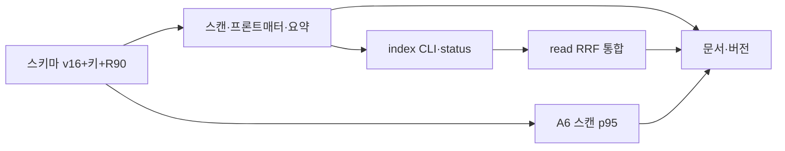

# flint v1.21.0 — 볼트 브리지 I: 색인·read 통합 (스키마 v16)

상태: active
**Spec path:** docs/plans/2026-11-22-flint-v1210.spec.md
**Detail:** tests · **Target-min:** 7
**Global constraints:** TDD·additive 스키마·주석 영어·개인 데이터 금지(합성 데모 볼트만 — 실볼트 경로·문서 인용 금지)·vault_files는 audit 스테이징.

```mermaid
%% schedule
gantt
  title Predicted schedule (mm:ss)
  dateFormat X
  axisFormat %M:%S
  section lane 1
  T1 스키마 v16+키+R90 :t1, 0, 151s
  section lane 2
  T2 스캔·프론트매터·요약 :t2, 0, 127s
  section lane 3
  T3 index CLI·status :t3, 0, 127s
  section lane 4
  T4 read RRF 통합 :t4, 0, 127s
  section lane 5
  T5 A6 스캔 p95 :t5, 0, 127s
  section lane 6
  T6 문서·버전 v1.21.0 :t6, 0, 102s
```

critical path: T1 (2.5 min) · peak width 6 · predicted build 2.5 min · predicted total ≈ 6.0 min

**리서치 근거** (v121-research): parseMarkdownSections 코드펜스 제외 이미 구현(import.go:132)·프론트매터 파서 부재·YAML 의존 금지(go.mod 직접 의존에 부재)·WalkDir 신규·sha256 raw bytes(export sidecar 관례)·DELETE…USING 미지원(NOT IN MIN 승계)·ReorderByFallbackCount 4신호 RRF(read.go:280)·ClampLimit 10/50·HotStats p95 패턴(metrics.go:46)·thresholds 등록 5곳·문자열 키 파서 부재(parseStringOrDefault 신규).

### T1 스키마 v16+키+R90 · Complexity 4 · Est. context 28k
**Owns:** lib/db/admin.go, lib/db/schema_gates.go, lib/sqlfs/schema.sql, lib/db/repo.go, lib/store/thresholds.go, lib/wire/threshold_meta.go, lib/wire/threshold_meta_test.go, lib/store/thresholds_test.go, lib/db/admin_test.go, lib/db/repo_v1203_test.go, lib/ops/tuning.go
**Components:** 3 · **LOC owned:** 150 · **Tests:** fast · **Model:** sonnet
**계약:** EnsureSchemaV16 — vault_files(열·인덱스 (content_hash)) + auditStageTables 등록 + LatestSchemaVersion=16 + schema.sql 종착상태. thresholds 3종(vault_scan_max_files 10000·vault_summary_max_runes 200·vault_skip_dirs 문자열 ".obsidian,.trash") — parseStringOrDefault 신규 헬퍼·등록 5곳·guard 키 집합 갱신. **R90: Merge 락 획득 직후 defer unlock() 1행**(즉시 호출 유지·panic 방어) — 회귀: swap seam panic 주입 후 락 해제.
**Test:** v15→v16 업그레이드·신규 직행·Contiguous·스테이징 포함·키 등록 동질·R90 panic 락 해제.

### T2 스캔·프론트매터·요약 · Complexity 4 · Est. context 30k
**Owns:** lib/vault/scan.go(신규), lib/vault/scan_test.go(신규), lib/vault/frontmatter.go(신규), lib/vault/frontmatter_test.go(신규)
**Components:** 2 · **LOC owned:** 220 · **Tests:** fast · **Model:** sonnet
**계약:** 신규 패키지 lib/vault — ①WalkDir+`.md` 전용+skip dirs(threshold) ②1차 필터 DB (mtime,size) 불일치 → sha256 raw bytes 재계산 ③디프: 신규 INSERT·변경 UPSERT(path UNIQUE)·삭제 NOT IN MIN DELETE·전체 1tx ④프론트매터 파서(첫 `---` 블록 — flow `[a,b]`·block `- a`·quoted `"[[x]]"` 수용·YAML 의존 금지) ⑤title=최초 `# ` 헤딩(부재 시 stem)·요약=프론트매터/헤딩 제외 첫 비빈 문단 TruncateRunes·parseMarkdownSections 승계(코드펜스 제외). Repo 경유 쓰기·합성 데모 볼트 픽스처만.
**Consumes:** T1 스키마·키
**Test:** 신규·변경·삭제·이름변경·복제 노트(비유니크 hash)·프론트매터 3변형+빈 프론트매터·CRLF·코드펜스·skip dirs·limit.

### T3 index CLI·status · Complexity 3 · Est. context 24k
**Owns:** lib/cli/index.go(신규), lib/cli/index_test.go(신규), lib/ops/status.go, lib/ops/status_test.go, lib/wire/registry.go, lib/wire/run.go, lib/wire/usage_registry_test.go, lib/cli/wire_v08_test.go, lib/cli/exit_contract_v101_test.go, lib/ops/maintain.go, lib/ops/meta_keys_v1194_test.go
**Components:** 2 · **LOC owned:** 130 · **Tests:** slow · **Model:** sonnet
**계약:** `flint index [--vault PATH] [--limit N]` — WalkDir 디프 T2 호출·배치 1커밋·산출 JSON(scanned·changed·new·removed·skipped·duration)·--vault 미명시 시 meta vault_path·부재 exit 3·--limit 초과 "N skipped — rerun"·usage·커맨드 표(usageOrder·TestHelpSummaryCoversUsageOrder 가드). status 볼트 색인 상태 행(마지막 색인·파일 수·변경 수 — **변경 수는 meta 키 `vault_last_scan` JSON 저장**·기존 키 순서 불변 append). **모든 출력(경로·요약)은 render 살균 경유**(원본 §3 프라이버시 계약).
**Consumes:** T2 스캔
**Test:** CLI e2e(합성 볼트)·status 키 순서 회귀·meta vault_path·vault_last_scan 왕복·exit 3·살균.

### T4 read RRF 통합 · Complexity 4 · Est. context 26k
**Owns:** lib/query/read.go, lib/query/read_test.go, lib/knowledge/read.go, lib/knowledge/read_test.go
**Components:** 2 · **LOC owned:** 120 · **Tests:** slow · **Model:** sonnet
**계약:** 별도 vault 쿼리(title||summary||tags LIKE) → 앱사이드 퓨전 — **지식 행 집합·상호 순위·직렬화는 불변, vault 행은 지식 행 이후에만 삽입**(순위 교란 금지). vault 행 상한 상수 5·응답 행 path 식별+`source:"vault"`·**출력 살균(render) 경유**·Suggestion·Filters 불변·ZeroReason 지식 도메인 유지·토큰 예산.
**Consumes:** T1 스키마
**Test:** 지식 행 직렬화 불변(회귀 봉인)·vault 행 통합·상한 5·zero-hit 회귀·--as-of 병행·살균.

### T5 A6 스캔 p95 · Complexity 3 · Est. context 22k
**Owns:** lib/knowledge/echo.go, lib/knowledge/echo_test.go, lib/query/suggest.go, lib/query/suggest_test.go, lib/ops/metrics.go, lib/ops/metrics_test.go
**Components:** 2 · **LOC owned:** 90 · **Tests:** fast · **Model:** sonnet
**계약:** EchoScan·SuggestSimilarWithScanMax 진입~반환 time.Since 샘플·meta `scan_stats` JSON {echo,suggest}{calls,p95}·샘플 상한·ceil(0.95n)-1(HotStats 패턴 승계)·저장은 hot_stats 커밋 시점 경유(audit 경로). PERF.md §2b는 T6와 분리해 본 태스크 산물로 문서 1행 추가 불가 — **PERF 행은 T6로 이월·계측만**.
**Consumes:** T1 키 불필요(신규 키 없음 — meta JSON)
**Test:** 샘플 축적·p95 산출·실패 조용히·경로 무왕복 추가.

### T6 문서·버전 v1.21.0 · Complexity 3 · Est. context 22k
**Owns:** VERSION, README.md, README.ko.md, flint-plugin/.claude-plugin/plugin.json, docs/HISTORY.md, docs/TUNING.md, docs/PERF.md, internal/doclint/versions_test.go, docs/plans/2026-11-21-flint-release-scope.md
**Components:** 1 · **LOC owned:** 50 · **Tests:** fast · **Model:** sonnet
**계약:** v1.21.0 동기·TUNING §2 키 3종(문자열 키 표기)·PERF §2b 스캔 p95 행(합성 2k행)·계약행 TestVersion01210Milestone{v1.21.0, vault-bridge-index}. **스코프 표 정정: v1.21.0 스키마 'v15'→'v16'**·§5 상태. release-gate.
**Test:** doclint·docs-sync·release-gate OK v1.21.0.

**Review Focus:** file(스테이징 누락·키 5곳)·state(디프 멱등·UPSERT)·encoding(프론트매터 3변형)·numeric(p95·limit 파생). 위험: 개인 볼트 경로 유출(문서·커밋 금지)·read 회귀·Doltgres 다중 문장 Exec 제약·장기 디프 1tx와 동시 쓰기(Repo.Commit) 경합.

**Probe entry:** run=go run ./cmd/flint index --vault /tmp/demo-vault · run=go run ./cmd/flint status

**Ruling:** 스코프 v16 정정 — v1.20.1이 v15 소진(리서치 실측) - 비용: 없음.
**Ruling:** vault 행 소스 신호 방식(퓨전 vs 섹션)은 T4 구현 선택 — 회귀 테스트로 지식 결과 불변 봉인이 계약 - 비용: 표현 차이만.
