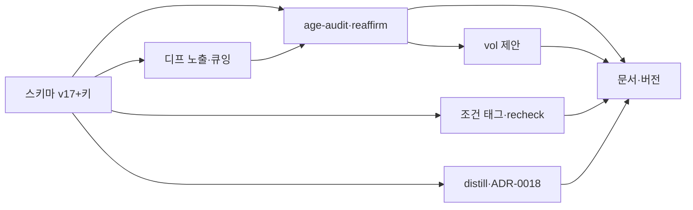

# flint v1.22.0 — 볼트 브리지 II·낡음 잔여 (스키마 v17)

상태: active
**Spec path:** docs/plans/2026-11-23-flint-v1220.spec.md
**Detail:** tests · **Target-min:** 7
**Global constraints:** TDD·additive 스키마·주석 영어·개인 데이터 금지(합성 데모 볼트만·볼트 경로 비인용)·스코어 분포 불변 봉인.

```mermaid
%% schedule
gantt
  title Predicted schedule (mm:ss)
  dateFormat X
  axisFormat %M:%S
  section lane 1
  T1 스키마 v17+키 :t1, 0, 127s
  section lane 2
  T3 age-audit·reaffirm :t3, 0, 127s
  section lane 3
  T6 distill·ADR-0018 :t6, 0, 127s
  section lane 4
  T2 디프 노출·큐잉 :t2, 0, 102s
  section lane 5
  T4 vol 제안 :t4, 0, 102s
  section lane 6
  T5 조건 태그·recheck :t5, 0, 102s
  section lane 7
  T7 문서·버전 v1.22.0 :t7, 0, 102s
```

critical path: T1 (2.1 min) · peak width 7 · predicted build 2.1 min · predicted total ≈ 5.6 min

**리서치 근거** (v122-research): age-audit 스코어 2신호 가중(maintain.go:1097)·신호 ⑤ non-goal "no source field" 근거 해소(HISTORY:750)·vault_files↔knowledge 연결고리 전무·Stats에 변경 목록 미노출(scan.go:94)·vol 사전 3종·콜론 태그 거부(policy.go:50)·valid_at 리셋 경로 부재·distill 코드 잔여 0·distilled_at 열 부재.

### T1 스키마 v17+키 · Complexity 3 · Est. context 24k
**Owns:** lib/db/admin.go, lib/db/schema_gates.go, lib/sqlfs/schema.sql, lib/store/thresholds.go, lib/wire/threshold_meta.go, lib/wire/threshold_meta_test.go, lib/store/thresholds_test.go, lib/db/admin_test.go
**Components:** 2 · **LOC owned:** 110 · **Tests:** fast · **Model:** sonnet
**계약:** EnsureSchemaV17 — vault_files `content_changed_at timestamptz NULL`·knowledge `distilled_at timestamptz NULL`·`conditions text NOT NULL DEFAULT ''` ALTER ADD · 레지스트리·LatestSchemaVersion=17·schema.sql 종착상태·threshold `distill_min_score`(1.0) 등록 5곳+frozen 갱신.
**Test:** v16→v17 업그레이드·직행·Contiguous·키 동질.

### T2 디프 노출·큐잉 · Complexity 3 · Est. context 22k
**Owns:** lib/vault/scan.go, lib/vault/scan_test.go, lib/vault/scan_v1211_test.go
**Components:** 1 · **LOC owned:** 90 · **Tests:** slow · **Model:** sonnet
**계약:** Stats에 변경 목록(path·구해시·신헤시) 노출(무경로 주의 — 목록은 DB 기록용·출력은 카운트)·ApplyDiff에서 변경 행 content_changed_at=now() 스탬프·무변경 재스캔 유지·해시 원복(복원) 시 NULL. index 산출은 기존 카운트만(경로 미노출 유지).
**Consumes:** T1 열
**Test:** 변경→스탬프·재스캔 무변경 유지·복원 NULL·삭제 행·실DB slow.

### T3 age-audit·reaffirm · Complexity 4 · Est. context 26k
**Owns:** lib/ops/maintain.go, lib/ops/maintain_test.go, lib/cli/maintain.go, lib/cli/maintain_test.go, lib/wire/registry.go, lib/cli/exit_contract_v101_test.go, lib/wire/run.go, lib/wire/usage_registry_test.go, lib/cli/wire_v08_test.go, lib/ops/fake_parity_test.go
**Components:** 2 · **LOC owned:** 130 · **Tests:** slow · **Model:** sonnet
**계약:** ①age-audit 참조열 "source changed" — content_changed_at NOT NULL 볼트 행 존재 시 보고 문구(지식 행 참조열 수준)·**스코어 불변(분포 봉인 테스트)** ②`maintain --reaffirm (--id|--ids) --yes` — valid_at=now() UPDATE·maintenance_runs 기록·usage·커맨드 표 ③`maintain --recheck <id>` — conditions 값·vol 태그와 함께 재검토 대상 보고.
**Consumes:** T2 스탬프, T1 conditions
**Test:** 참조열 발화·스코어 분포 불변·reaffirm 리셋+이력·recheck 보고·usage 가드.

### T4 vol 제안 · Complexity 2 · Est. context 18k
**Owns:** lib/ops/volclass.go(신규), lib/ops/volclass_test.go(신규), lib/ops/maintain.go, lib/ops/maintain_test.go
**Components:** 1 · **LOC owned:** 80 · **Tests:** fast · **Model:** sonnet
**계약:** 결정론 매핑 테이블(topic/tags 키워드 — 확정 결정·ADR·역사→immutable·버전·경로·명령·도구→volatile·나머지→conditional·다중 매칭 시 immutable>volatile>conditional)·age-audit 보고 행에 suggested_vol 부착·적립 없음(승인제 유지·사전 3종 무변경).
**Consumes:** T3 보고 구조
**Test:** 매핑 케이스·미매칭 conditional·보고 부착·사전 무변경.

### T5 조건 태그·recheck · Complexity 2 · Est. context 18k
**Owns:** lib/knowledge/write.go, lib/knowledge/write_test.go, lib/store/normalize.go, lib/store/normalize_test.go
**Components:** 1 · **LOC owned:** 60 · **Tests:** fast · **Model:** sonnet
**계약:** write stdin에 선택 `conditions` 문자열 필드 — 열 저장·**hashVolatile 등록(normalize.go — relations 선례)**·읽기 회로는 T3 --recheck(**read --fields 노출은 본 버전 안 함 — --recheck로 충족**).
**Consumes:** T1 conditions 열
**Test:** conditions 왕복·해시 불변·중복 재전송 멱등.

### T6 distill·ADR-0018 · Complexity 4 · Est. context 28k
**Owns:** lib/cli/distill.go(신규), lib/cli/distill_test.go(신규), lib/knowledge/distill.go(신규), lib/knowledge/distill_test.go(신규), docs/adr/0018-distill-output.md(신규 — NNNN-kebab 관례), lib/wire/registry.go, lib/wire/run.go, lib/wire/usage_registry_test.go, lib/cli/exit_contract_v101_test.go
**Components:** 2 · **LOC owned:** 180 · **Tests:** slow · **Model:** sonnet
**계약:** `flint distill --out DIR [--min-score N]` — recall_score ≥ distill_min_score AND distilled_at IS NULL 행·마크다운 인사이트(topic·summary·조건·태그)·출력 완료 행 스탬프(재실행 미출력분만)·미지정 폴더 exit 3·덮어쓰기 경고·render 살균·런당 집계 1개 `insights-<타임스탬프>.md`(행 id 정렬)·동일 파일 덮어쓰기 경고·threshold 오버라이드. ADR-0018 작성(출력 계약·로컬 한정·ADR-0015 구분).
**Consumes:** T1 distilled_at·키
**Test:** 임계 필터·멱등·미지정 exit 3·살균·오버라이드·실DB slow·ADR 존재.

### T7 문서·버전 v1.22.0 · Complexity 3 · Est. context 22k
**Owns:** VERSION, README.md, README.ko.md, flint-plugin/.claude-plugin/plugin.json, docs/HISTORY.md, docs/TUNING.md, docs/CONTENT.md, docs/adr/0018-distill-output.md, internal/doclint/versions_test.go, docs/plans/2026-11-21-flint-release-scope.md
**Components:** 1 · **LOC owned:** 50 · **Tests:** fast · **Model:** sonnet
**계약:** v1.22.0 동기·TUNING §2(distill_min_score)·CONTENT §4(conditional 의미·자동 분류 제안 표·조건 태그)·커맨드 표(distill·reaffirm·recheck)·계약행 TestVersion01220Milestone{v1.22.0, vault-staleness}·스코프 §5 building. release-gate.
**Test:** doclint·docs-sync·release-gate OK v1.22.0.

**Review Focus:** state(스탬프 수명주기·멱등)·protocol(스키마 additive)·file(vault 경로 비인용)·numeric(스코어 불변). 위험: 스코어 회귀·distill 출력 오염(살균)·conditions 해시 오염.

**Probe entry:** run=go run ./cmd/flint maintain --age-audit · run=go run ./cmd/flint distill --help

**Ruling:** 신호 ⑤ 스코어 미가입 — 연결고리 부재·분포 회귀 방지 - 비용: 근원 변경이 스코어에 즉시 반영 안 됨(참조열로 노출).
**Ruling:** source_path 연결 이월(v1.25.0) — 적립 원천 부재 - 비용: 지식↔볼트 직접 매핑 지연.
**Ruling:** distill 스코어 recall_score — survived는 D계측(v1.25.0) 후 - 비용: 생존 기반 엄선 지연.
**Ruling:** 자동 분류 제안 한정 — immutable 감쇠 면제의 자동 부여가 승인제 원칙과 충돌(vol:* 태그 자체는 사전 등록) - 비용: 수동 승인 유지.
