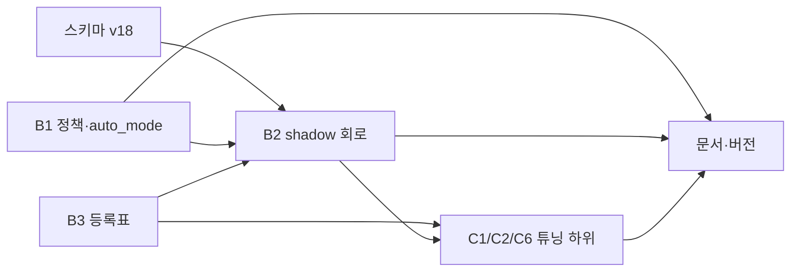

# flint v1.23.0 — 자율 튜닝 I: shadow 회로 (스키마 v18)

상태: active
**Spec path:** docs/plans/2026-11-23-flint-v1230.spec.md
**Detail:** tests · **Target-min:** 6
**Global constraints:** TDD·additive 스키마·주석 영어·개인 데이터 금지·미옵인(off) 비용 0·shadow 라운드 왕복 ≤5·실패 silent.

**리서치 근거** (v123-research): threshold_meta 등록 1곳 패턴·TuningMetaKeys enum 선례(exposure_profile)·tuning list 뼈대(tuning.go:259)·near_score 재분류 순수 함수(zero AND near_score≥신값)·snapshot.go "deferred to v1.23.0" 이연 주석·꼬리 순서 고정(usage.go:311)·Diagnose 입력 ReportOutput 전체(재사용 금지)·fired_ 접두 관례·nearest-rank p95 선례.

### T1 스키마 v18 · Complexity 3 · Est. context 24k
**Owns:** lib/db/admin.go, lib/db/schema_gates.go, lib/sqlfs/schema.sql, lib/db/repo.go, lib/db/admin_test.go
**Components:** 2 · **LOC owned:** 110 · **Tests:** fast · **Model:** sonnet
**계약:** EnsureSchemaV18 — tuning_predictions 테이블(열·(ts) 인덱스)+threshold_snapshots origin·trigger·rationale 3열·auditStageTables 등록·LatestSchemaVersion=18·schema.sql 종착상태.
**Test:** v17→v18 업그레이드·직행·Contiguous·스테이징.

### T2 B1 정책·auto_mode · Complexity 3 · Est. context 24k
**Owns:** lib/ops/tuning.go, lib/ops/tuning_test.go, lib/wire/threshold_meta.go, lib/wire/threshold_meta_test.go, lib/wire/run.go, lib/wire/usage_registry_test.go, lib/ops/maintain.go, lib/ops/meta_keys_v1194_test.go
**Components:** 2 · **LOC owned:** 120 · **Tests:** fast · **Model:** sonnet
**계약:** ①auto 필드(등록표 — threshold_meta 확장·가드테스트 갱신)·초기 화이트리스트 {suggest_min_score: shadow} ②meta `auto_mode`(TuningMetaKeys·enum off|shadow·기본 off·SetMetaKV) ③`tuning auto off|shadow` 서브커맨드(디스패치·usage·exit 계약) ④auto 아닌 키 auto 경로 접근 시 exit 3. ⑤**metaKnownKeys에 auto_mode·last_shadow_at·metaKnownPrefixes에 auto_streak_ 등록**(Owns에 lib/ops/maintain.go 추가 필요 시 인시던트 보고).
**Test:** 등록표 동질·enum 완복·서브커맨드·미옵인 off·exit 3·usage 가드.

### T3 B3 등록표 · Complexity 3 · Est. context 22k
**Owns:** lib/ops/autotune.go(신규), lib/ops/autotune_test.go(신규)
**Components:** 1 · **LOC owned:** 110 · **Tests:** fast · **Model:** sonnet
**계약:** 코드 등록표(AutoRule{Signal·Query·Key·Direction·SafeRange·WeeklyMax·Auto·SuccessPair·ObsWindowD})·초기 1행 auto_zero_near_high(진단 접두 구분)→suggest_min_score 하향(SafeRange 0.05~0.30 등록표 상수·WeeklyMax는 v1.24.0 집행 대상 명시)·판정 쿼리(14일 창·zero_near_min_read 최소표본·임계는 thresholds 원천)·관측 축적 조건 판정 순수 함수(라운드 수·발화 수·streak 입력→진행률).
**Test:** 판정 쿼리 경계·조건 판정(각 조합)·등록표 가드(1행·필드 완전).

### T4 B2 shadow 회로 · Complexity 5 · Est. context 32k
**Owns:** lib/db/usage.go, lib/db/usage_test.go, lib/db/autotune_shadow.go(신규), lib/db/autotune_shadow_test.go(신규)
**Components:** 2 · **LOC owned:** 200 · **Tests:** slow · **Model:** sonnet
**계약:** ①RecordReadEvent 꼬리에 shadow 훅(순서 rollup→prune→snapshot→shadow·가드테스트 갱신)·24h 게이트 meta last_shadow_at(캐시 없음)+실패 silent ②라운드: 트리거 판정(T3 등록표 쿼리 위임)→발화 시 fired_auto_<signal> bump→what-if 재분류(zero AND near_score≥신값 카운트·신 near_pct)→tuning_predictions INSERT(rationale 합성 문장)→전회 예츅과 비교 streak 갱신(meta auto_streak_<key>) ③제안값: 안전범위 내·방향 등록표(WeeklyMax 미집행 — v1.24.0) ④왕복 ≤5 실측(쿼리 카운트 주석)·**streak 규칙: 첫 발화=1·값 변화도 방향 유지면 적중·미발화 라운드 유지·리셋은 방향 반전/표본 미달만·off 시 잔존(유지)**.
**Consumes:** T1 테이블, T2 auto_mode·화이트리스트, T3 등록표
**Test:** off 비용 0·24h 게이트·트리거 발화/미발화·예측 행 필드·streak(첫 발화 1·값 변화 적중·미발화 유지·방향 반전/표본 미달 리셋·off 잔존)·안전범위 밖 제안 거부·왕복 수·훅 순서·실DB slow.

### T5 C1/C2/C6 튜닝 하위 · Complexity 3 · Est. context 24k
**Owns:** lib/ops/tuning.go, lib/ops/tuning_test.go, lib/cli/tuning.go, lib/cli/tuning_test.go
**Components:** 2 · **LOC owned:** 130 · **Tests:** slow · **Model:** sonnet
**계약:** ①`tuning what-if <key> <value>` — 재분류 카운트·신 near_pct·p50/p90(nearest-rank)·표본 수·살균·auto 등급 표시 ②`tuning status` — 기존 list 뼈대+drift(현재−기본)·fired 카운터·auto 등급·streak·관측 축적 진행률. usage·exit 계약.
**Consumes:** T3 등록표, T4 streak/fired
**Test:** what-if 재분류 정확(합성 직접 대조)·p50/p90 경계·status 카드 필드·실DB slow.

### T6 문서·버전 v1.23.0 · Complexity 3 · Est. context 22k
**Owns:** VERSION, README.md, README.ko.md, flint-plugin/.claude-plugin/plugin.json, docs/HISTORY.md, docs/TUNING.md, docs/METRICS.md, internal/doclint/versions_test.go, docs/plans/2026-11-21-flint-release-scope.md
**Components:** 1 · **LOC owned:** 50 · **Tests:** fast · **Model:** sonnet
**계약:** v1.23.0 동기·TUNING(auto_mode·화이트리스트 표·관측 축적 조건 문안·**"적중=안정성, 인과 아님" 각주**)·METRICS(Tier 표기·tuning_predictions 정의)·스코프 표 v1.23.0 스키마 "v18 additive" 갱신·§5 building·계약행 TestVersion01230Milestone{v1.23.0, autotune-shadow}. release-gate.
**Test:** doclint·docs-sync·release-gate OK v1.23.0.

**Review Focus:** state(게이트·streak·멱등)·numeric(재분류·p50/p90)·file(훅 순서·스테이징)·protocol(스키마). 위험: 마스킹(성공쌍 누락)·진단 이중 정의 드리프트·미옵인 비용.

**Probe entry:** run=go run ./cmd/flint tuning auto shadow · run=go run ./cmd/flint tuning what-if suggest_min_score 0.1

**Ruling:** 화이트리스트 1키(suggest_min_score) — 정확 인과층 유일 분류키 - 비용: echo 등은 v1.25.0+ 재검토.
**Ruling:** 적중=회차 안정성(방향 유지) — 인과 아님 각주 의무 - 비용: 문서 표현 제한.
**Ruling:** Diagnose 미재사용 — 입력이 report 전체라 비용 전제 - 비용: 판정 쿼리 이중 정의(드리프트 가드로 완화).
