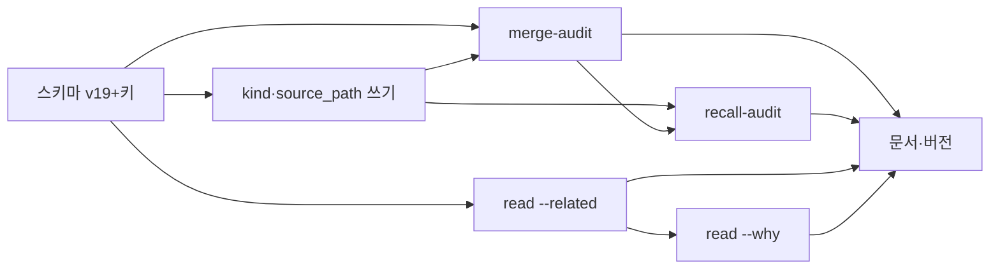

# flint v1.24.0 — 지식 관리 잔여: 병합·환류·이웃·근거·kind (스키마 v19)

상태: active
**Spec path:** docs/plans/2026-11-23-flint-v1240.spec.md
**Detail:** tests · **Target-min:** 7
**Global constraints:** TDD·additive 스키마·주석 영어·개인 데이터 금지·기본 read 바이트 불변 봉인·relief 기본 0 불변.

**리서치 근거** (v124-research): EchoScan multiset Dice ≥ conflict_dup_threshold(echo.go:119)·decay-audit 리스팅 패턴(maintain.go:1097)·age-audit 참조열 SQL(maintain.go:1301)·knowledge_links INSERT 전용·vault append 패턴(T4·VaultMaxRows=5·바이트 불변 봉인)·RRF 4신호(read.go:283)·ReorderByTokenScore scores(read.go:386)·near_score 저장 미노출·kind 3중 충돌·relief 기본 0·MeteringKindRegistry curation 그룹·echo 후보 DB 미저장(D1 전제 부재 → 테이블 신설).

### T1 스키마 v19+키 · Complexity 3 · Est. context 26k
**Owns:** lib/db/admin.go, lib/db/schema_gates.go, lib/sqlfs/schema.sql, lib/db/repo.go, lib/store/thresholds.go, lib/wire/threshold_meta.go, lib/wire/threshold_meta_test.go, lib/store/thresholds_test.go, lib/db/admin_test.go
**Components:** 2 · **LOC owned:** 130 · **Tests:** fast · **Model:** sonnet
**계약:** EnsureSchemaV19 — knowledge kind·source_path 2열(NULL)·echo_candidates 테이블(열·인덱스 2)·auditStageTables·LatestSchemaVersion=19·schema.sql 종착상태·threshold recall_audit_min_bad(기본 2) 등록 5곳+frozen.
**Test:** v18→v19 게이트 3경로·Contiguous·키 동질.

### T2 kind·source_path 쓰기 · Complexity 4 · Est. context 30k
**Owns:** lib/knowledge/write.go, lib/knowledge/write_test.go, lib/store/normalize.go, lib/store/normalize_test.go, lib/ops/maintain.go, lib/ops/maintain_test.go, lib/cli/maintain.go, lib/cli/maintain_test.go, lib/db/usage.go, lib/db/usage_test.go, lib/ops/diagnosis.go, lib/ops/diagnosis_test.go, lib/knowledge/distill.go, lib/knowledge/distill_test.go, lib/cli/distill.go, lib/cli/distill_test.go
**Components:** 3 · **LOC owned:** 220 · **Tests:** slow · **Model:** sonnet
**계약:** write stdin 선택 kind(**입력 키 knowledge_kind — 판별자 rec["kind"] 불변·키 분리 규칙**·preference|fact 어휘 검증·미지정 NULL·hashVolatile 제외)·source_path(살균·hashVolatile 제외)·중복 멱등. --recheck N — source_path 일치 vault_files content_changed_at 소거 자동 수반(다중 공유 함의 주석). D2 카운터 correction_preference·correction_fact(curation 그룹·**적립: source=="correction" write kind별**·등록표+diagnosis 노출). **survived 최소 이행: distill 리스팅·출력 행에 survived_sessions 카운트 병기.**
**Consumes:** T1 열·키
**Test:** 왕복·해시 불변·어휘 검증·멱등·recheck 소거 실DB·D2 동질.

### T3 merge-audit · Complexity 4 · Est. context 26k
**Owns:** lib/knowledge/mergeaudit.go(신규), lib/knowledge/mergeaudit_test.go(신규), lib/ops/maintain.go, lib/ops/maintain_test.go, lib/cli/maintain.go, lib/cli/maintain_test.go, lib/wire/registry.go, lib/wire/run.go, lib/wire/usage_registry_test.go, lib/cli/exit_contract_v101_test.go
**Components:** 2 · **LOC owned:** 150 · **Tests:** slow · **Model:** sonnet
**계약:** `maintain --merge-audit [--limit M]` — 활성 행 상호 multiset Dice ≥ conflict_dup_threshold 쌍 리스팅(점수순·스캔 상한 suggest_scan_cap·사전 비용 추정(쌍수×µs/쌍 실측 공표)·A6 p95 관측 동반)·처분 안내 승인제 위임·카운터 merge_audit_pairs·usage·커맨드 표.
**Consumes:** T1 카운터 등록
**Test:** 합성 유사 쌍·임계 경계·스캔 상한·리스팅만(처분 미수행)·usage·실DB slow.

### T4 recall-audit · Complexity 3 · Est. context 22k
**Owns:** lib/ops/maintain.go, lib/ops/maintain_test.go, lib/cli/maintain.go, lib/cli/maintain_test.go, lib/wire/run.go, lib/wire/usage_registry_test.go
**Components:** 1 · **LOC owned:** 90 · **Tests:** slow · **Model:** sonnet
**계약:** `maintain --recall-audit [--limit M]` — 같은 topic 무효화·superseded 중 **recall_events EXISTS**(age-audit 선례) 회상 이력 수 ≥ recall_audit_min_bad 활성 행 점수순 리스팅·처분 승인제 위임·카운터 recall_audit_listed·recall_audit_disposed·usage.
**Consumes:** T1 키·T2 카운터 패턴·T3 직렬(maintain.go 공유)
**Test:** 합성 bad_recall 시나리오·임계·리스팅만·실DB slow.

### T5 read --related · Complexity 3 · Est. context 24k
**Owns:** lib/query/read.go, lib/query/read_test.go, lib/knowledge/read.go, lib/knowledge/read_test.go
**Components:** 2 · **LOC owned:** 110 · **Tests:** slow · **Model:** sonnet
**계약:** `read --related N` — knowledge_links 양방향 UNION·relation 라벨+역방향 표시·지식 행 후 append(interleave 금지)·source:"related"·--json related_hits·상한 5·대상 부재 exit 3·0건 빈 응답·**기본 read 바이트 불변 봉인 회귀**.
**Consumes:** T1 불필요(knowledge_links v14)
**Test:** 왕복·무방향·불변 봉인·부재·0건·실DB slow.

### T6 read --why · Complexity 3 · Est. context 24k
**Owns:** lib/query/read.go, lib/query/read_test.go, lib/knowledge/read.go, lib/knowledge/read_test.go
**Components:** 2 · **LOC owned:** 100 · **Tests:** fast · **Model:** sonnet
**계약:** `read --why` — 근거 부록: 행별 토큰 tier("token×weight" 나열 인코딩)·RRF 4신호 값·rank·기여·zero-hit 행 zero_reason+near_score·행당 1행 캡·총 상한·**기본 응답 불변 봉인**.
**Consumes:** T5와 동일 파일(T5→T6 직렬·taskgraph 순서)
**Test:** 근거 정합(합성 직접 대조)·불변 봉인·상한·옵트인.

### T7 문서·버전 v1.24.0 · Complexity 3 · Est. context 22k
**Owns:** VERSION, README.md, README.ko.md, flint-plugin/.claude-plugin/plugin.json, docs/HISTORY.md, docs/TUNING.md, docs/CONTENT.md, internal/doclint/versions_test.go, docs/plans/2026-11-21-flint-release-scope.md, docs/plans/README.md
**Components:** 1 · **LOC owned:** 50 · **Tests:** fast · **Model:** sonnet
**계약:** v1.24.0 동기·TUNING §2(recall_audit_min_bad·relief 룰링 "기본 0 유지 — 활성화는 meta 오버라이드·관측 근거 문서 기록")·CONTENT(kind 값 집합·source_path)·커맨드 표(merge-audit·recall-audit·--related·--why)·계약행 TestVersion01240Milestone{v1.24.0, curation-residual}·스코프 §5 building·의존 메모 "v1.22.0→v1.25.0"을 v1.24.0 실제로 정정·plans/README knowledge-pipelines 요약 행 교환 순서 갱신. release-gate.
**Test:** doclint·docs-sync·release-gate OK v1.24.0.

**Review Focus:** state(멱등·소거)·numeric(Dice·근거 정합)·encoding(살균)·file(불변 봉인·스캔 상한). 위험: 회상 회귀·O(n²)·kind 충돌 재론·토큰 폭발.

**Probe entry:** run=go run ./cmd/flint maintain --merge-audit · run=go run ./cmd/flint read 데모 --related 1

**Ruling:** kind 열+소비처 동시 — v1.20.0 이월 조건 "소비처 확보" 충족 - 비용: 값 집합 2종 확정(확장 차기).
**Ruling:** echo_candidates 테이블(v19) — D1 소급의 전제·응답만 저장은 계측 불가 - 비용: 스키마 1테이블.
**Ruling:** --related 무방향 UNION — 이웃 회상은 무방향 소비·방향은 라벨 보존 - 비용: 없음.
**Ruling:** relief 코드 불변 — 활성화 경로는 이미 meta 오버라이드뿐 - 비용: 없음.
