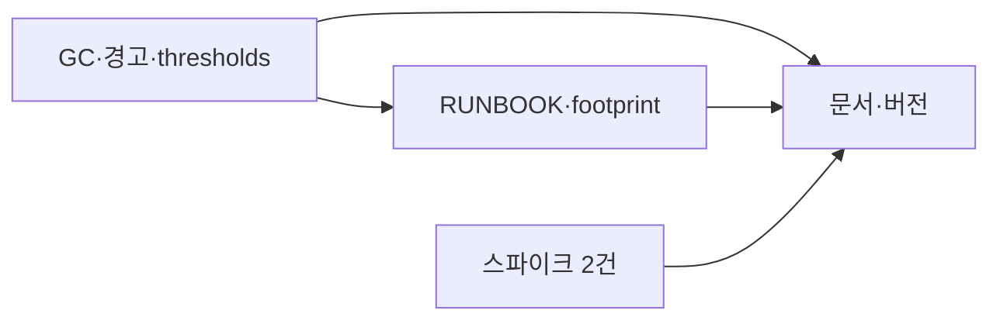

# flint v1.25.0 — 엔진 운영·GC·경고·footprint·스파이크 2건

상태: active
**Spec path:** docs/plans/2026-11-23-flint-v1250.spec.md
**Detail:** tests · **Target-min:** 5
**Global constraints:** TDD·주석 영어·개인 데이터 금지·스키마 변경 없음·GC 접속 단절 계약·에이전트 배제(RUNBOOK만).

**리서치 근거** (v125-research): maintainModeFlags·yesModes(maintain.go:80-121)·--reaffirm --yes 선례(:1727)·doctor 등록표 체크 1행(doctor.go:84-106·17종)·ThFn 패턴·ComposePsFn seam(:1319)·commit_order 단조(O(1))·pg_database_size 신규·buildMetaKnownKeys(:2197·R80-1)·status 래핑 관례·RUNBOOK §1~§9.

### T1 GC·경고·thresholds · Complexity 4 · Est. context 30k
**Owns:** lib/ops/maintain.go, lib/ops/maintain_test.go, lib/ops/doctor.go, lib/ops/doctor_test.go, lib/store/thresholds.go, lib/wire/threshold_meta.go, lib/wire/threshold_meta_test.go, lib/wire/thresholds.go, lib/store/thresholds_test.go, lib/cli/maintain_test.go, lib/wire/run.go, lib/wire/usage_registry_test.go
**Components:** 3 · **LOC owned:** 200 · **Tests:** slow · **Model:** sonnet
**계약:** ①`--gc [--shallow] --yes` — 안내→dolt_gc()→Ping 5회(실패 시 "reconnect failed" exit 1·meta 미기록)→schema 재검증→meta 2키→JSON·--yes exit 1·usage 등록 ②doctor `dolt_log_depth`(commit_order DESC LIMIT 1·10000)·`db_size`(pg_database_size·2048·skip) tail 2행·ThFn ③thresholds 2종 **6곳**(store 4 + wire meta 대응행 + wire thresholds.go fallback) ④metaKnownKeys에 last_gc_at·last_gc_mode 등록.
**Test(TDD·실DB slow):** --yes 가드·안내 문구·GC 실행(실측 어려우면 seam 주입)·Ping 재시도·schema 재검증·meta 왕복·doctor 2종 경계·오류 skip·thresholds 동질·Ping 실패 시 reconnect failed·exit 1·meta 미기록·usage 가드.

### T2 RUNBOOK·footprint · Complexity 2 · Est. context 18k
**Owns:** docs/RUNBOOK.md, internal/doclint/runbook_test.go, lib/ops/doctor.go, lib/ops/doctor_test.go, lib/ops/status.go, lib/ops/status_test.go
**Components:** 2 · **LOC owned:** 100 · **Tests:** fast · **Model:** sonnet
**계약:** ①RUNBOOK §10 GC(접속 단절·절차·자동 GC 우선·조용한 시간대)·§11 이미지 업그레이드(순서 고정) ②doctor `engine-footprint`(docker stats seam·2s·skip)·status engine_mem_mb(실패 생략).
**Consumes:** T1 doctor 구조
**Test:** RUNBOOK 절 존재·doclint·footprint skip·status 필드·키 순서.

### T3 스파이크 2건 · Complexity 3 · Est. context 26k
**Owns:** docs/plans/2026-11-23-flint-v1250-spike-analyze.md(신규), docs/plans/2026-11-23-flint-v1250-spike-auditlog.md(신규), docs/plans/2026-11-21-flint-engine-ops.md
**Components:** 1 · **LOC owned:** 150 · **Tests:** fast · **Model:** sonnet
**계약:** ①ANALYZE — 합성 scratch Doltgres에서 `ANALYZE knowledge;` 실행→결과(성공/오류 원문)를 engine-ops 플랜 §4 M3에 기록·지원 시 --analyze 채택/미지원 시 폐기 선언 ②audit_log 리플레이 — 설계안 DDL(seq·tx_id·message·ts + 테이블별 이벤트 행·대체 3쿼리·wire.Store 5메서드 경계)·합성 PG diff 재현 쿼리·결론 노트(실패 시 v2.0 Ruling 근거 명시).
**Test:** 산출 문서 2건 존재·doclint.
**주의:** 실증은 격리 scratch DB만·개인 데이터 금지·repo에는 결론만.

### T4 문서·버전 v1.25.0 · Complexity 2 · Est. context 18k
**Owns:** VERSION, README.md, README.ko.md, flint-plugin/.claude-plugin/plugin.json, docs/HISTORY.md, docs/TUNING.md, docs/PERF.md, internal/doclint/versions_test.go, docs/plans/2026-11-21-flint-release-scope.md, docs/plans/README.md
**Components:** 1 · **LOC owned:** 40 · **Tests:** fast · **Model:** sonnet
**계약:** v1.25.0 동기·TUNING §2 키 2종·PERF GC 회수량 관례·계약행 TestVersion01250Milestone{v1.25.0, engine-ops}. **스코프 v2.0.0 행 "v1.26.0 스파이크"→"v1.25.0" 정정**·§5 building·plans/README 갱신(engine-ops 색인 행 v1.26.0→v1.25.0 정정 포함). release-gate.
**Test:** doclint·docs-sync·release-gate OK v1.25.0.

**Review Focus:** protocol(GC 접속 단절 계약·--yes)·state(Ping 재시도 상한·meta 왕복)·file(metaKnownKeys 누락·thresholds 6곳). 위험: 접속 단절 흡수·자기모순(R80-1)·스파이크 실패 전파.

**Probe entry:** run=go run ./cmd/flint maintain --gc · run=go run ./cmd/flint doctor

**Ruling:** GC 기본 full — 플랜 usage 정합·희박 이벤트 철저성 - 비용: 실행 시간.
**Ruling:** O(1) 깊이 — commit_order 단조·count(*) 회피 - 비용: 근사(삭제 커밋 반영 안 됨 — 경고 목적상 충분).
**Ruling:** 스파이크 실패 분기 사전 명시 — 결과와 무관하게 진행 - 비용: 없음.
