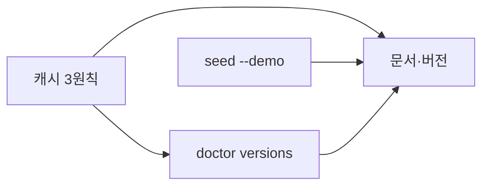

# flint v1.26.0 — 표면 신뢰: 캐시 3원칙·seed --demo·doctor 버전 정합

상태: active
**Spec path:** docs/plans/2026-11-23-flint-v1260.spec.md
**Detail:** tests · **Target-min:** 5
**Global constraints:** TDD·주석 영어·개인 데이터 금지·스키마 변경 없음·데모는 합성만.

**리서치 근거** (v126-research): updateCache ETag 부재(update.go:80-83)·24h TTL(:72)·compareVersions 재사용(:375-413)·doctor checkUpdate 캐시 무시(:1651)·MaybeUpdateNoticeFn seam(sessionhook.go:98)·seed 12줄·Makefile seed(FLINT_SEED_DSN)·go:embed 선례 4곳·BumpMetaCounter 선례(sessionhook.go:104)·plugin.json bump 동기화(bump_version.sh:42).

### T1 캐시 3원칙 · Complexity 3 · Est. context 26k
**Owns:** lib/cli/update.go, lib/cli/update_test.go, lib/cli/root.go
**Components:** 2 · **LOC owned:** 120 · **Tests:** fast · **Model:** sonnet
**계약:** ①updateCache ETag 필드·구 캐시 ETag="" ②fetchReleaseMeta If-None-Match+304(캐시 latest 승계) ③모순 검출기(캐시 latest < 현재 → 즉시 재 fetch) ④noticeLine에 checked_at 확장(report --text 노출은 T3③ 소관).
**Test(TDD):** ETag 왕복(304 가짜 응답)·모순 검출기 발화·checked_at 표시·구 캐시 하위호환·네트워크 실패 조용히.

### T2 seed --demo · Complexity 4 · Est. context 28k
**Owns:** lib/data/embed.go(신규), lib/data/embed_test.go(신규), lib/cli/seed.go(신규), lib/cli/seed_test.go(신규), lib/cli/setup.go, lib/cli/setup_ux.go, lib/cli/setup_test.go
**Components:** 2 · **LOC owned:** 180 · **Tests:** slow · **Model:** sonnet
**계약:** ①data 패키지 go:embed ②`flint seed --demo [--reset] [--yes]` — RunWrite 경유 적립(멱등) ③격리 DB(운영 DSN db명+_demo 접미사·FLINT_DEMO_DSN 오버라이드) ④--reset 고정 식별자·불일치 exit 3·--yes 필수 ⑤setup·QUICKSTART 문구 교체·usage·커맨드 표.
**Consumes:** T1 불필요
**Test(TDD·실DB slow):** embed 왕복·격리 DB 생성/적립/멱등·--reset 식별·불일치 exit 3·setup 문구·실DB slow.

### T3 doctor versions · Complexity 3 · Est. context 26k
**Owns:** lib/ops/doctor.go, lib/ops/doctor_test.go, lib/ops/doctor_check_registry_test.go, lib/ops/sessionhook.go, lib/ops/sessionhook_test.go, lib/ops/report.go, lib/cli/update.go, lib/cli/update_test.go, lib/ops/maintain.go
**Components:** 2 · **LOC owned:** 140 · **Tests:** fast · **Model:** sonnet
**계약:** ①doctor 등록표 1행 `versions`(Fn) — 자기 버전·캐시 latest+나이·PATH flint(LookPath)·mcp-registry plugin.json(ETag) 나란히 ②RunSessionStart meta upsert `self_version_last:session-start`(실패 조용히·**metaKnownPrefixes 등록**) ③report --text checked_at(기존 표면·T1④ 귀속) ④offline "unverified" 표시 ⑤threshold `update_cache_age_h`(72) 6곳.
**Consumes:** T1 ETag 경로
**Test(TDD):** versions 등록·가드 3종+주석 갱신(20→21·14→15·copilot QUICKSTART 가드)·자가 보고 meta 왕복·PATH 대조·오프라인 표시·thresholds 동질·report --text checked_at 표시.

### T4 문서·버전 v1.26.0 · Complexity 2 · Est. context 20k
**Owns:** VERSION, README.md, README.ko.md, flint-plugin/.claude-plugin/plugin.json, docs/HISTORY.md, docs/TUNING.md, docs/QUICKSTART.md, internal/doclint/versions_test.go, internal/doclint/copilot_auto_registration_test.go, docs/plans/2026-11-21-flint-release-scope.md, docs/plans/README.md
**Components:** 1 · **LOC owned:** 40 · **Tests:** fast · **Model:** sonnet
**계약:** v1.26.0 동기·TUNING §2 update_cache_age_h·QUICKSTART seed --demo 교체·검사 수 문구(17→21)+doclint copilot 가드 갱신·계약행 TestVersion01260Milestone{v1.26.0, surface-trust}·스코프 §5 building·plans/README surface-trust v1.26.0 갱신. release-gate.
**Test:** doclint·docs-sync·release-gate OK v1.26.0.

**Review Focus:** protocol(304·하위호환)·state(멱등·--reset)·file(격리 DB 파생). 위험: 모순 검출기 오탐(등호)·데모 DB 충돌·plugin.json 드리프트.

**Probe entry:** run=go run ./cmd/flint seed --demo · run=go run ./cmd/flint doctor --check versions

**Ruling:** 격리=별도 DB 접미사 파생 — 신규 인프라 0 - 비용: FLINT_DEMO_DSN 오버라이드 필요.
**Ruling:** 자가 보고 meta 키 self_version_last:session-start(단일) — session_starts 스키마 불별 - 비용: 키 위생 등록 필요.
**Ruling:** mcp-registry 오프라인 = unverified 표시(경고 아님) — PLAN §4 원칙 3 - 비용: 없음.
