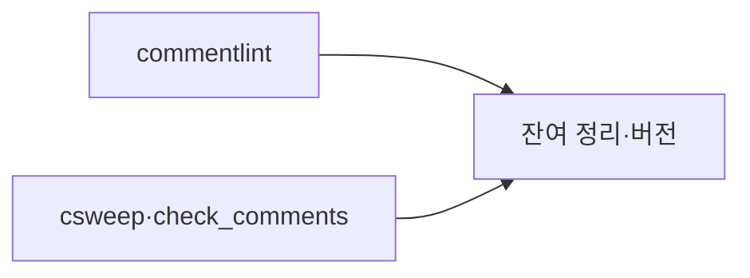

# flint v1.26.3 — 주석 금지 게이트

상태: draft
**Spec path:** docs/plans/2026-11-23-flint-v1263.spec.md
**Global constraints:** TDD·개인 데이터 금지·스키마 변경 없음·**모든 신규 코드 주석 0**(지시어만 허용).

critical path: T1 → T3 · predicted total ≈ 4 min

### T1 internal/commentlint · Complexity 2 · Est. context 14k
**Owns:** internal/commentlint/commentlint_test.go
**Components:** 1 · **LOC owned:** 90 · **Tests:** fast · **Model:** sonnet
**계약:** walkComments(root) 함수(루트 주입 가능)·지시어 판별 isDirective(text)·전수 .go 스캔 테스트(repo 루트 green)·주입 FAIL 테스트(t.TempDir).
**Test(TDD):** clean 디렉터리 green·주석 1건 주입 시 에러 문자열 포함·지시어 3종은 허용.

### T2 csweep·check_comments · Complexity 3 · Est. context 22k
**Owns:** scripts/csweep.go(신규), scripts/check_comments.py(신규), Makefile
**Components:** 3 · **LOC owned:** 180 · **Tests:** fast · **Model:** sonnet
**계약:** csweep.go(`//go:build ignore`·AST 삭제·지시어 보존·dry `-n`)·check_comments.py(bash 라인 스캔 — 셔뱅·따옴표·`$#`/`${}`·`#!` 토큰 제외·git 추적 .sh·.py 전수(git ls-files)·python tokenize·exit 1 계약)·Makefile ci에 check_comments 행.
**Consumes:** T1 isDirective와 동일 규칙(복제 허용 — 언어가 다름)
**Test:** csweep dry 카운트 0·check_comments 자기 자신 green+scripts 잔여 검출 red 단정(T3 전)·주입 시 exit 1(수동 실증·플랜 Probe entry).

### T3 잔여 정리·버전 v1.26.3 · Complexity 2 · Est. context 16k
**Owns:** flint-plugin/hooks/*.sh, tests/regression/*.py, scripts/(전체 *.sh·*.py·verify 포함), VERSION, README.md, README.ko.md, flint-plugin/.claude-plugin/plugin.json, docs/HISTORY.md, internal/doclint/versions_test.go, docs/plans/2026-11-21-flint-release-scope.md, docs/plans/README.md
**Components:** 1 · **LOC owned:** 60 · **Tests:** fast · **Model:** sonnet
**계약:** git 추적 .sh·.py 전수 주석 삭제(셔뱅·임베디드 셔뱅 유지 — scripts·verify·flint-plugin/hooks·tests 포함)·make_mcpb.sh usage를 echo/heredoc로 재작성 후 주석 삭제·v1.26.3 버전 동기 5곳·스코프 §5 v1.26.0 비고에 v1.26.3 추가·release-gate.
**Test:** make ci·docs-sync·release-gate OK v1.26.3.

**Review Focus:** protocol(check_comments exit 계약)·state(csweep dry no-op)·file(스크립트 문자열-주석 경계).
위험: bash 따옴표 상태 머신 오류(heredoc·이스케이프)·tokenize 인코딩.

**Probe entry:** run=go test ./internal/commentlint/ · run=python3 scripts/check_comments.py · run=go run scripts/csweep.go -n

**Ruling:** G2 통과 후 직접 빌드(패치 루프 관례 — 소규모 3태스크·감사는 R115로 독립 수행)
