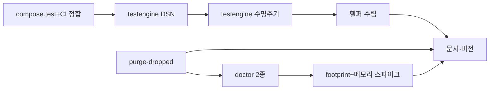

# flint v1.29.0 — 테스트 엔진 격리·엔진 점유

상태: active
**Spec path:** docs/plans/2026-11-23-flint-v1290.spec.md
**Detail:** tests · **Target-min:** 8
**Global constraints:** TDD·개인 데이터 금지·스키마 변경 없음·**주석 0**(commentlint·check_comments 게이트 통과 필수).

```mermaid
%% schedule
gantt
  title Predicted schedule (mm:ss)
  dateFormat X
  axisFormat %M:%S
  section lane 1
  T1 docker-compose.test.yml·CI 정합 :t1, 0, 127s
  T6 doctor 경고 2종 :t6, 127, 151s
  T7 footprint 재시작 횟수·메모리 스파이크 :t7, 277, 127s
  T8 문서·버전 v1.29.0 :t8, 482, 102s
  section lane 2
  T5 maintain --purge-dropped :t5, 0, 127s
  T2 testengine DSN 해소 :t2, 127, 102s
  T3 testengine 수명주기 :t3, 229, 127s
  T4 헬퍼 수렴 42파일 :t4, 355, 127s
```

critical path: T1 → T2 → T3 → T4 → T8 (9.7 min) · peak width 2 · predicted build 9.7 min · predicted total ≈ 13.2 min

critical path: T1 → T2 → T3 → T4 → T8 · peak width 2 · predicted total ≈ 14 min

### T1 docker-compose.test.yml·CI 정합 · Complexity 3 · Est. context 20k
**Owns:** docker-compose.test.yml(신규), .github/workflows/ci.yml, Makefile
**Components:** 2 · **LOC owned:** 60 · **Tests:** slow · **Model:** sonnet
**계약:** ①docker-compose.test.yml — 프로젝트 flint-test·이미지 다이제스트=운영 compose와 동일(동치 가드 테스트로 단정)·127.0.0.1:5499:5432·restart: no·전용 볼륨 ②Makefile test-up/test-down(-v 회수) ③ci.yml job 환경 FLINT_TEST_DSN 명시(서비스 5434)·접속 실패는 skip 아님 fail ④skip 0건 센티널(go test 실행부에 FLINT_REALDB_REQUIRED=1 전파 — 헬퍼가 env면 fail).
**Test:** compose 동치 가드(다이제스트 문자열 비교)·make -n test-up 렌더.
**Probe entry:** run=make test-up

### T2 testengine DSN 해소 · Complexity 3 · Est. context 24k
**Owns:** internal/testengine/dsn.go(신규), internal/testengine/dsn_test.go(신규), internal/testengine/guard_test.go(신규)
**Components:** 1 · **LOC owned:** 90 · **Tests:** fast · **Model:** sonnet
**계약:** ResolveDSN() string — FLINT_TEST_DSN 설정 시 verbatim, 미설정 시 전용 엔진 기본값(postgresql://flint:pw@127.0.0.1:5499/flint_test). **운영 DSN 폴백 금지**(기존 testDSNFromEnv의 FLINT_DSN 폴백 제거·부재 시 전용 기본값). 프로덕션 패키지의 testengine import 소스 가드(lib cmd 내 "internal/testengine" 문자열 0건).
**Produces:** ResolveDSN() string · TestDSNDefault() string
**Test:** env 우선·폴백 부재(FLINT_DSN 설정돼도 무시)·기본값 5499·소스 가드.

### T3 testengine 수명주기 · Complexity 5 · Est. context 34k
**Owns:** internal/testengine/lifecycle.go(신규), internal/testengine/lifecycle_test.go(신규)
**Components:** 2 · **LOC owned:** 200 · **Tests:** slow · **Model:** sonnet
**계약:** ①EnsureEngine(ctx) error — lazy(첫 실DB 접속 시)·미기동이면 compose up -d --wait 1회·프로세스 간 flock(전용 lock 파일 — flint-drill.lock 선례)·로컬 실패 skip+경고 1행·CI(FLINT_REALDB_REQUIRED=1) fail ②RegisterScratch(name)·RunCleanup() — 생성 등록→런 종료 일괄 DROP(재시도 백오프·실패 이름 1행 보고)→해소 출처가 전용 기본값일 때만 dolt_purge_dropped_databases() 1회.
**Consumes:** ResolveDSN() string (T2)
**Test:** flock 직렬화(동시 호출 1회 기동)·lazy(단위 접속 무=기동 무)·등록-DROP 왕복·purge 조건부(오버라이드 DSN 시 미실행)·실DB slow.
**Probe entry:** call=testengine.EnsureEngine

### T4 헬퍼 수렴 42파일 · Complexity 4 · Est. context 30k
**Owns:** internal/testengine/scratch.go(신규), tests/ 및 lib/**/*_test.go(헬퍼 교체 — 42파일 FLINT_TEST_DSN 참조분·DROP 리터럴 33곳 23파일)
**Components:** 2 · **LOC owned:** 150 · **Tests:** slow · **Model:** sonnet
**계약:** Scratch(t) 헬퍼(생성+등록+정리 위임) — 개별 42파일의 로컬 헬퍼·DROP DATABASE 리터럴·기본 DSN 상수 3종을 testengine으로 단일화. 운영 DSN 직접 읽기 4곳(seed·asof·readhot·mcp tools) 교체. 소스 가드 "`*_test.go`의 FLINT_DSN 직접 읽기 0건"(grep 계약 테스트). 기본 DSN 고정 테스트 3종을 "전용 엔진(5499)" 회귀로 교체.
**Consumes:** EnsureEngine·RegisterScratch (T3)
**Test:** 소스 가드 green·기존 실DB 스위트 전체 green(운영 엔진 정지 상태 1회·FLINT_DSN 설정 상태 1회)·기본 병렬 로컬 1회(CI -p 1 유지).
**Probe entry:** run=go test ./internal/testengine/ ./lib/cli/ -count=1

### T5 maintain --purge-dropped · Complexity 4 · Est. context 28k
**Owns:** lib/knowledge/purge.go(신규) 또는 lib/ops/maintain.go, lib/cli/root.go, lib/wire/registry.go, lib/wire/run.go
**Components:** 2 · **LOC owned:** 140 · **Tests:** fast+slow · **Model:** sonnet
**계약:** `flint maintain --purge-dropped [--yes]` — 기본 dry-run(복원 가능 목록·개수 JSON)·--yes 시 dolt_purge_dropped_databases()(SUPERUSER). **루프백 한정**(해소 DSN 호스트가 127.0.0.1/localhost 아니면 exit 3). dry-run 목록 조회 미지원 시 --yes 금지(exit 3). 첫 태스크에서 카탈로그 조회 SQL 실증(Doltgres ESCAPE·format 제약 내 조립). 사람 운영자 명령 — RUNBOOK만 기재.
**Produces:** RunPurgeDropped(ctx, st, yes, stdout) int
**e.g.** dry-run -> {"status":"dry_run","dropped":2} · --yes -> {"status":"purged","dropped":2}
**Test:** dry-run 기본·--yes 가드·루프백 외 exit 3·목록 미지원 --yes 금지·slow 실DB 왕복.
**Probe entry:** run=go run ./cmd/flint maintain --purge-dropped

### T6 doctor 경고 2종 · Complexity 3 · Est. context 24k
**Owns:** lib/ops/doctor.go, lib/ops/doctor_test.go, lib/ops/maintain.go, lib/store/thresholds.go, lib/wire/threshold_meta.go, lib/wire/thresholds.go
**Components:** 3 · **LOC owned:** 120 · **Tests:** fast · **Model:** sonnet
**계약:** 등록표 2행(thresholds 6곳 등록·warn) — `dropped_dbs`(보존 영역 DB 수)·`stray_dbs`(허용 목록 외 — 운영 DB·postgres·template* 제외 + meta `stray_dbs_allow` 쉼표 목록·metaKnownKeys 등록). 레거시 flint_test는 전용 안내. 카탈로그 조회 미지원 시 조용히 skip(v1.25.0 룰링 승계).
**Consumes:** RunPurgeDropped 존재(Fix 안내) — 이름만(엣지 아님)
**Test:** 등록 동질(23종)·thresholds 6곳 동질·stray_dbs_allow 면제 왕복·미지원 skip·레거시 안내.
**Probe entry:** run=go run ./cmd/flint doctor --check stray_dbs

### T7 footprint 재시작 횟수·메모리 스파이크 · Complexity 3 · Est. context 22k
**Owns:** lib/ops/doctor.go(footprint), lib/ops/report.go, docs/RUNBOOK.md
**Components:** 2 · **LOC owned:** 80 · **Tests:** fast · **Model:** sonnet
**계약:** footprint에 엔진 재시작 횟수 표시(ComposePsFn 관례 신규 seam RestartCountFn). 메모리 측정 스파이크(L0·문서): 전용 엔진 합성 부하 전후 측정→GOMEMLIMIT·GOGC 후보 비교→채택·기각 선언(RUNBOOK §신설·기본값 적용은 v1.30.0 위임).
**Test:** seam 주입 왕복·스파이크 결론 기록 존재(doclint).
**Probe entry:** run=go run ./cmd/flint doctor --check engine-footprint

### T8 문서·버전 v1.29.0 · Complexity 2 · Est. context 18k
**Owns:** VERSION, README.md, README.ko.md, flint-plugin/.claude-plugin/plugin.json, docs/HISTORY.md, docs/RUNBOOK.md, docs/QUICKSTART.md, internal/doclint/versions_test.go, docs/plans/2026-11-21-flint-release-scope.md, docs/plans/README.md
**Components:** 1 · **LOC owned:** 50 · **Tests:** fast · **Model:** sonnet
**계약:** v1.29.0 동기·RUNBOOK "테스트 DB 장사 위생"·"실DB 테스트 격리·러너"·"기존 기기 1회 정리 절차" 재작성·ADR-0010 준항목 슈퍼세드 표기·계약행 TestVersion01290Milestone{v1.29.0, engine-isolation}·스코프 §5 v1.29.0 building→발행·하이라이트 엔트리. release-gate.
**Test:** doclint·docs-sync·release-gate OK v1.29.0.

**Review Focus:** protocol(DSN 해소 우선순위·exit 3 계약)·state(스크래치 등록-정리 왕복·purge 조건)·file(lock 파일 경합)·numeric(재시작 횟수). 위험: 42파일 일괄 교체 회귀·CI 서비스 DSN 불일치·Doltgres 카탈로그 비표준.

**Ruling:** G3 빌드는 안정 태스크부터 superlite 디스패치(T1·T2 우선 — T4 수렴은 T3 커밋 후).
