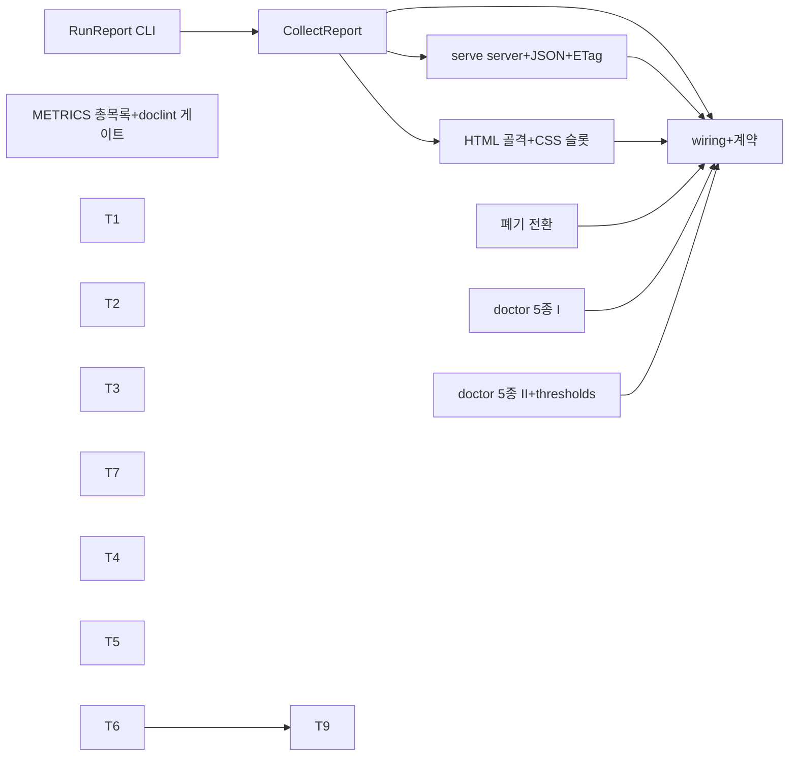

# flint v1.33.0 빌드 플랜 — 대시보드 에이전틱 + 관측 건강 (2026-11-24)

상태: active
비고: G2 APPROVED·G3 빌드 진행
원천: 2026-11-24-flint-v1.33.0.spec.md(역링크)·release-scope2 §2 v1.33.0 행

**Goal**: report --serve(localhost·조크포인트·ETag·요청 단위 연결) + HTML 골격(슬롯) + --html/--out deprecated 전환 + doctor 5종 신설 + METRICS 총목록·doclint 대조 게이트.
**Architecture**: lib/ops 내 serve·doctor 확장 — 기존 RunReport 수집부를 CollectReport로 추출해 serve가 동일 원천 소비. 프론트는 go:embed 단일 바이너리.
**Tech stack**: Go(stdlib net/http·html/template)·go:embed·기존 wire.Store·render 조크포인트·thresholds 등록표.
**Spec**: docs/plans/2026-11-24-flint-v1.33.0.spec.md (G2 APPROVED)
**Detail**: tests · **Target-min:** 24
**Review plan:** 본 플랜 — 스펙 §1 M1~M4와 1:1 대응
**Global constraints**: 스키마 v19 유지(스키마 변경 금지)·주석 0(v1.26.3 게이트)·개인 데이터 금지(합성 시드만)·React·Node 런타임·무거운 차트 라이브러리 금지·바인딩은 127.0.0.1 한정·응답은 render 조크포인트 경유·thresholds 신규 키 2종 등록표+동질 가드·계약 동반(커맨드 표·usage·docs-sync)·fast test: `go test ./lib/... -count=1`.

```mermaid
%% schedule
gantt
  title Predicted schedule (mm:ss)
  dateFormat X
  axisFormat %M:%S
  section lane 1
  T6 doctor II — 신선도·격차·잔재 :t6, 0, 151s
  section lane 2
  T7 wiring·계약 동반 :t7, 0, 151s
  section lane 3
  T2 serve 서버·JSON·ETag :t2, 0, 127s
  section lane 4
  T3 HTML 골격·CSS 슬롯 :t3, 0, 127s
  section lane 5
  T5 doctor I — 훅 경로·DSN :t5, 0, 127s
  section lane 6
  T8 METRICS 총목록·doclint 게이트 :t8, 0, 127s
  section lane 7
  T1 CollectReport 추출 :t1, 0, 102s
  section lane 8
  T4 폐기 전환 :t4, 0, 102s
```

critical path: T6 (2.5 min) · peak width 8 · predicted build 2.5 min · predicted total ≈ 6.0 min

## File structure

- `lib/ops/report_collect.go` — CollectReport: RunReport의 수집부 추출(단일 진단 원천)
- `lib/ops/serve.go` — serve 서버 코어·JSON 엔드포인트·ETag·포트 선택
- `lib/ops/serve_html.go` + `lib/ops/serve_page.tmpl.html` — HTML 골격·CSS 변수 훅·embed
- `lib/ops/report_html.go` — 정적 경로 deprecated 전환·안내 헬퍼
- `lib/ops/check_hookpath.go`·`check_dsn.go`·`check_freshness.go`·`check_plugin_gap.go`·`check_service.go` — 영역 F 5종
- `lib/store/thresholds.go` — collection_freshness_hours·plugin_version_gap_minors 등록
- `lib/ops/report.go` — --serve/--port 플래그·deprecate 경유·wiring
- `lib/ops/doctor.go` — doctorChecks() 등록행 5종
- `lib/wire/registry.go` — 커맨드 표·usage 행
- `docs/METRICS.md` — 원천 데이터 총목록 섹션·스테일 5키 정정
- `internal/doclint/metrics_registry_test.go` — 등록표 파생 키 전수 대조 게이트
- `docs/PLAN.md` — "2뷰 + serve" 계약·비목표 해제 본문 반영

## Review Focus

- **app type**: CLI+HTTP service (lib/ops) · library (doclint).
- **categories**: protocol(플래그·엔드포인트·exit), encoding(살균·JSON·HTML 이스케이프), state(포트 점유·ETag 재검증), file(embed·docs-sync).
- **specific risks**: localhost 외 바인딩 누출·원시 값 직접 노출(조크포인트 우회)·ETag 모순·thresholds 키 미등록 하드코딩·개인 경로 노출.
- **Probe entry:** `run=bin/flint doctor --check secrets`

### T1 CollectReport 추출 · Complexity 3 · Est. context 21k
**Spec:** M1 serve 서버 (동일 Diagnose 원천) — 동일 진단 원천 수집부
**Owns:** lib/ops/report_collect.go, lib/ops/report_collect_test.go
**Components:** 1 · **LOC owned:** 90 · **Tests:** fast · **Model:** sonnet
**Est. time:** 2 min
**Produces:** `CollectReport(ctx context.Context, st wire.Store, days int) -> (ReportOutput, error)`
  e.g. CollectReport(ctx, store, 7) -> ReportOutput{ReadCalls: 142, DupPct: 9}
  e.g. CollectReport(ctx, brokenStore, 30) -> error (exit 2 계약 유지)
**Review Focus:** `TestCollectReportParity`: RunReport 수집 결과 == CollectReport 결과(같은 시드 5행) — dup_pct·fallback_pct·savings 바이트 동일. `TestCollectReportPingFail`: Ping 실패 시 error 랩.
**Steps:** 1 failing parity test, 2 run: FAIL, 3 extract collection from RunReport into CollectReport(RunReport delegates), 4 run: PASS
**Notes:** 수집 순서(collectDaily→collectStats→collectCuration→CollectCounts→CollectEffect)와 임계값 소비 그대로 유지 — 동작 변경 금지.

### T2 serve 서버·JSON·ETag · Complexity 5 · Est. context 33k
**Spec:** M1 serve 서버 (동일 Diagnose 원천)·0. 리서치 요약 (내부 조사)
**Owns:** lib/ops/serve.go, lib/ops/serve_test.go
**Components:** 2 · **LOC owned:** 210 · **Tests:** fast · **Model:** sonnet
**Est. time:** 5 min
**Consumes:** `CollectReport(ctx context.Context, st wire.Store, days int) -> (ReportOutput, error)` (T1)
**Produces:** `NewServeServer(newStore func(context.Context) (wire.Store, error), days int, port int) -> *ServeServer` · `(*ServeServer).Handler() -> http.Handler` · `(*ServeServer).Port() -> int`
  e.g. NewServeServer(factory, 30, 0) -> ServeServer{Port: 7480} (0=기본)
  e.g. Handler() ServeHTTP GET /api/diagnose.json -> 200 {"days":7,...} (조크포인트 경유)
**Review Focus:** `TestServeLocalOnly`: 0.0.0.0 바인딩 요청 시도 → listen 주소가 항상 127.0.0.1. `TestPortRetry5`: 7480~7484 점유 시 6번째 실패 error. `TestETag304`: 동일 응답 If-None-Match → 304. `TestSection404`: /api/sections/unknown.json → 404.
**Steps:** 1 failing local-only test, 2 run: FAIL, 3 implement server(port pick 7480+1×5·요청 단위 newStore 호출·mux /api/diagnose.json·/api/sections/<area>.json 5영역·ETag+If-None-Match 304), 4 run: PASS
**Notes:** 응답 JSON은 render 조크포인트 함수 경유로 생성(직접 json.Marshal 노출 금지 — 살균 단일 출구). 요청마다 newStore(ctx)로 연결·핸들러 종료 시 닫음.

### T3 HTML 골격·CSS 슬롯 · Complexity 4 · Est. context 30k
**Spec:** M2 HTML 골격 + 임시 디자인 슬롯
**Owns:** lib/ops/serve_html.go, lib/ops/serve_page.tmpl.html, lib/ops/hand.css, lib/ops/serve_html_test.go
**Components:** 2 · **LOC owned:** 170 · **Tests:** fast · **Model:** sonnet
**Est. time:** 4 min
**Consumes:** `CollectReport(ctx context.Context, st wire.Store, days int) -> (ReportOutput, error)` (T1)
**Produces:** `HTMLHandler(newStore func(context.Context) (wire.Store, error), days int) -> http.Handler`
  e.g. HTMLHandler(factory, 30) GET / -> 200 HTML with `<section data-area="knowledge-hygiene">` …5영역
**Review Focus:** `TestFiveSections`: 렌더 HTML에 data-area 5종(knowledge-hygiene·recall-quality·token-economy·auto-tuning·engine-ops). `TestCSSVarHook`: hand.css가 --flint-* 변수만 정의하는 슬롯 구조(하드커딩 색상 0 — 임시 토큰만). `TestHTMLEscape`: 값에 `<script>` 유입 시 이스케이프 확인.
**Steps:** 1 failing sections test, 2 run: FAIL, 3 implement html/template 골격+go:embed+hand 토큰 CSS+vanilla fetch(수동 갱신·?poll=<초> 옵트인), 4 run: PASS
**Notes:** 템플릿은 auto-escape(html/template 기본) — 값을 지표 텍스트로만 출력. 차트 없음(임시 골격 — 디자인 트랙에서 결정).

### T4 폐기 전환 · Complexity 3 · Est. context 24k
**Spec:** M3 폐기 전환
**Owns:** lib/ops/report_html.go, lib/ops/report_html_test.go
**Components:** 1 · **LOC owned:** 70 · **Tests:** fast · **Model:** sonnet
**Est. time:** 2.5 min
**Produces:** `DeprecationNotice(flag string) -> string`
  e.g. DeprecationNotice("--html") -> "--html is deprecated — use `flint report --serve` (removed in a later release)"
**Review Focus:** `TestDeprecationNoticeServed`: notice에 serve 대체 경로 포함. `TestStaticPathStillWorks`: deprecated 경유 동작(정적 산출)이 변경 전과 동일 — 마이그레이션 안내만 추가.
**Steps:** 1 failing notice test, 2 run: FAIL, 3 implement notice+기존 경로에 경유 안내 출력, 4 run: PASS
**Notes:** 완전 제거 금지 — 전역 미결정(실측 후). dashboard.tmpl.html 정적 템플릿 파일 삭제는 T7 wiring에서 연결(serve 경유 대체 확인 후).

### T5 doctor I — 훅 경로·DSN · Complexity 4 · Est. context 28k
**Spec:** M4 영역 F — doctor 확장 5종 + METRICS 총목록 (체크 1·2)
**Owns:** lib/ops/check_hookpath.go, lib/ops/check_dsn.go, lib/ops/check_hookpath_test.go
**Components:** 2 · **LOC owned:** 150 · **Tests:** fast · **Model:** sonnet
**Produces:** `CheckHookPath() -> DoctorCheck` · `CheckDSNClass() -> DoctorCheck`
  e.g. CheckHookPath() -> DoctorCheck{Name:"hook-path", Status:"pass"} (훅 명령이 PATH에서 해석됨)
  e.g. CheckDSNClass() -> DoctorCheck{Status:"fail", Detail:"config engine_url unreachable vs malformed: <분류>"} (엔진 다운 vs DSN 결함 구분)
**Review Focus:** `TestHookPathResolution`: settings.json의 flint 명령 경로가 존재·해석 → pass, 존재하지 않는 바이너리 → fail+fix 안내. `TestDSNClassify`: 접속 거부(엔진 다운)와 호스트 불명(DSN 결함)이 서로 다른 Detail 분류. `TestNoLeak`: Detail에 비밀·전체 DSN 문자열 미포함.
**Steps:** 1 failing resolution test, 2 run: FAIL, 3 implement two checks(등록 검사와 별개 — 훅 셸 기준 해석·DSN 분류), 4 run: PASS
**Notes:** 등록 검사(checkHookFile)는 무변경 — 본 체크는 해석 가능성만. 감지만+복구 명령 안내(Fix 필드)·자동 실행 금지.

### T6 doctor II — 신선도·격차·잔재 · Complexity 4 · Est. context 30k
**Spec:** M4 영역 F — doctor 확장 5종 + METRICS 총목록 (체크 3·4·5)
**Owns:** lib/ops/check_freshness.go, lib/ops/check_plugin_gap.go, lib/ops/check_service.go, lib/ops/check_freshness_test.go, lib/store/thresholds.go
**Components:** 3 · **LOC owned:** 180 · **Tests:** fast · **Model:** sonnet
**Consumes:** thresholds 등록표 헬퍼(기존) — `store.ParseIntInRangeOrDefault` 계열(기존 함수, T1과 무관)
**Produces:** `CheckFreshness(ctx context.Context, st wire.Store) -> DoctorCheck` · `CheckPluginGap() -> DoctorCheck` · `CheckServiceRemnant() -> DoctorCheck`
  e.g. CheckFreshness(ctx, st) -> DoctorCheck{Name:"collection-freshness", Status:"warn"} (마지막 session_starts가 72h 초과)
  e.g. CheckPluginGap() -> DoctorCheck{Name:"plugin-version-gap", Status:"warn"} (플러그인 마이너 격차 3 > 임계 2)
  e.g. CheckServiceRemnant() -> DoctorCheck{Name:"service-remnant", Status:"ok"} (launchd plist가 정상 경로 지칭·비해당 플랫폼)
**Review Focus:** `TestFreshnessStale`: session_starts 최종 행을 now-73h로 고정 → warn, now-1h → pass. `TestPluginGapWarn`: 플러그인 마이너가 CLI 대비 2 초과 → warn, 동일 → pass. `TestServiceRemnant`: launchd label이 /tmp·/var/folders 경로 지칭 → warn. `TestThresholdOverride`: meta 오버라이드 24h 적용 확인(등록표 경유 — 하드코딩 금지).
**Steps:** 1 failing stale test, 2 run: FAIL, 3 implement three checks+thresholds 키 2종 등록(collection_freshness_hours 기본 72 범위 6~168·plugin_version_gap_minors 기본 2 범위 1~10), 4 run: PASS
**Notes:** launchd·systemd user 양쪽(플랫폼 비해당 시 pass·판단 근거 Detail). 감지만+복구 명령 안내.

### T7 wiring·계약 동반 · Complexity 5 · Est. context 38k
**Spec:** M3 폐기 전환·2. Ruling (원천 §미결정 확정안 — 독립 리뷰에서 확정) 적용
**Owns:** lib/ops/report.go, lib/ops/doctor.go, lib/ops/report_serve_v1330_test.go, lib/ops/doctor_checks_v1330_test.go, lib/ops/plan_docs_v1330_test.go, lib/wire/registry.go, lib/wire/threshold_meta_test.go, docs/PLAN.md
**Components:** 3 · **LOC owned:** 140 · **Tests:** fast · **Model:** sonnet
**Est. time:** 4.5 min
**Consumes:** `CollectReport(ctx context.Context, st wire.Store, days int) -> (ReportOutput, error)` (T1) · `NewServeServer(newStore func(context.Context) (wire.Store, error), days int, port int) -> *ServeServer` (T2) · `HTMLHandler(newStore func(context.Context) (wire.Store, error), days int) -> http.Handler` (T3) · `DeprecationNotice(flag string) -> string` (T4) · `CheckHookPath() -> DoctorCheck` (T5) · `CheckDSNClass() -> DoctorCheck` (T5) · `CheckFreshness(ctx context.Context, st wire.Store) -> DoctorCheck` (T6) · `CheckPluginGap() -> DoctorCheck` (T6) · `CheckServiceRemnant() -> DoctorCheck` (T6)
**Produces:** 커맨드 표·usage `report --serve/--port` 행 + doctorChecks() 등록행 5종 + RunReport 플래그 위임 (기존 등록표 형식 준수 — 신규 타입 없음)
  e.g. `bin/flint report --serve` -> localhost:7480 기동 로그 1행+"Ctrl-C" 안내 (exit 0 유지)
  e.g. `bin/flint report --serve --port 7490` -> 7490 바인딩
**Review Focus:** `TestServeFlagWiring`: --serve가 NewServeServer 경유 기동·--port 전달. `TestDoctorChecksRegistered`: doctorChecks()에 5종 신설 체크 존재(등록표 — 미등록 체크는 동질 가드 위반). `TestUsageUpdated`: usage에 --serve/--port 노출. `TestPlanDocsSync`: PLAN.md "2뷰 + serve" 문구·비목표 해제 반영(doclint docs-sync 통과).
**Steps:** 1 failing wiring test, 2 run: FAIL, 3 implement flags+registration+usage+PLAN 본문+dashboard.tmpl.html 정적 경로 제거(serve 대체 확인 후 — T4 경유 안내 유지), 4 run: PASS
**Notes:** 기존 --html/--out은 deprecated 경유 동작 유지. 커맨드 표·thresholds 등록표·usage의 단일 소스 3곳 동시 갱신. lib/wire/threshold_meta_test.go의 frozenThresholdKeys 가드에는 thresholds 신규 키 2종 편입이 필요(T6 등록의 필수 수반물 — Ruling으로 소관 편입). doctor 등록행의 체크 Name은 구현값(hook-path·dsn-class·collection-freshness·plugin-version-gap·service-remnant)과 일치시키고 상태 어휘는 코드베이스 규약을 따른다.

### T9 cli serve 팩토리 주입·frozen 계약 동반 · Complexity 4 · Est. context 30k
**Spec:** M1 serve 서버 (동일 Diagnose 원천) — 요청 단위 연결 완결 + T7 frozen 계약 동반 커밋
**Owns:** lib/cli/cli.go, lib/cli/serve_inject_test.go, lib/ops/report.go, lib/ops/doctor_check_registry_test.go, lib/ops/doctor_test.go, lib/ops/thresholds_once_f6_test.go, lib/ops/check_freshness.go
**Components:** 2 · **LOC owned:** 80 · **Tests:** fast · **Model:** sonnet
**Est. time:** 3 min
**Consumes:** `NewServeServer(newStore func(context.Context) (wire.Store, error), days int, port int) -> *ServeServer` (T2)
  e.g. NewServeServer(cliFactory, 30, 0) -> ServeServer{Port: 7480}, 요청마다 cliFactory(ctx)가 새 store를 만들고 핸들러 종료 시 Close 호출
**Notes(Consumes 보강):** T7의 cli fallback(런 스토어 공유, no-Close 래퍼)을 cli 측 진짜 요청 단위 팩토리로 교체하는 것이 본 태스크의 목적이다.
**Produces:** cli가 report serve 경로에 요청 단위 store 팩토리(serveNewStoreFn) 주입 — e.g. 요청마다 새 store 생성·핸들러 종료 시 Close 호출 카운트 == 요청 수
**Review Focus:** `TestServeFactoryPerRequest`: cli 주입 팩토리가 요청마다 새 store·Close 보장. `TestDoctorFrozenCounts`: doctor frozen counts 24→29 계약 테스트 통과(T7 동반 수정 커밋 — 기존 계약 유지).
**Steps:** 1 failing factory test, 2 run: FAIL, 3 implement cli 주입, 4 run: PASS
**Notes:** T7의 out-of-scope 동반 수정(doctor frozen counts 3파일·check_freshness.go CheckFreshnessTh 스코프 공유화)을 본 태스크 소관으로 커밋(Ruling). dashboard.tmpl.html은 유지(Ruling — spec M3 경유 유지·제거 시점 전역 미결정).

### T8 METRICS 총목록·doclint 게이트 · Complexity 3 · Est. context 26k
**Spec:** M4 영역 F — doctor 확장 5종 + METRICS 총목록 (항목 6)
**Owns:** docs/METRICS.md, internal/doclint/metrics_registry_test.go, internal/doclint/copilot_auto_registration_test.go
**Components:** 2 · **LOC owned:** 130 · **Tests:** fast · **Model:** sonnet
**Est. time:** 3 min
**Produces:** METRICS.md "원천 데이터 총목록" 섹션 + `TestMetricsRegistrySync`(doclint)
  e.g. TestMetricsRegistrySync: MeteringKindRegistry 전수 키가 METRICS 총목록 표에 존재 — 1키라도 누락 시 FAIL
**Review Focus:** `TestMetricsRegistrySync`: 등록표 파생 키 전수(lib/db/usage.go MeteringKindRegistry) vs 총목록 표 대조 — 누락·과잉 0. `TestStaleFiveKeysFixed`: correction_preference·correction_fact·merge_audit_pairs·recall_audit_listed·recall_audit_disposed 5키가 §4.9 A5 기술에 반영. `TestRetentionColumn`: 총목록 표에 보존 기간 열 존재.
**Steps:** 1 failing sync test(현재 5키 누락 상태에서 red), 2 run: FAIL, 3 implement 총목록 섹션(등록표 파생·수집 조건·보존 기간)+5키 정정, 4 run: PASS
**Notes:** 진실 원천은 코드 등록표 — 문서는 파생물. 수치는 등록표 수 기술만(실측 수치 인용 금지).

## Self-review

1. Coverage: 스펙 M1→T1·T2, M2→T3, M3→T4·T7, M4→T5·T6·T7·T8 — 전 항 매핑.
2. Placeholders: 없음 — 미결정(Ruling)은 스펙 §2로 확정된 값만 사용.
3. Type consistency: Consumes/Produces 시그니처 상호 일치(T7이 전 생산자 소비).
4. Graph: 병렬 태스크 파일 비공유(T1 report_collect.go vs T7 report.go — T1 완료 후 T7 실행).
5. Fields: 전 태스크 Components·LOC·Tests·Model 기재.
6. Review Focus: 카테고리+Probe entry 기재·케이스 태스크 배치 완료.
7. Limits: 본문 ~11k chars·SIZE 밴드 내(최대 5min)·lint·schedule 실행 대기.
