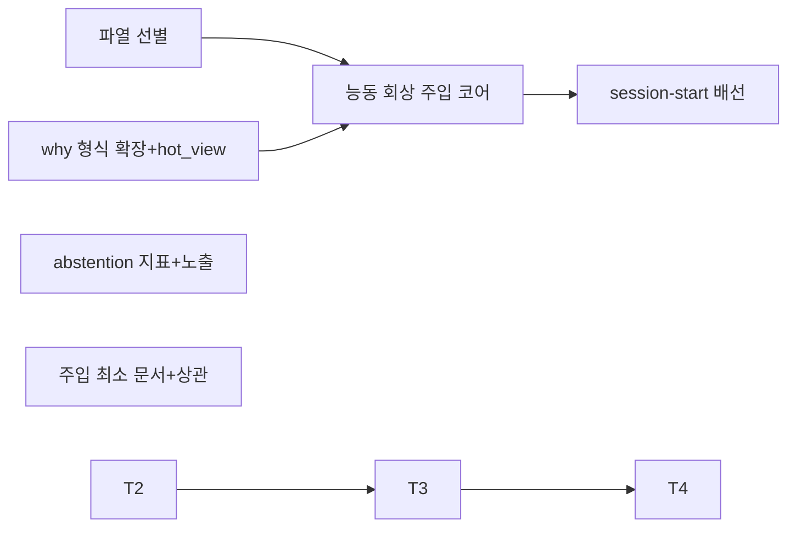

# flint v1.34.0 빌드 플랜 — 지식 체계 I·전달 (2026-11-25)

상태: active
비고: G2 APPROVED(2026-11-25)·G3 빌드 진행
원천: 2026-11-24-flint-v1.34.0.spec.md(역링크)·release-scope2 §2 v1.34.0 행

**Goal**: 세션 시작 1회 능동 회상(hot 잔여 예산·파열 선별)·provenance 표기 단일 관례(why 형식 확장)·abstention 지표(zero_hit_unowned_pct)·주입 최소 실증 문서화+상관 계측.
**Architecture**: lib/ops 주입 코어(recall_active·recall_burst·abstention) + lib/query why 형식 확장 + lib/sqlfs hot_view additive 확장 + sessionhook 배선. 스키마 변경 0 — 기존 계측·컬럼·meta 소비.
**Tech stack**: Go(stdlib)·기존 wire.Store·render 조크포인트·thresholds(신규 키 없음).
**Spec**: docs/plans/2026-11-24-flint-v1.34.0.spec.md (G2 APPROVED)
**Detail**: tests · **Target-min:** 18
**Global constraints**: 스키마 v19 유지(스키마 변경 금지)·주석 0(v1.26.3 게이트)·개인 데이터 금지(합성 시드만)·새 훅 0(UserPromptSubmit 기각)·주입은 hot_budget 회계 내(잔여 0 무주입)·파열 0 무출력·훅 비차단·fast test: `go test ./lib/... -count=1 -p 1`.

Spec sections map: 0. 리서치 요약 (내부 조사) — T1·T2 접점 전제 / 1. 마일스톤 — T1~T6 전체 / M1 능동 회상 session-start 흡수 (사용자 확정 경로) — T1 선별·T3 주입·T4 배선 / M2 provenance 노출 강화 — T2 형식 확장.

```mermaid
%% schedule
gantt
  title Predicted schedule (mm:ss)
  dateFormat X
  axisFormat %M:%S
  section lane 1
  T5 abstention 지표+노출 :t5, 0, 151s
  T4 session-start 배선 :t4, 253, 102s
  section lane 2
  T2 why 형식 확장+hot_view :t2, 0, 127s
  T3 능동 회상 주입 코어 :t3, 127, 127s
  section lane 3
  T6 주입 최소 문서+상관 계측 :t6, 0, 127s
  section lane 4
  T1 파열 선별기 :t1, 0, 102s
```

critical path: T2 → T3 → T4 (5.9 min) · peak width 4 · predicted build 5.9 min · predicted total ≈ 9.4 min

## File structure

- `lib/ops/recall_burst.go` — 파열 선별(conditions·age-audit SQL·vaultSourceChanged 조합)
- `lib/ops/recall_active.go` — 능동 회상 주입 코어(잔여 예산 산술·provenance 표기·조용함 계약)
- `lib/ops/sessionhook.go` — RunSessionStart 배선(1회 한정 가드)
- `lib/query/read.go` — WhyEvidence·FormatWhyRows source=·confidence= 확장
- `lib/sqlfs/views.sql` — hot_view select 확장(additive)
- `lib/ops/abstention.go` — zero_hit_unowned_pct 산출(A1 read_events 소비)
- `lib/ops/report.go`·`lib/ops/serve_html.go` — 지표 노출 행
- `docs/METRICS.md` — zero_hit_unowned_pct 정의·상관 계측 정의
- `internal/doclint/metrics_test.go` — 정의 게이트 행
- `docs/PLAN.md`·`README.md`·`README.ko.md` — 실증 원칙 문구(docs-sync)

## Review Focus

- **app type**: CLI hook path (lib/ops) · library (lib/query).
- **categories**: protocol(exit·무출력 계약), encoding(살균·provenance 표기), state(1회 한정·예산 절삭), numeric(지표 분모·분자).
- **specific risks**: 예산 밖 주입(비간섭 위반)·2회 중복 주입·원시 값 노출(조크포인트 우회)·hot_view 확장의 기존 뷰 파손·METRICS 정의 드리프트.
- **Probe entry:** `run=bin/flint session-start`

### T1 파열 선별기 · Complexity 4 · Est. context 28k
**Spec:** M1 능동 회상 — 선별
**Owns:** lib/ops/recall_burst.go, lib/ops/recall_burst_test.go
**Components:** 1 · **LOC owned:** 110 · **Tests:** fast · **Model:** sonnet
**Est. time:** 3 min
**Produces:** `RecallBurstItems(ctx context.Context, st wire.Store, limit int) -> ([]BurstItem, error)` — BurstItem{ID int, Topic string, Reason string}
  e.g. RecallBurstItems(ctx, store, 5) -> []BurstItem{{ID: 42, Topic: "…", Reason: "stale-condition"}} (조건 태그·stale 증거 충족 행)
  e.g. RecallBurstItems(ctx, emptyStore, 5) -> []BurstItem{} (nil error)
**Review Focus:** `TestBurstStaleCondition`: conditions 태그+age-audit 임계 초과 행 선별. `TestBurstVaultChanged`: vault 원본 해시 불일치(source_path 행) 선별 — vaultSourceChanged 의미론 재사용. `TestBurstOrderLimit`: bad_recall·age 내림차순·limit 절삭.
**Steps:** 1 failing stale-condition test, 2 run: FAIL, 3 implement selector(단일 SQL — conditions 컬럼+age-audit 임계+vault 해시 조합), 4 run: PASS
**Notes:** `--recheck`(단일 ID기)를 벌크 선별에 오용 금지(G2 정정) — 선별은 읽기 전용·부작용 0.

### T2 why 형식 확장+hot_view · Complexity 4 · Est. context 30k
**Spec:** M2 provenance — 단일 관례 정의
**Owns:** lib/query/read.go, lib/sqlfs/views.sql, lib/query/read_why_test.go
**Components:** 2 · **LOC owned:** 120 · **Tests:** fast · **Model:** sonnet
**Est. time:** 3.5 min
**Produces:** `WhyEvidence` 확장 — Source string `json:"source,omitempty"`·Confidence float64 `json:"confidence,omitempty"` 필드 추가 + `FormatWhyRows(ev []WhyEvidence, jsonMode bool) -> string`이 source=·confidence= 표기 행 출력(기존 토큰·RRF 표기 유지) + hot_view select에 source·confidence 컬럼 추가(additive)
  e.g. FormatWhyRows([]WhyEvidence{{ID:"k1", Source:"manual", Confidence:0.9}}, false) -> "why k1 source=manual confidence=0.9" 형태(기존 토큰 표기와 결합)
**Review Focus:** `TestWhyProvenanceFields`: source·confidence 세팅 시 표기 포함, 미세팅 시 기존 표기와 byte 동일(하위 호환). `TestHotViewColumns`: hot_view에 source·confidence 컬럼 노출 — 기존 컬럼 순서·이름 불변(additive만). `TestWhyJSONMode`: jsonMode에서 omitempty 유지.
**Steps:** 1 failing provenance test, 2 run: FAIL, 3 implement WhyEvidence 필드+FormatWhyRows 확장+views.sql select 확장, 4 run: PASS
**Notes:** 스키마 게이트 대상 아님(뷰 select 확장 — lib/sqlfs 게이트 규칙 준수). 표기는 render 조크포인트 계열 파서와 호환 유지.

### T3 능동 회상 주입 코어 · Complexity 5 · Est. context 36k
**Spec:** M1 능동 회상 — 주입
**Owns:** lib/ops/recall_active.go, lib/ops/recall_active_test.go
**Components:** 2 · **LOC owned:** 160 · **Tests:** fast · **Model:** sonnet
**Est. time:** 4 min
**Consumes:** — (T1 `RecallBurstItems`·T2 why 형식 확장 표기는 코디네이터 태스크 메시지가 시그니처와 e.g. 예시를 그대로 전달 — fake는 예시값 반환)
**Produces:** `InjectActiveRecall(ctx context.Context, st wire.Store, session string, stdout io.Writer) -> int` — e.g. 잔여 예산 400B·파열 1건 → stdout 1행(why 표기 포함)·return 0; 잔여 0 → 출력 0행·return 0
**Review Focus:** `TestInjectRespectsRemainingBudget`: 잔여 = HotBudget − 세션 hot recordBytes(hot_events 세션 합산) — 잔여 0이면 출력 0. `TestInjectQuietOnNoBurst`: 파열 0 → 무출력·exit 0. `TestInjectProvenanceFormat`: 주입 행이 T2 형식(source=·confidence=) 일치. `TestInjectRenderJokypoint`: 출력이 render 경유(원시 노출 금지).
**Steps:** 1 failing budget test, 2 run: FAIL, 3 implement injection core(잔여 산술·burst 소비·provenance 표기·stdout), 4 run: PASS
**Notes:** 세션 hot 바이트는 hot_events의 세션 행 합산(신규 카운터 없음). 주입 행 절삭은 예산 경계에서 행 단위. 실패 시 조용한 skip(exit 0·비차단).

### T4 session-start 배선 · Complexity 3 · Est. context 26k
**Spec:** M1 능동 회상 — 흡수(사용자 확정 경로)·3. 비목표 — 새 훅 0 승계
**Owns:** lib/ops/sessionhook.go, lib/ops/sessionhook_recall_test.go, lib/ops/maintain_meta.go
**Components:** 1 · **LOC owned:** 60 · **Tests:** fast · **Model:** sonnet
**Est. time:** 2.5 min
**Consumes:** — (T3 `InjectActiveRecall` 시그니처는 코디네이터 태스크 메시지가 전달 — fake는 예시값 반환)
**Produces:** RunSessionStart 내 RunHot 뒤 1회 호출 배선 + 세션당 1회 한정 가드(meta 마커 `recall_active:<session>`) — e.g. 동일 세션 2회 RunSessionStart → 주입 1회만
**Review Focus:** `TestSessionStartInjectOnce`: 같은 세션 라벨로 2회 호출 — 주입 1회. `TestSessionStartQuietPath`: 파열 0 세션 — session-start 출력이 기존과 byte 동일(하위 호환). `TestSessionStartHookNonBlocking`: InjectActiveRecall 실패 시에도 session-start exit 0(조용한 skip).
**Steps:** 1 failing once-guard test, 2 run: FAIL, 3 implement wiring+guard, 4 run: PASS
**Notes:** 배선 순서 — RunHot → InjectActiveRecall → RunNudge(공지는 유지). 새 훅·새 플래그 0.

### T5 abstention 지표+노출 · Complexity 4 · Est. context 30k
**Spec:** M3 abstention 자기 채점
**Owns:** lib/ops/abstention.go, lib/ops/abstention_test.go, docs/METRICS.md, internal/doclint/metrics_test.go, lib/ops/report.go, lib/ops/serve_html.go
**Components:** 3 · **LOC owned:** 150 · **Tests:** fast · **Model:** sonnet
**Est. time:** 3.5 min
**Produces:** `ZeroHitUnownedPct(ctx context.Context, st wire.Store, days int) -> (float64, error)` — A1 read_events 소비(스키마 불변) + METRICS `zero_hit_unowned_pct` 정의 등록 + report·serve 지표 행
  e.g. ZeroHitUnownedPct(ctx, store, 14) -> 62.5 (zero-hit 16건 중 unowned 10건)
**Review Focus:** `TestZeroHitUnownedPctMath`: 분모·분자 경계(zero-hit 0 → 0.0·전부 unowned → 100.0). `TestMetricsDefinitionGate`: doclint 정의 게이트 통과(abstention 정의+상관 정의 행). `TestReportRowExposure`: report 텍스트·serve 지표 행 노출.
**Steps:** 1 failing math test, 2 run: FAIL, 3 implement calc+METRICS 정의+노출 행, 4 run: PASS
**Notes:** 지표 정의·상관 정의 모두 METRICS 단일 소스(주간 rollup 소비 — hot bytes·read 성공/fallback 기존 카운터 조합) — 코드 주석 대신 문서. 개인값·실측 수치 인용 금지.

### T6 주입 최소 문서+상관 계측 · Complexity 3 · Est. context 24k
**Spec:** M4 주입 최소 실증 문서화+상관 계측·4. 검증 — docs-sync 게이트
**Owns:** docs/PLAN.md, README.md, README.ko.md, internal/doclint/injection_minimal_test.go
**Components:** 2 · **LOC owned:** 60 · **Tests:** fast · **Model:** sonnet
**Est. time:** 2 min
**Produces:** PLAN·README(EN/KO) "주입 최소 — 실증 원칙" 문구 행(docs-sync 계약) — 상관 계측 정의 행은 T5가 METRICS에 등록
  e.g. PLAN §4 문구 행 + README 라인 — doclint docs-sync 통과
**Review Focus:** `TestDocsSyncMinimalInjection`: docs-sync 게이트 통과(PLAN·README 문구 행). `TestReadmeKoParity`: 한국어 병기 행 존재.
**Steps:** 1 failing docs-sync test, 2 run: FAIL, 3 implement rows, 4 run: PASS
**Notes:** 문서는 영어 디폴트·한국어 병기(README.ko). 실측 수치 인용 금지 — 정의·원칙 서술만.

## Self-review

1. Coverage: 스펙 M1→T1·T3·T4, M2→T2, M3→T5, M4→T6 — 전 항 매핑.
2. Placeholders: 없음 — Ruling은 스펙 §2 확정값.
3. Type consistency: T3 Consumes= T1·T2 Produces·T4 Consumes= T3 Produces.
4. Graph: 병렬 비공유(T1·T2·T5·T6 상호 독립·T3는 스텁 소비).
5. Fields: 전 태스크 기재.
6. Review Focus: 카테고리+Probe entry·케이스 배치 완료.
7. Limits: 본문 ~9k chars·SIZE 밴드 내·lint·schedule 실행 대기.
