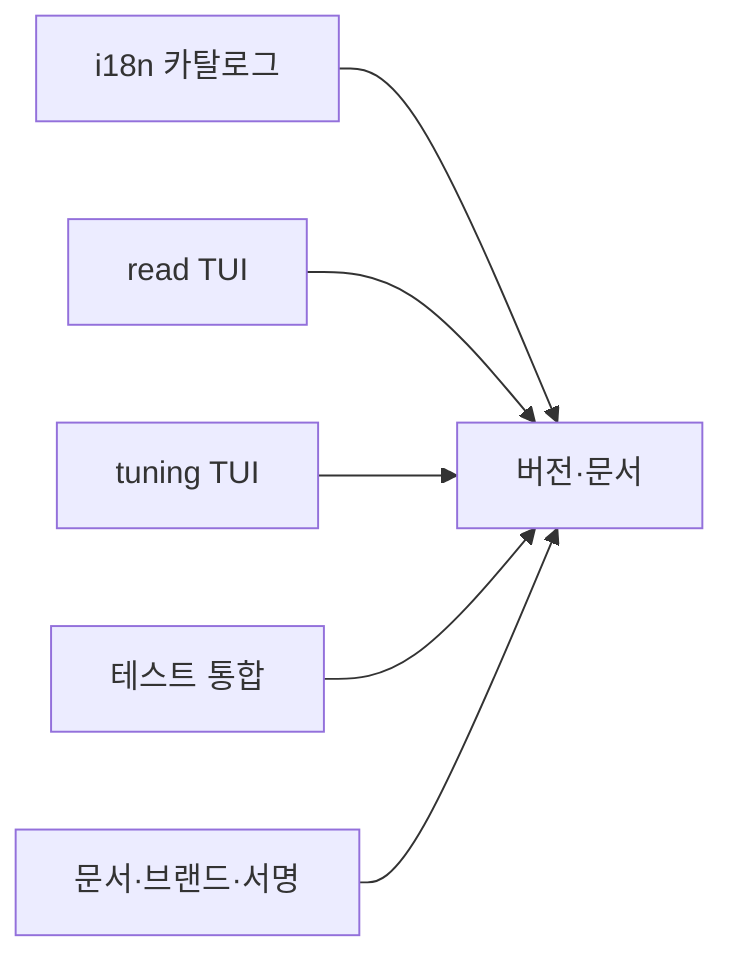

# flint v1.28.0 — 표면 확장·품질 청산

상태: active
**Spec path:** docs/plans/2026-11-24-flint-v1280.spec.md
**Detail:** tests · **Target-min:** 9
**Global constraints:** TDD·개인 데이터 금지·스키마 변경 없음·주석 0·v1.29.0 격리 준수(testengine 경유).

```mermaid
%% schedule
gantt
  title Predicted schedule (mm:ss)
  dateFormat X
  axisFormat %M:%S
  section lane 1
  T1 lib/i18n 카탈로그 :t1, 0, 127s
  T6 버전·스코프 문서 v1.28.0 :t6, 127, 102s
  section lane 2
  T2 read TUI :t2, 0, 127s
  section lane 3
  T4 테스트 통합·헬퍼 공유화 :t4, 0, 127s
  section lane 4
  T3 tuning TUI 승격·위임 테스트 :t3, 0, 102s
  section lane 5
  T5 문서·브랜드·서명 재실증 :t5, 0, 102s
```

critical path: T1 → T6 (3.8 min) · peak width 5 · predicted build 3.8 min · predicted total ≈ 7.3 min

critical path: T1 → T2 → T6 · peak width 3 · predicted total ≈ 15 min

### T1 lib/i18n 카탈로그 · Complexity 3 · Est. context 24k
**Owns:** lib/i18n/i18n.go(신규), lib/i18n/i18n_test.go(신규), lib/wire/run.go, lib/wire/registry.go
**Components:** 2 · **LOC owned:** 160 · **Tests:** fast · **Model:** sonnet
**계약:** Catalog(map 카탈로그 ko·en·기본 en)·T(key string) string·FLINT_LANG 환경(미지원 값은 en 폴백·경고 없음). usage 46곳(ArgSpec Usage 필드 포함)·wire.ErrLine 대표 오류 경로를 T() 경유로 교체. KO 번역 완성(스토어 상태·usage·대표 오류).
**Produces:** T(key string) string · Lang() string
**e.g.** T("usage.read") with FLINT_LANG unset -> "usage: flint read [query] [--limit N]" · FLINT_LANG=ko -> "사용법: flint read [쿼리] ..."
**Test:** 언어 전환 왕복·미지원 폴백·키 부재 시 키 자체 반환·usage 출력 KO.

### T2 read TUI · Complexity 4 · Est. context 30k
**Owns:** lib/tui/read.go(신규), lib/tui/read_test.go(신규), lib/knowledge/read.go, lib/cli/root.go
**Components:** 2 · **LOC owned:** 220 · **Tests:** fast · **Model:** sonnet
**계약:** 무인수+TTY — 대화형(쿼리 입력 huh 폼·결과 목록·상세 전환·스크롤). 비TTY·파이프·FLINT_NO_TUI·플래그 있는 호출은 현행 플래그 모드. 무인수 경로도 RecordReadEvent 계측 유지(read_v0190 계약 테스트 통과). NO_COLOR 준수·색상 ≤4.
**Consumes:** T(key string) string (T1)
**Test:** 진입 조건 4종·계측 보존·폴백 무변경(기존 테스트 전수 green).

### T3 tuning TUI 승격·위임 테스트 · Complexity 3 · Est. context 22k
**Owns:** lib/cli/tuning.go, lib/tui/tuning.go, lib/cli/tuning_test.go, lib/tui/tuning_test.go
**Components:** 1 · **LOC owned:** 90 · **Tests:** fast · **Model:** sonnet
**계약:** 무인수+TTY — TUI 우선(기존 huh 폼 재사용). 서브커맨드·플래그 현행 유지. 위임 테스트 6건 잔여 백로그 정리(리스트 실측·G2 §5 v1.19.0 비고분).
**Test:** 진입 조건·서브커맨드 무변경·위임 6건 green.

### T4 테스트 통합·헬퍼 공유화 · Complexity 4 · Est. context 30k
**Owns:** lib/cli/*_test.go(병합 대상 — doctor 11·read 10·maintain 14 실측 후 확정), lib/**/*_test.go(중복 헬퍼)
**Components:** 2 · **LOC owned:** 150 · **Tests:** slow · **Model:** sonnet
**계약:** 버전 접미 테스트 파일 병합(도메인별 단일 파일·테스트 함수명 불변 — 컴파일로 강제)·중복 헬퍼 testengine/공유 헬퍼로 이동(대상 G3 실측). 테스트 수 불변(이름 기준 집계 리포트)·전 스위트 green.
**Test:** 통합 후 go test ./... green·테스트 수 불변 단정·파일 수 감소 리포트.

### T5 문서·브랜드·서명 재실증 · Complexity 2 · Est. context 18k
**Owns:** docs/BRAND.md, docs/BREW.md(신규), docs/TUNING.md, docs/RUNBOOK.md, docs/plans/2026-11-21-flint-engine-ops.md
**Components:** 1 · **LOC owned:** 80 · **Tests:** fast · **Model:** sonnet
**계약:** BRAND.md 갱신(기존 보존+동향 회수 절)·BREW.md 신설(brews 구성안·비용·개설 게이트)·TUNING.md 관측 이월 재판정 기준 절(apply 게이트와 중복 없이)·RUNBOOK 시퀀스 회수 무해 가정 재확인 기록·Doltgres 업스트림 2건 주의사항 갱신·engine-ops 플랜 표 기록. 서명 재실증: 최신 릴리스 자산 cosign verify-blob 공개키 1회(기록으로만 — 인시던트).
**Test:** doclint·docs-sync green.

### T6 버전·스코프 문서 v1.28.0 · Complexity 2 · Est. context 16k
**Owns:** VERSION, README.md, README.ko.md, flint-plugin/.claude-plugin/plugin.json, docs/HISTORY.md, internal/doclint/versions_test.go, docs/plans/2026-11-21-flint-release-scope.md, docs/plans/README.md
**Components:** 1 · **LOC owned:** 60 · **Tests:** fast · **Model:** sonnet
**계약:** v1.28.0 동기 5곳·계약행 TestVersion01280Milestone{v1.28.0, surface-cleanup}·하이라이트 엔트리·README 명령 표 read·tuning 무인수 대화형 갱신·스코프 §2·§5·의존 메모 4회째 교환 갱신·R9 R68 철회 분리 명시·plans 색인.
**Test:** doclint·docs-sync·release-gate OK v1.28.0.

**Review Focus:** protocol(TUI 진입 조건·i18n 폴백)·state(계측 보존)·file(테스트 병합 충돌). 위험: 무인수 read 기존 동작(빈 쿼리 조회) 사용자 존재·테스트 병합 대규모 diff·KO 번역 품질.

**Probe entry:** run=go run ./cmd/flint read · run=go run ./cmd/flint tuning · run=FLINT_LANG=ko go run ./cmd/flint --help

**Ruling:** G3 — 안정 태스크 순차 디스패치(T1 선행·T4는 독립 병행).
