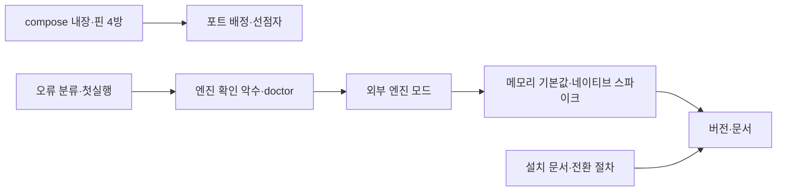

# flint v1.30.0 — 설치 여정

상태: active
**Spec path:** docs/plans/2026-11-23-flint-v1300.spec.md
**Detail:** tests · **Target-min:** 10
**Global constraints:** TDD·개인 데이터 금지·스키마 변경 없음·주석 0·v1.29.0 격리 준수·기존 설치 보호(자동 이전 금지).

```mermaid
%% schedule
gantt
  title Predicted schedule (mm:ss)
  dateFormat X
  axisFormat %M:%S
  section lane 1
  T1 compose 내장·핀 4방 동치 :t1, 0, 127s
  T4 엔진 확인 악수·doctor 재작성 :t4, 127, 127s
  T5 외부 엔진 모드 :t5, 253, 102s
  T6 메모리 기본값·네이티브 L0 스파이크 :t6, 355, 127s
  T8 버전·문서 v1.30.0 :t8, 482, 102s
  section lane 2
  T2 오류 분류·첫 실행 1회 성공 :t2, 0, 127s
  T3 포트 배정·선점자 식별 :t3, 127, 102s
  section lane 3
  T7 설치 문서·전환 절차 :t7, 0, 102s
```

critical path: T2 → T4 → T5 → T6 → T8 (9.7 min) · peak width 3 · predicted build 9.7 min · predicted total ≈ 13.2 min

critical path: T1 → T2 → T4 → T5 → T6 → T8 · peak width 2 · predicted total ≈ 16 min

### T1 compose 내장·핀 4방 동치 · Complexity 4 · Est. context 28k
**Owns:** lib/cli/embedded.go(신규), lib/cli/embedded_test.go(신규), lib/cli/setup.go, Makefile
**Components:** 2 · **LOC owned:** 160 · **Tests:** fast · **Model:** sonnet
**계약:** go:embed 내장 compose YAML(프로젝트명 flint·다이제스트 핀=ci.yml 현행·포트 변수화). 핀 4방 동치 가드(내장·ci.yml·docker-compose.test.yml·상수 — 문자열 매칭). `flint setup` 경로가 compose 파일을 임시 기록해 up(--project-name flint -p). make up/down은 유지(cwd 관례·문서만).
**Produces:** EmbeddedCompose() string · PinnedImage() string
**e.g.** EmbeddedCompose() -> "name: flint\nservices:..." · PinnedImage() == ci.yml 서비스 이미지 문자열
**Test:** 4방 동치(1방 변조 시 FAIL)·프로젝트명·포트 변수.

### T2 오류 분류·첫 실행 1회 성공 · Complexity 4 · Est. context 28k
**Owns:** lib/cli/classify.go(신규) 또는 lib/cli/setup.go 확장, lib/cli/setup_ux.go, lib/cli/setup_test.go, lib/cli/classify_test.go(신규)
**Components:** 2 · **LOC owned:** 180 · **Tests:** fast · **Model:** sonnet
**계약:** 엔진 부재·데몬 다운·권한·compose v1 폴백·경량 런타임(Colima·OrbStack·Podman — 처방 문구 반영, 기능 분기 아님) 분류기(표 테스트). 첫 실행: 기동 뒤 Ping 재시도(기본 30회×200ms·thresholds ping_retry_count·ping_retry_interval_ms — engine_wait_seconds와 별개)로 ping·migrate 동일 실행 완결·`st == nil` 경로 폴백 제거. 기존 설치 감지: 라벨 project=flint 컨테이너 채택·비flint 선점은 경고 후 정지(처방=RUNBOOK §11 전환 절차).
**Consumes:** EmbeddedCompose() string (T1)
**Test:** 분류기 표·Ping 예산 소진·기존 설치 2상태·정지 처방 문구.

### T3 포트 배정·선점자 식별 · Complexity 3 · Est. context 24k
**Owns:** lib/cli/port.go(신규), lib/cli/port_test.go(신규), lib/cli/config.go(있다면)·config 경로 파일
**Components:** 1 · **LOC owned:** 120 · **Tests:** fast · **Model:** sonnet
**계약:** `flint setup --port N`. 자동 배정: 기본 포트 점유 시 루프백 바인드 시험으로 빈 포트 탐색 — 후보 5434부터 순차·**5499 제외**(ADR-0019 예약)·65535 상한. config.json에 기록·compose 변수 주입·추적 파일 미편집. 선점자: lsof(부재 시 생략)+docker ps --filter publish=<port>로 프로세스·컨테이너명 안내.
**Produces:** PickPort(defaultPort int) (int, error)
**e.g.** PickPort(5434) with 5434·5435 점유·5436 비었음 -> (5436, nil) · 5434~65535 전부 점유 -> (_, error)
**Test:** 순차 탐색·5499 스킵 단정·전부 점유 에러·config 기록 왕복.

### T4 엔진 확인 악수·doctor 재작성 · Complexity 3 · Est. context 24k
**Owns:** lib/db/handshake.go(신규), lib/db/handshake_test.go(신규), lib/ops/doctor.go, lib/ops/doctor_test.go
**Components:** 2 · **LOC owned:** 140 · **Tests:** fast · **Model:** sonnet
**계약:** 접속 직후 엔진 종류·버전 확인(버전 쿼리 or error 응답 특성 — Doltgres 한정 판별). 관리형=핀 일치·외부=버전만. 불일치·비Doltgres는 원인형 오류(exit 1)+처방. doctor port 표기 재작성(라벨 정확 일치 — project=flint). checkVersions(v1.26.0)에 엔진 버전 연결 열 확장.
**Consumes:** PickPort (T3 — 표기용 port 출처)
**Test:** 가짜 응답 4종(Doltgres 핀 일치·불일치·바닐라 PG·무응답)·doctor 라벨 필터·훅 경로 조용한 skip 유지.

### T5 외부 엔진 모드 · Complexity 3 · Est. context 22k
**Owns:** lib/cli/setup_engine.go(신규), lib/cli/setup_engine_test.go(신규), lib/cli/root.go
**Components:** 1 · **LOC owned:** 110 · **Tests:** fast · **Model:** sonnet
**계약:** `flint setup --engine-url DSN`: 엔진 설치 없이 접속 대상 기록(M2 규칙·config.json 0600·DSN 마스킹·인라인 인자 거부)→악수→migrate. 루프백 한정(localhost·127.0.0.1·[::1]만 — 유닉스 소켓·원격 거부). engine.mode 기록(external)·purge는 관리형 한정 강화(v1.29.0 스펙 승계).
**Test:** 마스킹·0600·비Doltgres 거부·인라인 거부·비루프백 거부·mode 기록.

### T6 메모리 기본값·네이티브 L0 스파이크 · Complexity 3 · Est. context 26k
**Owns:** docker-compose.yml, docker-compose.test.yml, docs/RUNBOOK.md, docs/plans/native-spike-v1300.md(신규)
**Components:** 2 · **LOC owned:** 90 · **Tests:** slow · **Model:** sonnet
**계약:** 메모리 상한 — RUNBOOK §12 판정(채택 시 compose 환경 GOMEMLIMIT·GOGC 기본값·thresholds 동반 / 기각·보류 시 미반영 선언 기록·재측정 트리거 명시). 네이티브 L0 스파이크: 핀 버전 바이너리 다운로드·해시 검증·`doltgres -data-dir` 기동·CRUD 왕복·PERF 합성 벤치 — 결론 노트(v1.31.0 착수 판정).
**Test:** 스파이크 결론 노트 존재(doclint)·채택 시 동치(compose 환경·thresholds).

### T7 설치 문서·전환 절차 · Complexity 2 · Est. context 18k
**Owns:** docs/QUICKSTART.md, README.md, README.ko.md, docs/RUNBOOK.md, docs/contracts/cli.md, scripts/install.sh, docs/adr/ADR-0020-*.md(신규), docs/adr/ADR-0013*.md
**Components:** 1 · **LOC owned:** 80 · **Tests:** fast · **Model:** sonnet
**계약:** QUICKSTART 바이너리 우선 재작성·README 설치절(EN/KO)·cli.md·RUNBOOK §11(내장 compose·전환 절차 신설: dump→restore→config.json→구 엔진 정리)·install.sh 점검·ADR-0020(엔진 핀·프로젝트명)·ADR-0013 갱신(포트 가변·엔진 모드).
**Test:** doclint·docs-sync green.

### T8 버전·문서 v1.30.0 · Complexity 2 · Est. context 16k
**Owns:** VERSION, flint-plugin/.claude-plugin/plugin.json, docs/HISTORY.md, internal/doclint/versions_test.go, docs/plans/2026-11-21-flint-release-scope.md, docs/plans/README.md
**Components:** 1 · **LOC owned:** 50 · **Tests:** fast · **Model:** sonnet
**계약:** v1.30.0 동기 5곳·계약행 TestVersion01300Milestone{v1.30.0, install-journey}·하이라이트 엔트리·스코프 §5 v1.30.0 building·의존 메모 v1.26.0 정정(G2 추적 조건)·M4 스파이크 결과에 따른 v1.31.0 상태 갱신(통과 시 gating 아님 유지·미통과 시 closed).
**Test:** doclint·docs-sync·release-gate OK v1.30.0.

**Review Focus:** protocol(배정 범위·악수 오류 계약)·state(config 기록·mode)·file(임시 compose 기록 경로)·security(마스킹·0600·루프백). 위험: 기존 설치 감지 오탐·compose 변수 주입 실패·스파이크 환경 편차.

**Probe entry:** run=go run ./cmd/flint setup --port 5599 · run=go run ./cmd/flint doctor --check port · run=go run ./cmd/flint setup --engine-url postgresql://flint:pw@127.0.0.1:5434/flint

**Ruling:** G3 — T1 선행·T3 병행 가능(T2/T4는 T1 후).
