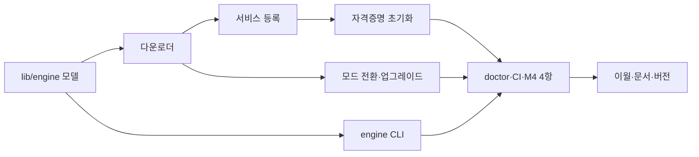

# flint v1.31.0 — 네이티브 엔진 모드

상태: active
**Spec path:** docs/plans/2026-11-23-flint-v1310.spec.md
**Detail:** tests · **Target-min:** 11
**Global constraints:** TDD·개인 데이터 금지·스키마 변경 없음·주석 0·v1.29.0 격리 준수·R123 이월 2건 편입.

```mermaid
%% schedule
gantt
  title Predicted schedule (mm:ss)
  dateFormat X
  axisFormat %M:%S
  section lane 1
  T1 lib/engine 모델 :t1, 0, 102s
  T2 다운로더 :t2, 102, 102s
  T3 서비스 등록 :t3, 204, 102s
  T4 자격증명 초기화 :t4, 307, 102s
  T7 doctor·CI·M4 4항 :t7, 409, 102s
  T8 이월·문서·버전 :t8, 511, 102s
  section lane 2
  T5 engine CLI :t5, 102, 102s
  T6 모드 전환·업그레이드 :t6, 204, 102s
```

critical path: T1 → T2 → T3 → T4 → T7 → T8 (10.2 min) · peak width 2 · predicted build 10.2 min · predicted total ≈ 13.7 min

critical path: T1 → T2 → T3 → T4 → T7 → T8 · peak width 2 · predicted total ≈ 18 min

### T1 lib/engine 모델 · Complexity 4 · Est. context 26k
**Owns:** lib/engine/engine.go(신규), lib/engine/engine_test.go(신규)
**계약:** Mode 관리(관례: config engine.mode·기존 설치 DSN 호스트 추론 기록)·Mode와 DSN 불일치 doctor warn 신호·인터페이스 Status/Start/Stop/Version(모드×명령 동작 — managed-container: 내장 compose·native: 서비스·external: 안내만·미정의 조합 거부).
**Produces:** CurrentMode() string · SetMode(mode string) error
**Test:** 모드 추론·전환 기록·불일치 신호·모드×명령 표.

### T2 다운로더 · Complexity 5 · Est. context 32k
**Owns:** lib/engine/download.go(신규), lib/engine/download_test.go(신규), lib/engine/pins.go(신규)
**계약:** 핀 버전·플랙폼별 해시 상수(신뢰 뿌리 flint 릴리스 서명·4방 동치 가드에 네이티브 핀 추가)·스트리밍 다운로드(크기 상한)·중첩 tarball에서 bin/doltgres 선택→해시 검증→-version 검증→원자 교체(FLINT_HOME/engine/<version>/·current 심링크·구버전 보존).
**Produces:** Download(ctx, ver string) (dir string, err error)
**e.g.** 해시 불일치 → error·성공 → current 심링크 교체
**Test:** httptest 스냅샷(중첩·불일치·크기 초과·-version 불일치 각 거부)·핀 동치.

### T3 서비스 등록 · Complexity 4 · Est. context 28k
**Owns:** lib/engine/service.go(신규), lib/engine/service_test.go(신규)
**계약:** macOS launchd(plist 0600·비밀 미포함)·Linux systemd user(unit 동일) 생성·bootout/enable+start·status {registered, running, version} 분리·서비스 관리자 부재 doctor fail+안내·teardown 연계.
**Produces:** Register(mode) error · Status() (ServiceStatus, error)
**Test:** 플랫폼 파일 생성·해제·3상태·부재 안내(seam).

### T4 자격증명 초기화 · Complexity 3 · Est. context 22k
**Owns:** lib/engine/bootstrap.go(신규), lib/engine/bootstrap_test.go(신규)
**계약:** 첫 기동 — 슈퍼유저 접속(postgres/password)→대상 사용자 ALTER ROLE→ADR-0010 기본 DSN 재접속 확인→mode 기록·실패 시 미기록·정지.
**Test:** 순서 왕복(가짜 pool)·실패 시 mode 미기록.

### T5 engine CLI · Complexity 3 · Est. context 22k
**Owns:** lib/cli/engine.go(신규), lib/cli/engine_test.go(신규), lib/cli/setup.go(--engine), lib/wire/registry.go, lib/wire/run.go
**계약:** `flint engine status|start|stop`(모드×명령)·`setup --engine <mode>` 멱등·커맨드 표·usage·i18n(ko/en).
**Consumes:** CurrentMode·SetMode·Status·Register (T1·T3)
**Test:** 위임·거부+안내·등록 관례.

### T6 모드 전환·업그레이드 · Complexity 4 · Est. context 26k
**Owns:** lib/engine/transition.go(신규), lib/engine/transition_test.go(신규)
**계약:** container→native(정지→데이터 디렉터리 복사→0700→기동→동치 확인→실패 시 원복)·업그레이드 왕복(구핀→신피→롤백·RUNBOOK 절차 코드화 아님 — 함수·e2e).
**Test:** 전환 왕복(가짜 복사 seam)·롤백.

### T7 doctor·CI·M4 4항 · Complexity 4 · Est. context 28k
**Owns:** lib/ops/doctor.go, lib/ops/doctor_test.go, .github/workflows/ci.yml, tests/e2e/engine_switch_v1310_test.go(신규)
**계약:** doctor engine 검사(등록·실행·버전·핀 정합)·네이티브 RSS seam·CI — Linux slow+e2e 네이티브 DSN(기준①)·systemctl --user 등록 경유(② Linux)·macOS 실다운로드→launchd 등록(② macOS)·전환 e2e(③)·업그레이드 왕복(④).
**Test:** doctor 단위·e2e 4항·훅 exit 2 유지.

### T8 이월·문서·버전 · Complexity 3 · Est. context 24k
**Owns:** lib/wire/args.go, lib/wire/run.go, lib/knowledge/*.go(로컬 파서 11곳), README.md, README.ko.md, docs/QUICKSTART.md, docs/RUNBOOK.md, docs/contracts/cli.md, docs/adr/0021-*.md(신규), VERSION, flint-plugin/.claude-plugin/plugin.json, docs/HISTORY.md, internal/doclint/versions_test.go, docs/plans/2026-11-21-flint-release-scope.md, docs/plans/README.md
**계약:** R123 이월 — wire.MaskToken 수출·로컬 파서 11곳 적용·README 본문 2문장 정정. 문서 — ADR-0021·RUNBOOK §11 모드 공통 재작성·QUICKSTART·cli.md·PERF 벤치 노트. 버전 v1.31.0 동기 6곳·계약행·하이라이트·스코프 §5·색인.
**Test:** doclint·docs-sync·release-gate OK v1.31.0.

**Review Focus:** protocol(다운로더 검증 순서·자격증명 초기화)·state(mode 기록·전환 원복)·file(0600·심링크)·security(비밀 미노출·루프백). 위험: 서비스 등록 플랫폼 편차·CI 매트릭스 비용·전환 복사 무결성.

**Probe entry:** run=go run ./cmd/flint engine status · run=go run ./cmd/flint setup --engine native · run=go run ./cmd/flint doctor --check engine

**Ruling:** G3 — T1 선행·T5 병행 가능·CI 매트릭스는 T7에서 신규 job.
