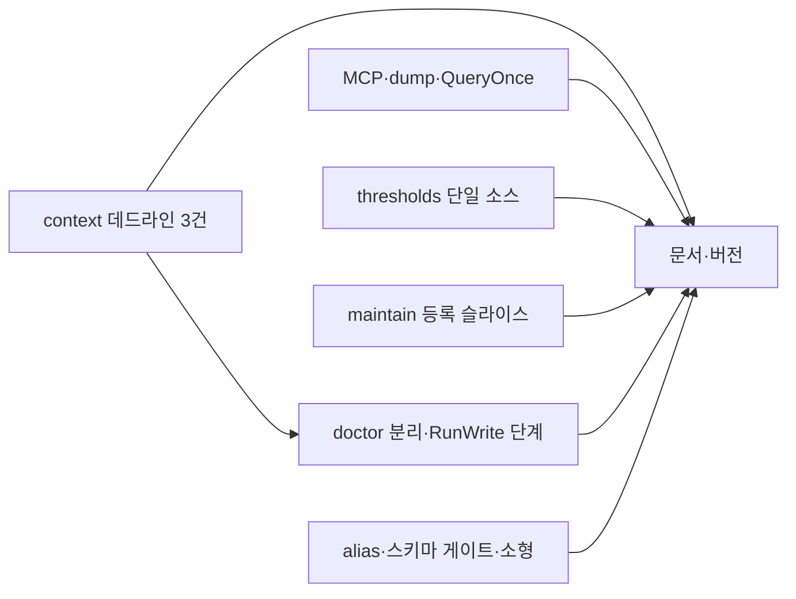

# flint v1.32.0 — 구조 청산

상태: active
**Spec path:** docs/plans/2026-11-24-flint-v1320.spec.md
**Detail:** tests · **Target-min:** 8
**Global constraints:** TDD·개인 데이터 금지·스키마 변경 없음·주석 0·신기능 0(동작 변경은 M1 계약 고정만).

```mermaid
%% schedule
gantt
  title Predicted schedule (mm:ss)
  dateFormat X
  axisFormat %M:%S
  section lane 1
  T1 context 데드라인 3건 :t1, 0, 102s
  T5 doctor 분리·RunWrite 단계 :t5, 102, 102s
  T7 문서·버전 v1.32.0 :t7, 204, 102s
  section lane 2
  T2 MCP·dump·QueryOnce :t2, 0, 102s
  section lane 3
  T3 thresholds 단일 소스 :t3, 0, 102s
  section lane 4
  T4 maintain 등록 슬라이스 :t4, 0, 102s
  section lane 5
  T6 alias·스키마 게이트·소형 :t6, 0, 102s
```

critical path: T1 → T5 → T7 (5.1 min) · peak width 5 · predicted build 5.1 min · predicted total ≈ 8.6 min

critical path: T1 → T5 → T7 · peak width 3 · predicted total ≈ 14 min

### T1 context 데드라인 3건 · Complexity 3 · Est. context 22k
**Owns:** lib/wire/run.go, lib/wire/run_test.go, lib/engine/service.go, lib/engine/service_test.go, lib/ops/doctor.go, lib/ops/doctor_test.go
**계약:** ①Run 명령 ctx에 상한(기본 300s·FLINT_COMMAND_TIMEOUT env 오버라이드·hooks 세션 경로는 무제한 유지 — RunSessionStart/RunSessionEnd 계열은 기존 ctx 유지) ②runManagerOutput → ctx 전파+exec.CommandContext(5s·seam에 ctx 추가) ③RestartCountFn → CommandContext(2s·같은 파일 관례 정렬).
**Test(TDD):** 타임아웃 만료 회귀(가짜 명령 지연→상한 도달)·hooks 무제한 유지·runManagerOutput ctx 전파·RestartCountFn 타임아웃.

### T2 MCP·dump·QueryOnce · Complexity 3 · Est. context 24k
**Owns:** lib/mcp/server.go, lib/mcp/server_test.go, lib/knowledge/done.go, lib/knowledge/done_test.go, lib/wire/store.go, lib/wire/store_test.go
**계약:** ①MCP Serve ErrTooLong 재귀 → for 루프+초과 행 스킵(잔여 바이트 프레이밍 수정) ②lazyDumpFile 초기화 실패 원인 필드 저장·Write/close 근원 포함 에러 ③QueryOnce 영구 오류(ctx 취소) 즉시 반환 — 이름·호출부 117곳 무변경.
**Test:** 초과 행 2개+정상행 프레이밍·근원 에러 문자열·취소 즉시(재시도 0회)·일시 오류는 기존 재시도 유지.

### T3 thresholds 단일 소스 · Complexity 4 · Est. context 28k
**Owns:** lib/store/thresholds.go, lib/store/thresholds_test.go, lib/wire/thresholds.go, lib/wire/threshold_meta.go, lib/wire/threshold_meta_test.go
**계약:** thresholdMetas{Field,Key,Default,Type} 단일 소스 → reflect로 DefaultThresholds 생성·ParseThresholds switch 생성·const 블록 삭제·wire/thresholds.go ApplyThresholdsFallback 하드코딩 리스트도 metas 기반 생성. 편집 지점 5곳→1곳. parity 테스트 유지.
**Test:** 기존 parity·동질 테스트 전수 green(무변경 증명)·신규 키 추가 시 1곳 편집으로 전파 단정.

### T4 maintain 등록 슬라이스 · Complexity 4 · Est. context 30k
**Owns:** lib/ops/maintain.go, lib/ops/maintain_*.go(모드별 신규·dup/conflict/stale/invalidate/expire/supersede/decay/merge/recall/age/reaffirm/recheck/gc/purge/meta-audit), lib/ops/maintain_test.go
**계약:** `type maintainMode{name, flags, run}` 등록 슬라이스(CheckSpec 패턴)·플래그 맵·디스패치·meta 키 목록 일원화·모드별 파일 분리(2,190줄 → 등록+모드 파일들). 핸들러 로직은 바이트 동일 이동.
**Test:** 기존 maintain 테스트 전수 green·모드 표 테스트(등록 수·플래그 일치).

### T5 doctor 분리·RunWrite 단계 · Complexity 4 · Est. context 30k
**Owns:** lib/ops/doctor.go, lib/ops/doctor_check_*.go(신규), lib/ops/doctor_test.go, lib/knowledge/write.go, lib/knowledge/write_test.go
**계약:** doctor 체크를 check_*.go로 분리(등록 테이블 doctor.go 유지·ApplyHookFix는 hookfix.go) — **T1③ 완료 후 착수(동일 파일 순차)**. RunWrite를 parse→validate→dedupe→persist→render 단계 함수로(기존 헬퍼 재사용·orchestration만 잔류).
**Consumes:** T1 ③(RestartCountFn — 같은 파일 선행)
**Test:** doctor 24종 등록 동질·RunWrite 기존 테스트 전수 green.

### T6 alias·스키마 게이트·소형 · Complexity 3 · Est. context 26k
**Owns:** lib/cli/cliwire_alias.go, lib/cli/*_test.go(printErr 치환 대상), lib/db/schema_gate.go(신규), lib/db/schema_gate_test.go(신규), lib/ops/metrics.go, lib/knowledge/echo.go, lib/knowledge/hot.go, lib/engine/download.go, lib/engine/download_test.go, docs/contracts/*.md, docs/adr/
**계약:** ①cliwire_alias errLine/wire.ErrLine 단일 경로 수렴 + printErr 헬퍼 통합(51곳) ②스키마 게이트 1단계: db/schema_gate.go에 대표 쿼리 3종(meta 조회·knowledge 카운트·read_events)+TestSchemaSealedOutsideDB(방언 게이트 패턴) — 산재 3쿼리 호출부 이전 ③seam 규칙 docs 기록 ④소형: download fetchTarball 방어적 완결성·CellToInt db 내부 복제(render 의존 제거)·doctor SetNativeService wiring cli 부팅 이동·ADR 0019 결번 채움·mcp→cli 재진입 계약 기록.
**Test:** 스키마 게이트 위반 주입 FAIL·printErr 치환 후 출력 바이트 동일·fetchTarball 실패 dst 정리·seam 규칙 doclint.

### T7 문서·버전 v1.32.0 · Complexity 2 · Est. context 18k
**Owns:** VERSION, README.md, README.ko.md, flint-plugin/.claude-plugin/plugin.json, docs/HISTORY.md, internal/doclint/versions_test.go, docs/plans/2026-11-21-flint-release-scope.md, docs/plans/README.md
**계약:** v1.32.0 동기 5곳·계약행 TestVersion01320Milestone{v1.32.0, structure-cleanup}·하이라이트 엔트리(context 데드라인·MCP 프레이밍·thresholds 단일 소스·god file 분리·스키마 게이트)·스코프 §5 v1.32.0 행 추가(structure-cleanup)·plans 색인.
**Test:** doclint·docs-sync·release-gate OK v1.32.0.

**Review Focus:** protocol(QueryOnce 재시도 조건·타임아웃 상한)·state(thresholds reflect 생성 무변경)·file(maintain/doctor 이동 누락). 위험: reflect 생성 오탐·maintain 이동 중 플래그 회귀·doctor 파일 분리 충돌(T1③ 선행으로 방지).

**Probe entry:** run=FLINT_COMMAND_TIMEOUT=1s go run ./cmd/flint doctor --check versions · run=go test ./lib/wire/ -run QueryOnce · run=go test ./lib/ops/ -run Maintain

**Ruling:** G3 — T1·T2·T3·T4 병행 착수·T5는 T1 완료 후·T6는 독립·T7 마지막. superlite 디스패치.
