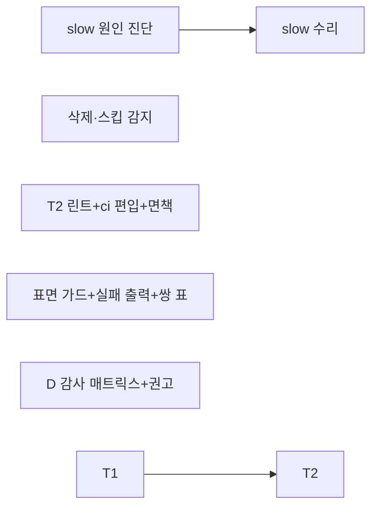

# flint v1.35.0 빌드 플랜 — AX 점검+작업 시스템 (2026-11-25)

상태: active
비고: G2 APPROVED(2026-11-25)·G3 빌드 진행
원천: 2026-11-25-flint-v1.35.0.spec.md(역링크)·release-scope2 §2 v1.35.0 행

**Goal**: slow 격리 원인 진단·수리(CI 3회 차단 종결)·영역 C 결정론 검사 5종(증명+등록표)·영역 D 전수 감사 산출(매트릭스·호환 문서·교정 입구 권고).
**Architecture**: 진단 태스크가 원인 확정을 먼저 산출하고 수리가 소비한다. 검사는 doclint 게이트 계열+scripts 파이썬 검사로 배치 — 단일 소스 등록표(쌍 표)+동질 가드.
**Spec**: docs/plans/2026-11-25-flint-v1.35.0.spec.md (G2 APPROVED)
**Detail**: tests · **Target-min:** 18
**Global constraints**: 스키마 v19 유지·주석 0(v1.26.3)·개인 데이터 금지(합성만)·제품 코드 LLM 유입 금지(T2)·검사 실패 출력은 exit 3 관례 구조·fast test: `go test ./lib/... ./internal/... -count=1 -p 1`.

Spec sections map: 0. 리서치 요약 (내부 조사) — T1 진단·T3~T5 접점 전제 / 1. 마일스톤 — T1~T6 전체 / M1 slow 격리 경화 (승계 항목 — 최우선·진단 선행) — T1 진단·T2 수리 / M2 영역 C 신설 검사 (결정론 5종) — T3·T4·T5 / M3 검사 실패 증명+등록표 (영역 C §3 장치) — T3·T4 증명 절차 / M4 영역 D 전수 감사 실행 (감사 산출 — 도구 아님) — T6 / 3. 비목표 — T6 감사 산출 제한·T4 errcheck 제외 승계.

```mermaid
%% schedule
gantt
  title Predicted schedule (mm:ss)
  dateFormat X
  axisFormat %M:%S
  section lane 1
  T4 T2 린트+ci 편입+면책 :t4, 0, 151s
  section lane 2
  T3 삭제·스킵 감지 검사 :t3, 0, 127s
  section lane 3
  T5 표면 가드+구조화 출력 :t5, 0, 127s
  section lane 4
  T6 D 감사 실행·산출 :t6, 0, 127s
  section lane 5
  T1 slow 원인 진단 :t1, 0, 102s
  T2 slow 수리 :t2, 102, 151s
```

critical path: T1 → T2 (4.2 min) · peak width 5 · predicted build 4.2 min · predicted total ≈ 7.7 min

## File structure

- `.superlite/diagnosis-slow.md` — M1 진단 보고(원인·증거·메커니즘 결정)→ lib/db·backup·regression 수리(원인별)
- `internal/doclint/test_delete_skip_test.go` — 테스트 삭제·스킵 감지 게이트
- `scripts/check_llm_imports.py` — T2 보호 린트(외부 LLM SDK import 화이트리스트)
- `Makefile` — ci에 vet·lint 편입·신규 검사 호출 행
- `internal/doclint/surface_contract_test.go` — 표면 계약 가드 확장(플래그·exit 표)
- `internal/doclint/structured_fail_test.go` — 구조화 실패 출력 계약 게이트
- `internal/doclint/pair_registry_test.go` — 규칙↔집행 쌍 표·불변 규칙 ID 가드
- `docs/plans/2026-11-25-ax-matrix.md` — D 감사 보고(5축×접점 매트릭스·호환 매트릭스·교정 입구 권고)
- `docs/METRICS.md`·`docs/PLAN.md` — 계약 행(docs-sync)

## Review Focus

- **app type**: file I/O·generator (검사 게이트) · audit runner (D).
- **categories**: protocol(exit·게이트), file(스캔·문서), encoding(주석·출력 살균), state(베이스라인·등록표).
- **specific risks**: 게이트 오탐으로 CI 상시 red·증명 없는 검사 도입(원칙 위반)·감사 매트릭스 빈칸·쌍 표 드리프트.
- **Probe entry:** `run=make ci`

### T1 slow 원인 진단 · Complexity 5 · Est. context 30k
**Spec:** M1 slow 격리 경화 — 진단 선행
**Owns:** .superlite/diagnosis-slow.md, .superlite/diagnosis-slow-test.cmd
**Components:** 1 · **LOC owned:** 40 · **Tests:** slow · **Model:** sonnet
**Est. time:** 4 min
**Produces:** 진단 보고 — 소진 원인 확정(3회 CI 실패 로그 시그니처 분석+docker-compose.test.yml 엔진 조건+newTestRepo pool 라이프사이클)·재현 절차·메커니즘 결정(Ruling 형식)
  e.g. 원인: "5-goroutine 버스트 × max_connections=N 초과" → 재현: docker compose 엔진+동일 시퀀스 스크립트
**Review Focus:** `TestDiagnosisReproducible`: 재현 절차가 CI 조건(엔진+매트릭스)에서 실패를 재현. `TestDiagnosisNoGuess`: 원인 문장마다 로그 라인·구성 근거 인용.
**Steps:** 1 실패 로그 수집(gh run view 3건), 2 엔진 조건 분석(docker-compose.test.yml·newTestRepo), 3 재현 스크립트 실행·시그니처 대조, 4 진단 보고+메커니즘 결정 기록
**Notes:** 제품 계약 goroutine(병렬 INSERT 멱등)은 유지 — 수리 후보에서 제외. 진단 결정은 T2 수리의 Consumes.

### T2 slow 수리 · Complexity 5 · Est. context 32k
**Spec:** M1 slow 격리 경화 — 수리
**Owns:** lib/db/admin_v1201_test.go, tests/regression/slowlock_test.go, lib/backup/drill_test.go
**Components:** 3 · **LOC owned:** 80 · **Tests:** slow · **Model:** sonnet
**Est. time:** 4 min
**Consumes:** T1 진단 보고(원인·메커니즘 결정) — 코디네이터 태스크 메시지가 결정 내용 전달
**Produces:** 원인별 수리(예: 테스트 내 goroutine 배리어에 연결 상한·pool 재사용·slow 스위트 순차 실행) — 제품 병렬 INSERT 멱등 계약 유지
  e.g. 수리 후 3패키지 full 테스트 CI 조건 재현 3회 green
**Review Focus:** `TestSlowSuiteSerialGreen`: CI 조건 재현 3회 green. `TestIdempotencyContractKept`: 병렬 INSERT 멱등 계약 테스트가 여전히 5-goroutine 재현(커버리지 불변).
**Steps:** 1 진단 결정 확인, 2 수리 구현(원인별), 3 CI 조건 재현 3회 green, 4 기존 계약 테스트 무손상 확인
**Notes:** 수리 범위는 진단 결정에 종속 — 결정 변경 시 코디네이터 Ruling. 검증은 실제 CI 조건(docker compose 엔진)에서.

### T3 삭제·스킵 감지 검사 · Complexity 4 · Est. context 26k
**Spec:** M2 검사 1·M3 증명+등록표
**Owns:** internal/doclint/test_delete_skip_test.go, internal/doclint/pair_registry_test.go
**Components:** 2 · **LOC owned:** 130 · **Tests:** fast · **Model:** sonnet
**Est. time:** 3 min
**Produces:** `TestNoTestDeletion`·`TestNoSkipIncrease`(doclint — git 베이스라인 대조·테스트 파일 삭제·t.Skip 수 증가·-run 필터 커밋 감지) + 쌍 표 가드 `TestRuleEnforcementPairs`(규칙↔집행 쌍 표 일치·불변 규칙 ID 존재)
  e.g. TestNoTestDeletion: 베이스라인 테스트 파일 목록 vs 현재 — 삭제 1건 → FAIL·수정처 표기
**Review Focus:** `TestNoTestDeletion`(red 증명: 실제 삭제 커밋 재현 — 수리 사고 재료)·`TestNoSkipIncrease`(Skip 수 증가 감지)·`TestRuleEnforcementPairs`(쌍 표 드리프트 감지).
**Steps:** 1 red 증명(과거 실수 커밋에서 FAIL 확인 — 기록 남김), 2 구현, 3 green+계약 테스트, 4 쌍 표 등록
**Notes:** red 증명 재료는 .superlite가 아닌 검사 출력 자체로 남긴다(재현 절차 문서화). 베이스라인은 등록표(단일 소스).

### T4 T2 린트+ci 편입+면책 · Complexity 4 · Est. context 26k
**Spec:** M2 검사 2·3·면책 동반
**Owns:** scripts/check_llm_imports.py, Makefile, internal/doclint/llm_import_gate_test.go
**Components:** 3 · **LOC owned:** 110 · **Tests:** fast · **Model:** sonnet
**Est. time:** 3 min
**Produces:** `check_llm_imports.py`(외부 LLM SDK import 경로 감지 — 화이트리스트 초기 0건·면책 행 관례: 이유·만료일 필수·면책 없는 위반 fail) + Makefile ci에 `go vet`·`make lint` 편입 행 + doclint 게이트 `TestLLMImportGate`(화이트리스트·면책 형식 검증)
  e.g. check_llm_imports.py: `import openai` 감지 → fail+파일:행·수정처(5줄 요약 구조)
**Review Focus:** `TestLLMImportGate`(SDK import 감지·면책 행 형식·만료일 필수)·`TestCiRunsVetLint`(Makefile ci 타깃에 vet·lint 행 존재 — 문서 정합 게이트).
**Steps:** 1 red(SDK import 더미에서 fail 확인 후 제거), 2 구현+ci 편입, 3 green, 4 면책 행 관례 문서(docs/CI_REVIEW.md 해당 행)
**Notes:** errcheck은 재료 미확정 — 본 태스크 불포함(spec Ruling). 검사 실패 출력은 구조화 계약(파일:행·수정처·5줄) 준수.

### T5 표면 가드+구조화 출력 · Complexity 4 · Est. context 28k
**Spec:** M2 검사 4·5
**Owns:** internal/doclint/surface_contract_test.go, internal/doclint/structured_fail_test.go
**Components:** 2 · **LOC owned:** 120 · **Tests:** fast · **Model:** sonnet
**Est. time:** 3 min
**Produces:** `TestSurfaceContractDepth`(필수 플래그·exit 코드 표를 실제 동작 1단계로 검증 — 어댑터 계약 확장: 대표 커맨드의 필수 플래그 부재 시 exit 3·에러 키 확인) + `TestStructuredFailureOutput`(검사 실패 출력이 파일:행·수정처·5줄 요약 구조를 만족 — 신규 검사들의 출력 계약)
  e.g. TestSurfaceContractDepth: `flint read --json`에 필수 플래그 누락 시나리오 → exit 3+error 키·수정처 포함
**Review Focus:** `TestSurfaceContractDepth`(커맨드 표×실제 exit·플래그 정합)·`TestStructuredFailureOutput`(5종 신규 검사 출력 구조 통일).
**Steps:** 1 red(구조 미준수 출력 재현), 2 구현, 3 green, 4 기존 어댑터 계약 무손상 확인
**Notes:** 검사 대상은 대표 표면(커맨드 표 기준 샘플) — 전수는 감사(M4) 영역. exit 4종 계약 준수.

### T6 D 감사 실행·산출 · Complexity 5 · Est. context 34k
**Spec:** M4 영역 D 전수 감사 실행
**Owns:** docs/plans/2026-11-25-ax-matrix.md, docs/CI_REVIEW.md
**Components:** 2 · **LOC owned:** 160 · **Tests:** fast · **Model:** sonnet
**Est. time:** 4 min
**Produces:** AX 감사 보고(5축×접점 매트릭스 — CLI·MCP·훅·스킬 전수·빈칸 0) + 하니스 호환 매트릭스 문서 + 교정 입구 권고(A안/B안 비교 근거) + 발견 등록표 축적(유형·표면·수정처) — e.g. 매트릭스 행: "CLI read — 표면 접근성 pass·오류 계약 pass·..."
**Review Focus:** `TestMatrixComplete`(매트릭스 행 수=표면 전수·빈칸 0)·`TestCompatibilityDocSync`(호환 매트릭스 문서 docs-sync)·감사 각도별 합성 시나리오 증거 인용(실DB 0).
**Steps:** 1 접점 전수 목록화(커맨드 표·MCP 등록표·훅·스킬), 2 5축 감사 실행(실물 구동·exit 계약 확인·합성 시나리오), 3 매트릭스·호환 문서·권고 작성, 4 발견 등록표 축적(수정 배치 분리)
**Notes:** 감사 실행은 결정론 경계 밖(에이전트 감사 허용 룰링). 발견의 코드 수정은 본 태스크 불포함 — 등록표 축적 후 코디네이터가 패치 배치 판정. CI_REVIEW.md에는 면책 행 관례 문서(T4와 정합).

## Self-review

1. Coverage: 스펙 M1→T1·T2, M2→T3·T4·T5, M3→T3(쌍 표·증명), M4→T6 — 전 항 매핑.
2. Placeholders: 없음 — T2는 T1 결정에 종속(Consumes 명시).
3. Type consistency: T2 Consumes= T1 산출(문서 계약 — 태스크 메시지 전달).
4. Graph: T1→T2만 엣지·T3~T6 병렬(파일 비공유).
5. Fields: 전 태스크 기재.
6. Review Focus: 카테고리+Probe entry·red 증명 절차 명시.
7. Limits: 본문 ~10k chars·SIZE 밴드 내·lint·schedule 실행 대기.
