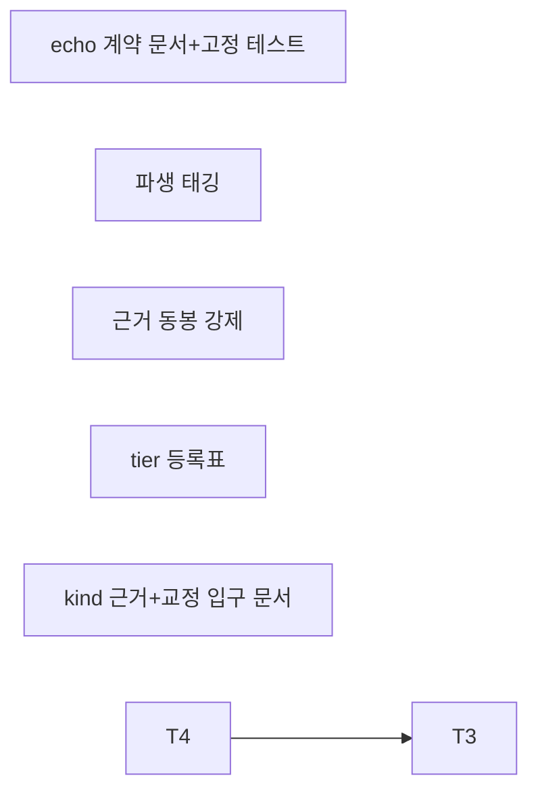

# flint v1.36.0 빌드 플랜 — 지식 체계 II·추출 (2026-11-25)

상태: active
비고: G2 APPROVED(2026-11-25)·G3 빌드 진행
원천: 2026-11-25-flint-v1.36.0.spec.md(역링크)·release-scope2 §2 v1.36.0 행

**Goal**: echo 위계 계약 문서화+고정 테스트·재도출 파생 태깅(원본 해시 일치)·규칙형 근거 동봉 강제(origin/source_path·status)·신뢰 tier 등록표(하향만)·kind 근거 문서 편입·교정 입구 B안 결정 기록.
**Architecture**: lib/knowledge write 게이트 확장(파생 태깅·근거 동봉·tier)+contracts 문서+doclint 게이트 — 스키마 불변.
**Spec**: docs/plans/2026-11-25-flint-v1.36.0.spec.md (G2 APPROVED)
**Detail**: tests · **Target-min:** 16
**Global constraints**: 스키마 v19 유지(스키마 변경 금지)·주석 0(v1.26.3)·개인 데이터 금지(합성 시드만)·동작 변경 금지(M1 — 코드 위계 그대로 문서화)·K2 하향만·검사 실패 출력은 exit 3·구조화 5줄 계약·fast test: `go test ./lib/... ./internal/... -count=1 -p 1`.

Spec sections map: 0. 리서치 요약 (내부 조사) — T1·T2 접점 전제 / 1. 마일스톤 — T1~T5 전체 / M1 echo 계약 명문화 — T1 / M2 재도출 파생 태깅 후 저장 (사용자 확정) — T2 / M3 규칙형 근거 동봉 강제 — T3·T2 게이트 / M4 신뢰 tier 등록표 — T4 / M5 kind 분리 근거 편입 — T5 / M6 교정 입구 결정 (영역 D 권고 편입) — T5 문서 / 2. Ruling — 전 태스크 적용 / 3. 비목표 — T5 문서·T4 게이트 한계 / 4. 검증 — 전 태스크.

```mermaid
%% schedule
gantt
  title Predicted schedule (mm:ss)
  dateFormat X
  axisFormat %M:%S
  section lane 1
  T1 echo 계약 문서+고정 테스트 :t1, 0, 127s
  T3 근거 동봉 강제 :t3, 127, 102s
  section lane 2
  T2 파생 태깅 :t2, 0, 127s
  section lane 3
  T4 tier 등록표 :t4, 0, 127s
  section lane 4
  T5 kind 근거+교정 입구 문서 :t5, 0, 127s
```

critical path: T4 → T3 (3.8 min) · peak width 4 · predicted build 3.8 min · predicted total ≈ 7.3 min

## File structure

- `contracts/echo.md` — echo 위계 계약 문서(실물 2분기+위임 어휘 병기)
- `internal/doclint/echo_contract_test.go` — 위계 고정 게이트(문서-코드 일치)
- `lib/knowledge/derivative.go` — 파생 태깅 판정(source_path 해시 일치·태그 경유)
- `lib/knowledge/derivative_test.go` — 3경계+NOOP 경계 테스트
- `lib/knowledge/write.go` — write 게이트 편입(파생 태깅·근거 동봉·tier)
- `lib/knowledge/evidence_gate_test.go` — 근거 동봉 강제 게이트
- `lib/store/thresholds.go` — source→tier 상한 등록표
- `lib/knowledge/tier_gate_test.go` — 하향만 게이트
- `docs/PLAN.md` — kind 분리 근거 편입(§3)+교정 입구 결정 기록
- `internal/doclint/plan_docsync_test.go` — 문서 게이트 행

## Review Focus

- **app type**: library (write gate) · file I/O (contracts 문서 게이트).
- **categories**: protocol(exit 3·구조화 출력), state(echo 위계 고정·tier 등록표), encoding(태그·필드 검증), numeric(해시 일치 판정).
- **specific risks**: 동작 변경(위계 문서화가 코드를 건드림)·파생 오분류(정상 지식 유실)·tier 상향 우회·payload 유실 키 재사용.
- **Probe entry:** `run=bin/flint write --demo-mode`

### T1 echo 계약 문서+고정 테스트 · Complexity 4 · Est. context 28k
**Spec:** M1 echo 계약 명문화
**Owns:** docs/contracts/echo.md, internal/doclint/echo_contract_test.go
**Components:** 2 · **LOC owned:** 120 · **Tests:** fast · **Model:** sonnet
**Est. time:** 3 min
**Produces:** contracts/echo.md(실물 흐름 문서화 — 배치 seen-dup→content_hash NOOP(emitDuplicate)→echo 어드바이저리(duplicates/contradicts 보고)→Classify→추가·NOOP>삭제>갱신>추가는 위임 어휘 병기: 삭제=maintain/invalidate·갱신=approve/pending) + `TestEchoContractFrozen`(문서 서술 vs 실물 write.go 흐름 일치 — 위계 변경 시 red)
  e.g. TestEchoContractFrozen: write.go의 emitDuplicate·EchoScan·Classify 호출 순서 스캔이 계약 문서 순서와 일치
**Review Focus:** `TestEchoContractFrozen`(드리프트 red)·경계 케이스 표 완비(threshold·topic·reason).
**Steps:** 1 문서 작성(실물 흐름 인용), 2 고정 테스트 작성(문서-코드 대조), 3 green, 4 기존 echo 테스트 무손상 확인
**Notes:** 동작 변경 금지 — 문서·테스트만. 케이스 표는 문서 내 표(주석 아님).

### T2 파생 태깅 · Complexity 5 · Est. context 32k
**Spec:** M2 재도출 파생 태깅 후 저장(사용자 확정)
**Owns:** lib/knowledge/derivative.go, lib/knowledge/derivative_test.go, lib/knowledge/write.go
**Components:** 2 · **LOC owned:** 150 · **Tests:** fast · **Model:** sonnet
**Est. time:** 4 min
**Produces:** `IsDerivativeOfSource(ctx context.Context, st wire.Store, topic, summary, sourcePath string) -> (bool, error)`(source_path 해시 일치 판정 — vault_files 근거·기존 content_hash 1회 조회+echo 스캔 한도 내) + write 편입: 파생 판정 시 파생 태그(`derivative:source`) 추가 후 저장 — origin 값 불변
  e.g. IsDerivativeOfSource(ctx, store, "t", "s", "notes/x.md") -> true(원본 해시 일치) — write 시 태그 derivative:source 추가
**Review Focus:** `TestDerivativeThreeBounds`(원본 일치→태깅 저장·불일치→일반 저장·원본 없음→일반 저장 — 오분류 방지)·`TestDerivativeNoopBoundary`(content_hash 정확 중복은 NOOP 우선 — 파생 판정 이전)·`TestDerivativeCost`(신규 전수 스캔 없음 — echo 스캔 한도 내 재사용).
**Steps:** 1 failing 3-bounds test, 2 run: FAIL, 3 implement 판정+write 편입, 4 run: PASS
**Notes:** payload 키 유실 금지 — 태그는 tags 배열 경유. origin 불변. K2 준수(confidence 불변).

### T3 근거 동봉 강제 · Complexity 4 · Est. context 28k
**Spec:** M3 규칙형 근거 동봉
**Owns:** lib/knowledge/evidence_gate_test.go
**Components:** 1 · **LOC owned:** 110 · **Tests:** fast · **Model:** sonnet
**Est. time:** 3 min
**Consumes:** T2의 write 편입 지점(같은 파일 — T2 커밋 후 실행)
**Produces:** 근거 동봉 게이트 테스트 — 규칙형(태그 prefix·문형 결정론 조합·등록표 경유)은 origin(또는 source_path)·status 필드 필수·미동봉 시 exit 3+구조화 5줄 출력·사실형 면제
  e.g. 규칙형 지식(origin 없음) → exit 3+파일:행·수정처·5줄 요약
**Review Focus:** `TestEvidenceGateRequired`(규칙형 필수·미동봉 fail)·`TestEvidenceGateFactExempt`(사실형 면제)·`TestEvidenceGateStructuredOutput`(5줄 계약).
**Steps:** 1 red(규칙형 미동봉 재현), 2 게이트 구현(write.go 편입 — T2 이후), 3 green, 4 사실형 회귀 무손상
**Notes:** 판정 조합은 등록표 경유(단일 소스)·payload 유실 키(source) 재사용 금지.

### T4 tier 등록표 · Complexity 4 · Est. context 28k
**Spec:** M4 신뢰 tier 등록표
**Owns:** lib/store/thresholds.go, lib/knowledge/tier_gate_test.go
**Components:** 2 · **LOC owned:** 120 · **Tests:** fast · **Model:** sonnet
**Est. time:** 3 min
**Produces:** source 채널별 tier 상한 등록표(thresholds 관례 — meta 오버라이드·초기값: manual 높음·hook 중간·import 낮음) + 하향만 게이트 — confidence 상향 시도 시 exit 3(구조화 출력)·하향 허용
  e.g. tier 상한 0.8인 채널에 confidence 0.9 write → exit 3+tier 위반 표기
**Review Focus:** `TestTierCapEnforced`(상향 차단·하향 허용)·`TestTierMetaOverride`(meta 오버라이드 적용)·`TestTierRegistryGuard`(등록표 동질 가드 — frozenThresholdKeys 계열 패턴).
**Steps:** 1 red(상향 재현), 2 등록표+게이트 구현, 3 green, 4 기존 write 테스트 무손상
**Notes:** 등록표는 thresholds 단일 소스+동질 가드 대상. K2 무검증 자동 승격 금지 구현.

### T5 kind 근거+교정 입구 문서 · Complexity 3 · Est. context 22k
**Spec:** M5 kind 분리 근거 편입·M6 교정 입구 결정
**Owns:** docs/PLAN.md, internal/doclint/plan_docsync_test.go
**Components:** 2 · **LOC owned:** 80 · **Tests:** fast · **Model:** sonnet
**Est. time:** 2 min
**Produces:** docs/PLAN.md §3에 kind 분리 근거 편입(에피소드/의미/절차 유형별 그래뉼러리티 학술 근거 — 문서 전용) + 교정 입구 결정 기록(B안 기본+A안 한정 병행 — D 권고 승계·v1.34.0 전달 계열 연결 명시) + docsync 게이트 행 `TestPlanEvidenceKindRow`
  e.g. TestPlanEvidenceKindRow: PLAN §3에 kind 근거 행·교정 입구 결정 행 존재
**Review Focus:** `TestPlanEvidenceKindRow`(docs-sync)·기존 PLAN 150행 계약 유지.
**Steps:** 1 red(행 부재), 2 문서 편입, 3 green
**Notes:** 동작 변경 없음·실측 수치 인용 금지·주석 0.

## Self-review

1. Coverage: 스펙 M1→T1, M2→T2, M3→T3, M4→T4, M5+M6→T5 — 전 항 매핑.
2. Placeholders: 없음 — Ruling은 스펙 §2 확정값.
3. Type consistency: T3은 T2 커밋 후 실행(같은 파일 — 순서 명시).
4. Graph: T4→T3 엣지 아님·T2와 T3 같은 파일 — T3는 T2 커밋 후 파견(순서 보장).
5. Fields: 전 태스크 기재.
6. Review Focus: Probe entry+red 절차 명시.
7. Limits: 본문 ~9k chars·SIZE 밴드 내·lint·schedule 실행 대기.
