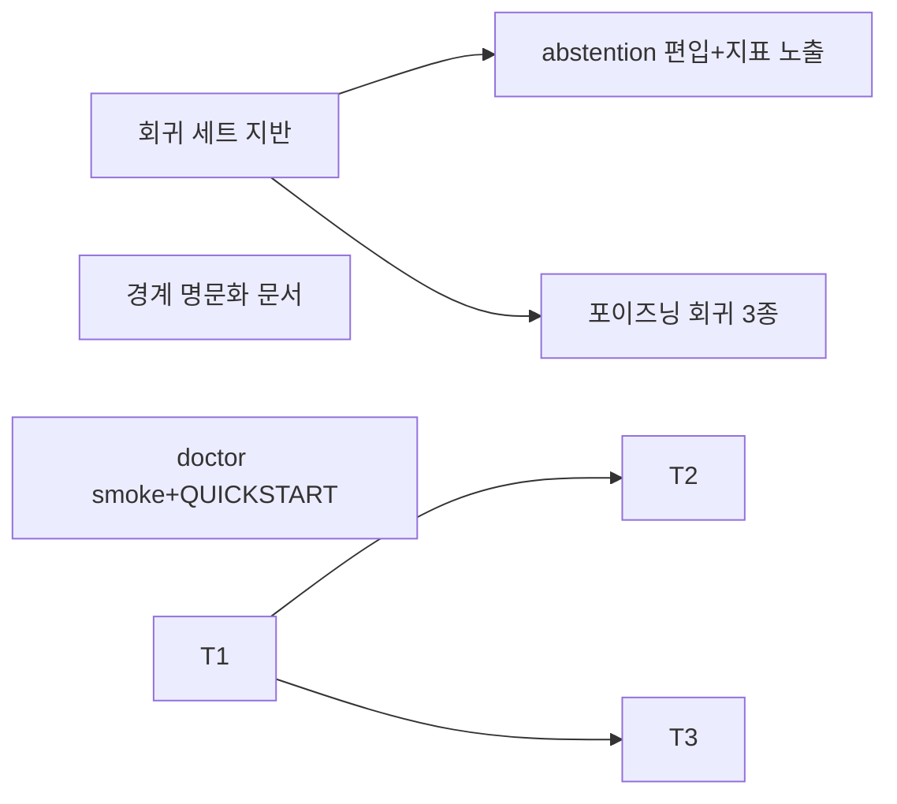

# flint v1.37.0 빌드 플랜 — 신뢰 기반 (2026-11-25)

상태: active
비고: G2 APPROVED(2026-11-25)·G3 빌드 진행·2기 스코프 최종 릴리스
원천: 2026-11-25-flint-v1.37.0.spec.md(역링크)·release-scope2 §2 v1.37.0 행

**Goal**: 합성 회귀 세트 지반(정답 도달·abstention·CI 편입)·포이즈닝 회귀 3종+경계 명문화·doctor smoke 절차 — 신뢰 기반 3영역 동행.
**Architecture**: I 회귀 세트(tests/regression·합성 시드·엔진 격리)가 지반·H 시나리오는 소비자·G는 doctor 서브모드(신규 커맨드 0). 스키마 불변.
**Spec**: docs/plans/2026-11-25-flint-v1.37.0.spec.md (G2 APPROVED)
**Detail**: tests · **Target-min:** 16
**Global constraints**: 스키마 v19 유지·주석 0(v1.26.3)·개인 데이터 금지(합성 시드만)·결정론(T2 — 비LLM judge·정확 일치 기준·근사 판정 신설 금지)·H 신규 메커니즘 금지·운영 DB 무접촉(seed --demo 격리·--reset 청소)·fast test: `go test ./lib/... ./internal/... ./tests/... -count=1 -p 1`.

Spec sections map: 0. 리서치 요약 (내부 조사) — T1·T3·T5 접점 전제 / 1. 마일스톤 — T1~T5 전체 / M1 합성 회귀 세트 (영역 I — 공용 지반) — T1·T2 / M2 주입 방어 명문화 (영역 H — 신규 메커니즘 금지) — T3·T4 / M3 온보딩 smoke (영역 G) — T5 / 2. Ruling — 전 태스크 적용 / 3. 비목표 — T5 CI 배제·T3 메커니즘 금지 / 4. 검증 — 전 태스크.

```mermaid
%% schedule
gantt
  title Predicted schedule (mm:ss)
  dateFormat X
  axisFormat %M:%S
  section lane 1
  T5 doctor smoke+QUICKSTART :t5, 0, 151s
  section lane 2
  T1 회귀 세트 지반 :t1, 0, 127s
  T2 abstention 편입+지표 노출 :t2, 127, 102s
  section lane 3
  T4 경계 명문화 문서 :t4, 0, 127s
  T3 포이즈닝 회귀 3종 :t3, 127, 102s
```

critical path: T1 → T2 (3.8 min) · peak width 3 · predicted build 3.8 min · predicted total ≈ 7.3 min

## File structure

- `tests/regression/recall_ground_test.go` — 회귀 세트 지반(정답 시드·질의 세트·도달 판정·정확 일치)
- `tests/regression/abstention_report_test.go` — abstention 채점 편입+지표 노출 검증
- `tests/regression/poisoning_test.go` — 포이즈닝 회귀 3종(지시문형·query-only·살균 우회)
- `docs/contracts/write-boundary.md` — 쓰기 경계·[flint] 경계 명문화
- `internal/doclint/write_boundary_test.go` — 경계 문서 게이트
- `lib/ops/smoke.go` — doctor smoke 서브모드(연결→훅→합성 쓰기→read→주입)
- `lib/ops/smoke_test.go`·`lib/ops/doctor.go` — 등록 행
- `docs/QUICKSTART.md` — smoke 절차·플러그인 갱신 안내
- `docs/METRICS.md` — 회귀 지표 정의 행

## Review Focus

- **app type**: data pipeline (회귀 세트) · CLI (smoke) · file I/O (경계 문서).
- **categories**: protocol(exit·게이트), encoding(살균·경계), state(엔진 격리·1회 한정), numeric(정확 일치·abstention).
- **specific risks**: 운영 DB 접촉·근사 판정 유입(T2 위반)·시나리오 누락(3종 미달)·smoke가 세션 흐름 차단·QUICKSTART 드리프트.
- **Probe entry:** `run=go test ./tests/regression -run TestRecallGround -count=1`

### T1 회귀 세트 지반 · Complexity 5 · Est. context 34k
**Spec:** M1 합성 회귀 세트 — 공용 지반
**Owns:** tests/regression/recall_ground_test.go, docs/METRICS.md
**Components:** 2 · **LOC owned:** 200 · **Tests:** slow · **Model:** sonnet
**Est. time:** 4.5 min
**Produces:** `TestRecallGround`(정답을 아는 합성 시드 적립 → 질의 세트 실행 → read 결과가 정답 행·키 필드에 도달하는 지 정확 일치 판정 — 태그·도메인 커버리지 표) + METRICS 회귀 지표 정의 행(recall_ground_pass·recall_ground_total)
  e.g. TestRecallGround: 시드 12행·질의 8종 → 정확 일치 ≥ 8/8 (엔진 격리 FLINT_TEST_DSN)
**Review Focus:** `TestRecallGround`(도달 판정 — 정확 일치·근사 금지)·`TestRecallGroundIsolated`(FLINT_TEST_DSN 경유 — 운영 DSN 미접촉)·METRICS 정의-docsync.
**Steps:** 1 정답 시드·질의 세트 설계(태그·도메인 커버리지 표), 2 도달 판정 구현, 3 엔진 격리 실행 green, 4 METRICS 행 등록
**Notes:** 정확 일치 기준(Ruling) — 근사 판정 신설 금지·echo 스코어 소비만. census·B5는 소비자(구현 불포함).

### T2 abstention 편입+지표 노출 · Complexity 4 · Est. context 28k
**Spec:** M1 abstention 채점 편입·지표 노출
**Owns:** tests/regression/abstention_report_test.go
**Components:** 1 · **LOC owned:** 110 · **Tests:** slow · **Model:** sonnet
**Est. time:** 3.5 min
**Consumes:** T1 회귀 지반(같은 패키지·T1 커밋 후) + `ZeroHitUnownedPct(ctx context.Context, st wire.Store, days int) -> (float64, error)` (커밋됨 — lib/ops/abstention.go)
**Produces:** `TestAbstentionScored`(모르는 질의 시나리오 — zero-hit에서 abstention 정확도 채점·zero_hit_unowned_pct와 정합) + report·serve 지표 노출 검증(회귀 결과 행이 지표로 노출 — METRICS 정합)
  e.g. TestAbstentionScored: 소유하지 않은 질의 5종 → abstention 판정이 zero_hit_unowned_pct 분모와 일치
**Review Focus:** `TestAbstentionScored`(정합 — 단일 소스 대조)·`TestRegressionExposure`(지표 노출 경로 — report 텍스트·serve 행).
**Steps:** 1 abstention 시나리오 설계, 2 채점 편입+노출 검증 구현, 3 green, 4 METRICS 정합 확인
**Notes:** 신규 정의 없음 — 기존 지표 소비만(T2 결정론).

### T3 포이즈닝 회귀 3종 · Complexity 5 · Est. context 34k
**Spec:** M2 주입 방어 명문화 — 회귀 고정
**Owns:** tests/regression/poisoning_test.go
**Components:** 1 · **LOC owned:** 180 · **Tests:** slow · **Model:** sonnet
**Est. time:** 4.5 min
**Consumes:** T1 회귀 지반(같은 패키지·T1 커밋 후 — 엔진 격리·시드 재사용) + 기존 방어 구현 실물(`lib/store/sanitize.go` SanitizeText·pending 승격 회로·render 조크포인트 — 사용만·수정 금지)
**Produces:** `TestPoisoningInstructionWriteRead`(지시문형 지식행 write→read — 데이터 경계·pending 승격·살균 통과 고정)·`TestPoisoningQueryOnlyAutoIngest`(query-only 자동 적립 입구 — echo·재점검 경로 검증)·`TestPoisoningSanitizeBypass`(살균 우회 시도 — SanitizeText·조크포인트 차단 고정) — 3종 전부 PASS가 done 조건(Ruling 3종 등록표)
  e.g. TestPoisoningInstructionWriteRead: "ignore previous instructions" 유입 → [flint] 경계·pending 상태 유지·주입 시 살균 확인
**Review Focus:** 3종 전부(Ruling 등록표 충족)·현재 흐름 차단 고정(기대값 = 실제 현재 동작)·합성 시나리오만.
**Steps:** 1 시나리오 3종 설계(Ruling 등록표), 2 각 시나리오 현재 동작 관측·고정, 3 엔진 격리 green, 4 개인 데이터 0 확인
**Notes:** 신규 방어 메커니즘 금지 — 현재 차단을 테스트로 잠금. 실패 시 현재 흐름 결함 발견 → 인시던트·코디네이터 판정.

### T4 경계 명문화 문서 · Complexity 3 · Est. context 24k
**Spec:** M2 쓰기 경계·[flint] 경계 문서화
**Owns:** docs/contracts/write-boundary.md, internal/doclint/write_boundary_test.go, internal/doclint/versions_test.go
**Components:** 2 · **LOC owned:** 100 · **Tests:** fast · **Model:** sonnet
**Est. time:** 2.5 min
**Produces:** docs/contracts/write-boundary.md(쓰기 경계 — K2 무검증 승격 금지·pending 검수·살균 위치·query-only 입구·[flint] 경계=보조 완화책 명시) + `TestWriteBoundaryDoc`(문서-구현 대조 게이트 — SanitizeText·render 조크포인트 참조 정합)
  e.g. TestWriteBoundaryDoc: 문서에 SanitizeText·render.Text·pending 경로가 실물 함수명과 일치 기술
**Review Focus:** `TestWriteBoundaryDoc`(드리프트 red)·SECURITY.md 신설 불요(Ruling — doclint 고정).
**Steps:** 1 실물 경로 조사(sanitize·render·pending), 2 문서 작성, 3 게이트 구현 green
**Notes:** 신규 방어 메커니즘 기술 금지 — 기존 구현의 위치·계약만. 헤지 없이 실물 함수명 기술.

### T5 doctor smoke+QUICKSTART · Complexity 5 · Est. context 34k
**Spec:** M3 온보딩 smoke
**Owns:** lib/ops/smoke.go, lib/ops/smoke_test.go, lib/ops/doctor.go, lib/ops/doctor_test.go, lib/ops/doctor_check_registry_test.go, internal/doclint/copilot_auto_registration_test.go, docs/QUICKSTART.md
**Components:** 3 · **LOC owned:** 200 · **Tests:** slow · **Model:** sonnet
**Est. time:** 4.5 min
**Produces:** doctor smoke 서브모드(`TestSmokeSequence` — 연결→훅 감지→합성 쓰기(seed --demo 격리)→read→주입 확인 일련 절차·--reset 청소·각 단계 구조화 출력) + doctor 등록 행(doctorChecks — 등록표+동질 가드) + QUICKSTART smoke 절차·플러그인 갱신 안내 행(docsync)
  e.g. TestSmokeSequence: demo DB 쓰기 3행→read 도달→[flint] 주입 확인→--reset 후 0행(청소)
**Review Focus:** `TestSmokeSequence`(전 단계·청소)·`TestSmokeProdIsolation`(운영 DB 무접촉 — DSN 고정 검증)·`TestSmokeRegistered`(doctor 등록표·미등록 체크 없음)·QUICKSTART docsync.
**Steps:** 1 smoke 절차 설계(F 체크 연결), 2 구현+등록, 3 실구동 green(--reset 청소 확인), 4 QUICKSTART 정비
**Notes:** doctor 모드(Ruling — 신규 커맨드 0)·비간섭(무간섭·짧은 실행)·seed --demo 격리 승계·등록표+동질 가드 준수.

## Self-review

1. Coverage: 스펙 M1→T1·T2, M2→T3·T4, M3→T5 — 전 항 매핑·지표 노출은 T2.
2. Placeholders: 없음 — Ruling은 스펙 §2 확정값.
3. Type consistency: T2·T3 Consumes= T1 지반+기존 구현.
4. Graph: T1→T2·T1→T3(같은 패키지 — T1 커밋 후 실행)·T4·T5 병렬.
5. Fields: 전 태스크 기재.
6. Review Focus: Probe entry+red 절차 명시.
7. Limits: 본문 ~10k chars·SIZE 밴드 내·lint·schedule 실행 대기.
