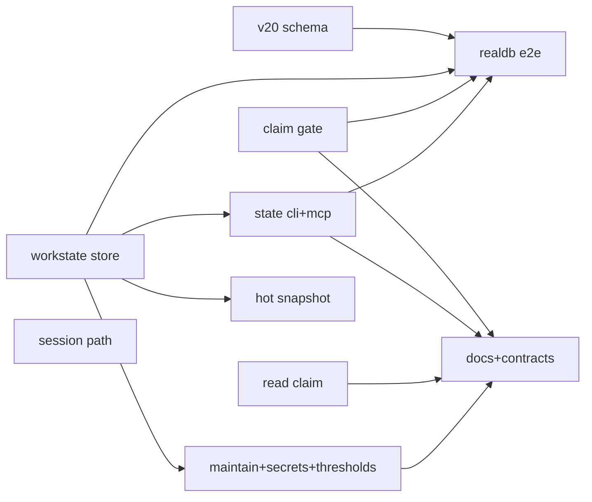

# v1.38.0 — 지식 성장 모델 1단계 플랜

상태: active

**Goal:** claim 축·work_state(진행 관리)·수집 3단(유한 보류→Δ≠0 승격 심사→사후 증명)·품질 검증자를 스키마 v20으로 출하한다.
**Review plan:** 없음 — AI 오케스트레이터(sl orchestrator status: AI, 2026-10-22 사용자 설정). 기획 리뷰 게이트는 독립 감사 2각도+빌더 체크로 통과(설계 문서 §9).
**Architecture:** Go 단일 바이너리·Doltgres(PG 호환)·접점 3종(CLI·MCP·hot 주입). 등록은 기존 패턴 준수: 커맨드 `wire.Register`·MCP `ToolsManifest`/`DispatchTool`·임계값 `thresholdMetas`·usage `usageOrder`.
**Tech stack:** Go 1.26·pgx v5·lib/db additive 스키마 게이트.
**Spec:** docs/plans/2026-11-25-flint-knowledge-growth-model.md
**Detail:** contracts
**Target-min:** 11
**Branch:** 빌드 시작 시 `superlite/v1380-growth-model`(현 main).

**Global constraints:** 스키마 v20 additive·버전당 1회. backfill `UPDATE knowledge SET claim='event' WHERE claim=''`는 마이그레이션 1회 한정 예외(설계 §5). claim ∈ {decision, procedure, lesson, event}. state_hash 정규화=NFKC·trim·소문자·기호 접기(서버측). 부분 유니크 `(project_id,state_hash) WHERE status='open'`. 새 임계값: `state_stale_days` 기본 14·`state_snapshot_max` 기본 3. hot 스냅샷 선정=프로젝트 일치 우선→updated_at 최신순, 최대 3건. exit 계약 0/1/2/3 불변. 쓰기 Repo 경유 전용. 훅 비차단·타임아웃. 개인 데이터 repo 불침투 — 픽스처는 합성 데모만. 신규 Go 주석 금지(commentlint). TDD(실패 테스트 먼저).

```mermaid
%% schedule
gantt
  title Predicted schedule (mm:ss)
  dateFormat X
  axisFormat %M:%S
  section lane 1
  T1b work_state 스토어 :t1b, 0, 151s
  T3 state 접점 CLI+MCP :t3, 151, 151s
  T8 문서·계약 동반 :t8, 302, 199s
  section lane 2
  T1a 스키마 v20 :t1a, 0, 127s
  T7 stale-state·secrets·임계값 :t7, 151, 151s
  T9 실DB 통합 e2e :t9, 302, 102s
  section lane 3
  T2 claim 게이트 :t2, 0, 127s
  T6 hot 상태 스냅샷 :t6, 151, 127s
  section lane 4
  T4 세션 경로 개편 :t4, 0, 127s
  section lane 5
  T5 read --claim·recall 뷰 :t5, 0, 127s
```

critical path: T1b → T3 → T8 (8.4 min) · peak width 5 · predicted build 8.4 min · predicted total ≈ 11.9 min (target ✗ 11.0)

**File structure:** lib/db/admin.go(v20 마이그레이션)·lib/db/workstate.go(신규 스토어)·lib/wire/store.go(Store 인터페이스 4메서드)+fake 동질·lib/knowledge/write_claim.go(신규)·lib/knowledge/approve.go(claim 게이트)·lib/knowledge/state_cmd.go(신규)·lib/mcp/tools.go(flint_work)·lib/wire/registry.go(usage)·lib/knowledge/done.go·compact.go(tasks 수신·원문 적립 폐지)·lib/knowledge/read.go+lib/db/asof_query.go(recall 뷰·--claim)·lib/knowledge/hot.go(스냅샷 합성)·lib/ops/maintain_state.go(신규)·lib/ops/check_secrets.go(work_state 3열)·lib/store/thresholds.go(2키)·문서 5종.

## lib/db·lib/wire — 스키마·스토어

**Probe entry:** run=flint state list

### T1a 스키마 v20 · Complexity 4 · Est. context 30k
**Owns:** lib/db/admin.go, lib/db/schema_gates.go, lib/db/admin_v20_test.go(신규)
**Components:** 2 · **LOC owned:** 110 · **Tests:** slow · **Model:** sonnet · **Est. time:** 3 min
**Produces:** `db.EnsureSchemaV20(ctx context.Context) -> error` — knowledge.claim text '' 기본+backfill UPDATE claim='event'+인덱스 flint_knowledge_claim_idx·work_state 테이블(설계 §4 DDL·resolved_by FK 없음)·부분 유니크 flint_work_state_open_idx·뷰 recall_knowledge(claim<>'event')·open_work_state·schema_version=20·LatestSchemaVersion=19→20.
**Review Focus:** `TestV20BackfillClaimsAllExistingRowsAsEvent`(기존 행 전부 claim='event'), `TestV20PartialUniqueRejectsSecondOpenSameHash`(동일 (project,hash) 2차 open INSERT → unique violation), `TestV20ViewsExcludeEvent`(recall_knowledge에 event 부재)
**Steps:** 1 failing test, 2 run: FAIL, 3 implement, 4 run: PASS
**Notes:** 뷰 열 집합은 설계 §5 그대로. asof allowlist는 T5 소관(파일 분리).

### T1b work_state 스토어 · Complexity 5 (O-1) · Est. context 42k
**Owns:** lib/db/workstate.go(신규), lib/wire/store.go(인터페이스 4메서드), lib/wire/store_test.go(fake 동질)
**Components:** 3 · **LOC owned:** 190 · **Tests:** fast · **Model:** sonnet · **Est. time:** 3.5 min
**Consumes:** 없음 — fast 테스트는 fake 경유(실스키마 정합은 T9)
**Produces:**
`Store.OpenWorkState(ctx context.Context, rec map[string]any) -> (int, string, error)` — task 서버측 정규화→state_hash. 동일 open 해시: detail/next_action 갱신+updated_at → (id,"updated"). 신규 → (id,"open"). 완전 동일 → (id,"noop"). e.g. OpenWorkState(ctx, {"project_id":1,"task":"  Fix: PATH! ","detail":"d"}) → (7,"open",nil) 후 OpenWorkState(ctx, {"project_id":1,"task":"fix path"}) → (7,"updated",nil)
`Store.ResolveWorkState(ctx context.Context, id int, byKnowledgeID int) -> error` — byKnowledgeID<=0 → NULL. e.g. ResolveWorkState(ctx, 7, 0) → nil
`Store.ListOpenWorkState(ctx context.Context, projectID int, limit int) -> []map[string]any` — projectID 일치+NULL 소속·updated_at 최신순. e.g. ListOpenWorkState(ctx, 1, 3) → [{id:7,task:"fix path",...}]
`Store.StaleOpenWorkStates(ctx context.Context, days int) -> []map[string]any` — updated_at < now()-days 인 open 전체.
**Review Focus:** `TestOpenWorkStateNormalizesHash`, `TestOpenWorkStateNewTaskOpens`, `TestResolveWorkStateNullableBy`, `TestListOpenOrderAndProjectFilter`, fake/real 동질 회귀
**Steps:** 1 failing test, 2 run: FAIL, 3 implement, 4 run: PASS
**Notes:** 정규화 함수는 store.SanitizeText 재사용 금지(목적 다름) — workstate.go 내부 순수 함수.

## lib/knowledge — 계약·접점

### T2 claim 게이트 · Complexity 5 (O-1) · Est. context 45k
**Owns:** lib/knowledge/write_claim.go(신규), lib/knowledge/approve.go, lib/knowledge/write_claim_test.go(신규)
**Components:** 2 · **LOC owned:** 150 · **Tests:** fast · **Model:** sonnet · **Est. time:** 3.5 min
**Produces:**
`knowledge.EnforceClaimPending(rec map[string]any) -> map[string]any` — kind=knowledge+claim 미지정 → status=pending 강제(conf 무관). claim 있으면 무변경.
`knowledge.ApproveWithClaim(ctx context.Context, st wire.Store, id int, claim string) -> (string, error)` — 행 claim이 '' 또는 'event'이고 인자 claim 공백 → (", exit 3 에러). 유효 claim 지정 → 행 claim 갱신 없이 승격 판정용으로만 사용 → 기존 승격 경로 수행. e.g. ApproveWithClaim(ctx, st, 910658, "") → ("", exit3); ApproveWithClaim(ctx, st, 910658, "decision") → ("promoted", nil)
세션 요약 동일 텍스트 거부: write 경로에서 summary가 최근 세션 행 summary와 동일·접두 일치 → exit 3(구현: write_claim.go 내 `knowledge.RejectSessionSummaryCopy(summary string, sessionSummary string) -> error`, e.g. RejectSessionSummaryCopy("Let me chr…","Let me chronologically…") → err)
**Review Focus:** `TestWriteWithoutClaimForcesPending`(conf 0.9+claim 없음 → pending), `TestApproveBackfillEventRowExits3`, `TestApproveWithClaimPromotes`, `TestWriteRejectsSessionSummaryCopy`
**Steps:** 1 failing test, 2 run: FAIL, 3 implement, 4 run: PASS
**Notes:** write 진입은 RunWrite validate 단계에서 EnforceClaimPending 1회 호출(호출점 1줄 편입 — write.go 소유 아님, 시그니처만 계약). --claim 파서는 기존 인자 파서 통합 패턴 재사용.

### T3 state 접점 CLI+MCP · Complexity 5 (O-1) · Est. context 46k
**Owns:** lib/knowledge/state_cmd.go(신규), lib/mcp/tools.go, lib/wire/registry.go, lib/knowledge/state_cmd_test.go(신규)
**Components:** 3 · **LOC owned:** 210 · **Tests:** fast · **Model:** sonnet · **Est. time:** 4 min
**Consumes:** Store.OpenWorkState (T1b) · Store.ResolveWorkState (T1b) · Store.ListOpenWorkState (T1b)
**Produces:** `knowledge.RunState(ctx context.Context, st wire.Store, args []string, stdin io.Reader, stdout io.Writer) -> int` — `flint state open --task T [--detail D] [--next A] [--project N]`→한 줄 JSON{id,status}·`flint state list [--all]`→open 목록(resolved는 --all)·`flint state resolve --id N [--by K]`. MCP `flint_work` 도구(open/update/resolve/list — action 필드). usageOrder에 "state" 삽입.
**Review Focus:** `TestStateOpenListResolveCLI`(open→list→resolve 한 줄 JSON 왕복), `TestMcpFlintWorkManifestAndDispatch`(manifest 6종→7종·dispatch action 4종), `TestUsageIncludesState`
**Steps:** 1 failing test, 2 run: FAIL, 3 implement, 4 run: PASS
**Notes:** 출력은 render 조크포인트 단일 출구. agent 필드는 기존 sanitize 경유.

### T4 세션 경로 개편 · Complexity 4 · Est. context 38k
**Owns:** lib/knowledge/done.go, lib/knowledge/compact.go, lib/knowledge/done_v1380_test.go(신규)
**Components:** 2 · **LOC owned:** 90 · **Tests:** fast · **Model:** sonnet · **Est. time:** 2.5 min
**Produces:** done stdin `tasks` 필드 수신 → UpdateSessionSummary로 sessions.tasks 저장("[]" 하드코어 폐지)·maybeSessionKnowledge 호출 제거(compact 지식 자동 적립 0건)·compact는 세션 행만 적립. e.g. done stdin {"agent":"claude","tasks":"[{\"task\":\"a\"}]"} → sessions.tasks 저장, knowledge 신규 0건
**Review Focus:** `TestDoneStoresTasksFromStdin`, `TestCompactNoKnowledgeDeposit`(compact 후 knowledge 신규 0·세션 행 1)
**Steps:** 1 failing test, 2 run: FAIL, 3 implement, 4 run: PASS
**Notes:** 세션 행 기록·session-end 판정·마커 경로 불변. session_knowledge_days 읽기 제거(임계값 행 자체는 T7/T8에서 deprecated 표기 유지).

### T5 read --claim·recall 뷰 · Complexity 4 · Est. context 36k
**Owns:** lib/knowledge/read.go, lib/db/asof_query.go, lib/knowledge/read_v1380_test.go(신규)
**Components:** 2 · **LOC owned:** 80 · **Tests:** fast · **Model:** sonnet · **Est. time:** 2.5 min
**Produces:** read 기본 FROM active_knowledge → recall_knowledge(event 제외)·`--claim <값>` 필터(event 포함 조회 가능)·asof_query 뷰 allowlist에 recall_knowledge 추가. e.g. read --claim event → event 행 노출; read(무인자) → event 부재
**Review Focus:** `TestReadDefaultExcludesEvent`, `TestReadClaimEventFilter`, `TestReadClaimFilterDecision`
**Steps:** 1 failing test, 2 run: FAIL, 3 implement, 4 run: PASS
**Notes:** asof incompat 안내 문구는 기존 패턴 승계(뷰 열 동일 구조). --json fields 허용 열에 claim 추가.

### T6 hot 상태 스냅샷 · Complexity 5 (O-1) · Est. context 44k
**Owns:** lib/knowledge/hot.go, lib/knowledge/hot_v1380_test.go(신규)
**Components:** 2 · **LOC owned:** 120 · **Tests:** fast · **Model:** sonnet · **Est. time:** 3.5 min
**Consumes:** Store.ListOpenWorkState (T1b)
**Produces:** hot 출력 하단에 open 스냅샷 블록 합성 — ListOpenWorkState(현재 프로젝트)→선정: 프로젝트 일치 우선→updated_at 최신순→최대 state_snapshot_max건·스냅샷 rune 상한=hot_budget의 20%(지식 예산 보호)·출력은 [flint] 데이터 블록 내 `state|task|next_action` 행. e.g. open 2건+state_snapshot_max 3 → 2행 주입; open 5건 → 3행
**Review Focus:** `TestHotIncludesOpenSnapshot`, `TestHotSnapshotCappedAtMax`, `TestHotProjectFirstThenRecent`
**Steps:** 1 failing test, 2 run: FAIL, 3 implement, 4 run: PASS
**Notes:** 스냅샷 부재 시 블록 자체 생략(바이트 동일 회귀). resolved·stale(14일) 제외 — stale 필터는 Store.ListOpenWorkState 결과에서 updated_at 기준 클라이언트측 판정 금지… T1b의 StaleOpenWorkStates와 역할 분리: hot은 ListOpen+state_stale_days 임계 적용(임계값은 thresholds 경유).

### T7 stale-state·secrets·임계값 · Complexity 4 · Est. context 38k
**Owns:** lib/ops/maintain_state.go(신규), lib/ops/check_secrets.go, lib/store/thresholds.go, lib/ops/maintain_state_test.go(신규)
**Components:** 3 · **LOC owned:** 130 · **Tests:** fast · **Model:** sonnet · **Est. time:** 3 min
**Consumes:** Store.StaleOpenWorkStates (T1b)
**Produces:** `maintain --stale-state` — StaleOpenWorkStates(state_stale_days) 제안 목록(dry-run 기본·`--commit` 시 resolve 처리·decay-audit 패턴)·check_secrets에 work_state task/detail/next_action 3열 스캔 추가(secrets_scan_row_limit 준수)·thresholdMetas 2행: {"StateStaleDays","state_stale_days",14,"days",false,false,"maintain --stale-state",""}·{"StateSnapshotMax","state_snapshot_max",3,"count",false,false,"hot",""}
**Review Focus:** `TestStaleStateProposesResolve`(15일 무접촉 open → 제안 1건·commit 없음), `TestSecretsScansWorkState`, `TestThresholdsRegistered`
**Steps:** 1 failing test, 2 run: FAIL, 3 implement, 4 run: PASS

### T9 실DB 통합 e2e · Complexity 4 · Est. context 36k
**Owns:** tests/growth_model_v1380_test.go(신규)
**Components:** 1 · **LOC owned:** 110 · **Tests:** slow · **Model:** sonnet · **Est. time:** 4 min
**Consumes:** db.EnsureSchemaV20 (T1a) · knowledge.ApproveWithClaim (T2) · knowledge.RunState (T3)
**Produces:** 전용 엔진(5499) 실DB 왕복: v20 마이그레이션→state open→read 기본(event 제외)→approve claim 게이트(exit 3→--claim 승격)→resolve→hot 스냅샷 주입. FLINT_REALDB_REQUIRED 계약 준수.
**Review Focus:** `TestRealDBV1380RoundTrip`
**Steps:** 1 failing test, 2 run: FAIL, 3 implement, 4 run: PASS

## 문서·계약

**Probe entry:** run=make docs-sync

### T8 문서·계약 동반 · Complexity 3 · Est. context 30k
**Owns:** docs/TUNING.md, docs/contracts/cli.md, flint-plugin/skills/flint/SKILL.md, README.md, README.ko.md
**Components:** 5 · **LOC owned:** 140 · **Tests:** fast · **Model:** sonnet · **Est. time:** 3 min
**Consumes:** knowledge.ApproveWithClaim (T2) · knowledge.RunState (T3) · read --claim (T5) · thresholds 2키 (T7)
**Produces:** TUNING §2에 state_stale_days·state_snapshot_max 행+session_knowledge_days deprecated 표기·contracts/cli.md에 `flint state`·`--claim`·MCP flint_work 계약행·SKILL에 work_state 절(무조건 기록·게이트 예외 근거)·README 2종 커맨드 표+사용 문단. docs-sync 계약 테스트 green.
**Review Focus:** `TestDocsSyncContracts`(make docs-sync green), 문서에 실측 수치·개인 데이터 0건(합성 예만)
**Steps:** 1 failing contract test, 2 run: FAIL, 3 implement, 4 run: PASS
**Notes:** 설치본 스킬 동기화는 릴리스 단계 수동 절차(빌드 밖).

**Rulings:**
- Ruling: 스키마 번호 v20=LatestSchemaVersion 19+1 — backfill UPDATE는 버전당 1회 스키마 원칙의 마이그레이션 예외로 명시 — cost: 없음(설계 §5 확정분).
- Ruling: session_knowledge_days thresholds 행은 유지+deprecated 표기(삭제 시 tuning get 호환 절단 방지) — cost: 레지스트리에 사행 1개.
- Ruling: 실DB 회귀를 T9 slow 단일 태스크로 집약(개별 태스크는 fake fast) — cost: 실DB 결함 발견이 후반으로 밀림.
- Ruling: T1a→T1b 에지 없음(T1b는 fake fast 테스트, 실스키마 정합은 T9) — cost: 마이그레이션 오탈자는 T9에서 발견.

**Review Focus (probe plan):**
- lib/db·lib/wire — app type: library — categories: state(부분 유니크 경합·FK·NULL), encoding(정규화) — specific: 동시 open 경합에서 부분 유니크 위반 분류(survive 패턴 승계)·정규화 경계(전각/기호).
- lib/knowledge — app type: CLI — categories: protocol(exit 계약·한 줄 JSON), encoding(마스킹·[flint] 경계), state(claim 상태 전이) — specific: 세션 요약 접두 일치 경계·--claim 무효값 처리(exit 3).
- lib/ops — app type: CLI — categories: state(dry-run/commit), file — specific: secrets 스캔 행 상한 준수.
- tests — categories: state(마이그레이션 멱등), protocol.

**Self-review:** 플레이스홀더 0·Consumes/Produces 대조 완료·동시 실행 태스크 파일 비공유 확인.
**Spec coverage:** §1 철학(상속과 신설)·§2 갭(2026-11-25 실측) = Goal·Global constraints(계약 주입 — 빌드 산출 아닌 근거)·§3 수집 3단 = T2(claim 게이트)·T4(원문 적립 폐지)·§4 work_state = T1a(DDL)·T1b(스토어)·T3(접점)·T6(hot 합성)·§5 스키마·뷰·읽기 = T1a·T5·§6 품질 검증자(계약 유도) = T2·§7 수명 규칙 총표 = T1a·T1b·T7(수명 연산 구현)·§8 단계 편성 = 본 플랜 전체(1단계)·§9 감사 판정 기록 = 설계 문서 기록(빌드 산출 없음)·§10 문서 동반 갱신 = T8.

### T1r 룰링 통합 커밋 · Complexity 3 · Est. context 12k
**Owns:** lib/cli/root.go, lib/cli/asof_test.go, lib/cli/cli_test.go, lib/cli/done_test.go, lib/wire/history.go, lib/wire/asof_test.go, lib/wire/threshold_meta_test.go, lib/wire/usage_registry_test.go, lib/db/engine_probe_test.go, lib/db/admin_test.go, lib/db/asof_query_test.go, lib/knowledge/write.go, lib/knowledge/write_test.go, lib/knowledge/fake_parity_test.go, lib/knowledge/approve_test.go, lib/knowledge/read_v096_test.go, lib/knowledge/read_v1200_test.go, lib/knowledge/read_v0420_test.go, lib/knowledge/readhot_render_output_test.go, lib/knowledge/done_v0270_test.go, lib/knowledge/pending_v0290_test.go, lib/knowledge/cutoff_v1192_test.go, lib/query/read.go, lib/query/read_test.go, lib/ops/maintain.go, lib/ops/maintain_modes_test.go, lib/ops/fake_parity_test.go, lib/mcp/tools_test.go, lib/mcp/serve_test.go, lib/mcp/server_test.go, lib/mcp/protocol_test.go, lib/mcp/tools_v1380_test.go, lib/mcp/store_reuse_real_test.go, lib/tui/read_test.go, lib/cli/compact_test.go, lib/cli/exit_contract_v101_test.go, lib/cli/wire_v08_test.go, lib/cli/read_versions_test.go, lib/cli/readhot_v06_test.go, lib/cli/sessionhook_v0200_test.go, lib/cli/cli_test.go, lib/cli/conf_floor_wire_test.go, lib/cli/realstore_curation_test.go, lib/cli/run_store_test.go, lib/sqlfs/views.sql, lib/db/repo_test.go, lib/db/diff_store.go, lib/render/render_test.go, tests/regression/poisoning_test.go, tests/regression/schema_upgrade_order_v06_test.go, tests/e2e/e2e_test.go, tests/e2e/export_import_test.go, tests/e2e/pam_roundtrip_test.go, tests/e2e/v06_test.go, tests/e2e/v07_test.go, tests/e2e/v08_test.go, docs/adapters/amp.md, docs/adapters/cline.md, docs/adapters/codex.md, docs/adapters/continue.md, docs/adapters/copilot.md, docs/adapters/cursor.md, docs/adapters/devin.md, docs/adapters/gemini.md, docs/adapters/goose.md, docs/adapters/hermes.md, docs/adapters/openclaw.md, docs/adapters/opencode.md, docs/adapters/qwen.md, docs/adapters/trae.md, docs/adapters/vscode.md, docs/adapters/windsurf.md, docs/adapters/zed.md, internal/doclint/commands_table_test.go, internal/doclint/adapters_tools_test.go, internal/doclint/test_delete_skip_test.go
**Components:** 4 · **LOC owned:** 0 · **Tests:** fast · **Model:** sonnet · **Est. time:** 1.5 min
**Produces:** 커밋 전용 통합 태스크 — T1b·T2·T4의 룰링 승인 편집(realStore 위임·HistoryStubs·언블록 스텁·write 게이트 호출점 3곳·레거시 기대치 정렬·파산 테스트 정리)을 플랜 Owns 밖 변경분으로 수납해 커밋한다. 변경 자체는 이미 워크트리에 있다(각 원 태스크 산출). 검증: go build ./... green + go vet 대상 패키지.
**Review Focus:** `TestRulingFilesCompile`(go build ./...·vet clean)
**Steps:** 1 verify build, 2 commit via coordinator
**Notes:** 플랜 Owns 분할 누락 수리용(progress.md 룰링 기록 2026-11-26 참조). lib/cli/asof_test.go delegatingFake 4메서드 스텁도 이 범위(T1b 후속 지시분).
