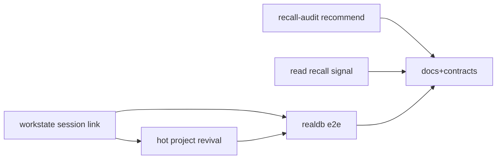

# v1.39.0 — 성장 모델 2단계 플랜(환류·순위·프로젝트 연결)

상태: active

**Goal:** recall 신호→read 랭킹 확장(보수적)·recall-audit 권장 처분 필드(decay-audit 패리티)·프로젝트 연결(work_state.session_id 백필+hot 죽은 분기 활성화·스키마 불변)을 출하한다.
**Review plan:** 없음 — AI 오케스트레이터(sl orchestrator status: AI). 기획 리뷰 게이트 통과(리서치 12사실+독립 감사 6건 반영 — docs/plans/2026-11-27-flint-v1390-growth-phase2.md).
**Architecture:** Go 단일 바이너리·Doltgres(PG 호환)·접점 3종(CLI·MCP·hot 주입). 등록 패턴 준수: wire.Register·ToolsManifest·thresholdMetas·usageOrder.
**Tech stack:** Go 1.26·pgx v5·lib/db additive 스키마 게이트(스키마 불변 우선 — v21 미소진).
**Spec:** docs/plans/2026-11-27-flint-v1390-growth-phase2.md
**Detail:** contracts
**Target-min:** 8
**Branch:** 빌드 시작 시 `superlite/v1390-growth-phase2`(현 main).

**Global constraints:** 스키마 불변(v21 미소진 — 완료 시 scope3 §1·§3 갱신). 세션 라벨 수신은 wire.ReadSessionLabel 라벨 파일 폴백 우선(ops.SessionLabel --session 파서와 구분). project_id NULL 행은 재시도 없음(해석 실패). hot 미해석 시 바이트 동일(1단계 회귀). recommend ∈ {supersede, expire, hold}(재확신 제외 — v1.40.0 예고). recommend 수치 컷은 thresholds 신설 키 등록(meta 오버라이드 원칙). read 확장은 RRF 융합 additive만·p95 무악화. `:vol:immutable:` 감쇠 면제 계약 유지. exit 계약 0/1/2/3 불변. 개인 데이터 repo 불침투(합성 픽스처만). 신규 Go 주석 금지(commentlint). TDD.

```mermaid
%% schedule
gantt
  title Predicted schedule (mm:ss)
  dateFormat X
  axisFormat %M:%S
  section lane 1
  T1a workstate 세션 연결 :t1a, 0, 151s
  T2 hot 프로젝트 해석 활성화 :t2, 151, 127s
  T6 세션 사슬 실DB e2e :t6, 277, 102s
  T5 문서·계약 동반 :t5, 380, 199s
  section lane 2
  T3 recall-audit recommend :t3, 0, 151s
  section lane 3
  T4 read recall 신호 :t4, 0, 102s
```

critical path: T1a → T2 → T6 → T5 (9.7 min) · peak width 3 · predicted build 9.7 min · predicted total ≈ 13.2 min (target ✗ 8.0)

**File structure:** lib/db/workstate.go(session_id 채움+세션 사슬 해석 메서드)·lib/wire/store.go(인터페이스 1메서드)+fake·lib/knowledge/state_cmd.go(라벨 폴백)·lib/knowledge/hot.go(프로젝트 해석·분기 활성화)·lib/ops/maintain_recall.go(recommend 필드)·lib/store/thresholds.go(1키)·lib/query/read.go(recall 신호 additive)·문서 4종.

## lib/db·wire — 세션 연결

**Probe entry:** run=flint state list

### T1a workstate 세션 연결 · Complexity 4 · Est. context 28k
**Owns:** lib/db/workstate.go, lib/wire/store.go(인터페이스 1메서드), lib/wire/store_test.go(fake), lib/db/workstate_v1390_test.go(신규)
**Components:** 3 · **LOC owned:** 120 · **Tests:** fast · **Model:** sonnet · **Est. time:** 3 min
**Produces:**
`Store.LatestProjectForSession(ctx context.Context, session string) -> (int, error)` — 세션 라벨(또는 빈 값)로 work_state 최근 행의 project_id 해석. NULL 행 재시도 없음(해석 실패 → 0). e.g. LatestProjectForSession(ctx, "s-abc") → 7; LatestProjectForSession(ctx, "") → 0
**Review Focus:** `TestLatestProjectForSessionResolves`(최근 행 project_id 7 반환), `TestLatestProjectForSessionEmptySessionZero`(빈 라벨 → 0), `TestOpenWorkStateRecordsSessionId`, fake/real 동질
**Steps:** 1 failing test, 2 run: FAIL, 3 implement, 4 run: PASS
**Notes:** 세션 라벨→sessions 행 매칭 불요(라벨 문자열을 work_state 행의 세션 식별자로 직접 사용 — 스키마 불변). 정규화는 기존 NormalizeWorkTask 패턴 준용.

## lib/knowledge — 활성화·권장 처분

### T2 hot 프로젝트 해석 활성화 · Complexity 5 (O-1) · Est. context 40k
**Owns:** lib/knowledge/hot.go, lib/knowledge/hot_v1390_test.go(신규)
**Components:** 2 · **LOC owned:** 110 · **Tests:** fast · **Model:** sonnet · **Est. time:** 3.5 min
**Consumes:** Store.LatestProjectForSession (T1a)
**Produces:** RunHot이 세션 라벨(wire.ReadSessionLabel 라벨 파일 폴백·hot.go:459 기존 수신 경로)을 LatestProjectForSession에 전달 → projectID>0이면 프로젝트 우선 정렬 분기(hot.go:420-425) 활성화, 해석 실패(0)면 기존 동작(바이트 동일). e.g. 세션 라벨이 project 7 해석 → 스냅샷 선정 project 7 우선; 라벨 부재 → 기존 출력 바이트 동일
**Review Focus:** `TestHotProjectPriorityActive`(해석 성공 시 프로젝트 우선), `TestHotUnresolvedByteIdentical`(미해석 시 기존 출력과 바이트 동일), hot 전체 회귀
**Steps:** 1 failing test, 2 run: FAIL, 3 implement, 4 run: PASS
**Notes:** 1단계의 죽은 분기(T6 파라미터화)를 세션 사슬로 활성화 — 새 정렬 로직 추가 금지(기존 분기 재사용만).

### T3 recall-audit recommend · Complexity 4 · Est. context 34k
**Owns:** lib/ops/maintain_recall.go, lib/store/thresholds.go, lib/ops/maintain_recall_v1390_test.go(신규)
**Components:** 3 · **LOC owned:** 130 · **Tests:** fast · **Model:** sonnet · **Est. time:** 3 min
**Produces:** `maintain --recall-audit` 출력 행에 recommend 필드 추가 — supersede|expire|hold. 판정 수치 컷은 신설 thresholds 키(`recall_audit_recommend_min`, 기본 2 — bad recall 이벤트 수 하한, 그 미만은 hold)·thresholds 등록+meta 오버라이드 원칙·frozen keys 갱신. e.g. bad_recall 이벤트 3건 행 → recommend:"supersede"; 1건 행 → recommend:"hold"
**Review Focus:** `TestRecallAuditRecommendsSupersede`(3건 행 supersede), `TestRecallAuditRecommendsHoldBelowFloor`(1건 행 hold), `TestThresholdsRegistered`
**Steps:** 1 failing test, 2 run: FAIL, 3 implement, 4 run: PASS
**Notes:** 출력은 리포트 전용 유지(처분 실행은 기존 maintain 경로·승인제 — 자동 처분 금지). recommend 판정 구조는 코드 상수·수치만 키.

### T4 read recall 신호 · Complexity 5 (O-1) · Est. context 42k
**Owns:** lib/query/read.go, lib/query/read_v1390_test.go(신규)
**Components:** 1 · **LOC owned:** 90 · **Tests:** fast · **Model:** sonnet · **Est. time:** 3.5 min
**Produces:** read RRF 융합에 recall_events 기반 신호 additive 편입(기존 4신호+read_count 불변·산식 구조 유지) — 행별 recall 횟수를 융합 입력으로. 신호 부재 행은 기존 순위 유지(회귀 불변). e.g. 동일 스코어 2행 중 recall 3건 행이 상위. `:vol:immutable:`·RRF 산식 구조 불변
**Review Focus:** `TestReadRecallSignalOrdersRows`(recall 3건 행 상위), `TestReadNoSignalKeepsOrder`(신호 부재 행 기존 순위), read p95 회귀(기존 read 테스트 전부 green)
**Steps:** 1 failing test, 2 run: FAIL, 3 implement, 4 run: PASS
**Notes:** recall_events 조인은 기존 hotRankedSQL의 RecallAggregateSQL 재사용(신규 SQL 최소화)·쿼리 1회 추가 이내(p95 무악화).

## tests — 실DB

**Probe entry:** run=go test ./tests -run TestV1390

### T6 세션 사슬 실DB e2e · Complexity 4 · Est. context 34k
**Owns:** tests/growth_phase2_v1390_test.go(신규)
**Components:** 1 · **LOC owned:** 100 · **Tests:** slow · **Model:** sonnet · **Est. time:** 3.5 min
**Consumes:** 없음 — 실DB 왕복은 커밋된 v1.38 코드(v20 스키마·state CLI)와 T1a 착지분 사용
**Produces:** 전용 엔진(5499) 실DB 왕복: 세션 라벨 파일 기록→state open(--project 7)→LatestProjectForSession 해석→hot 스냅샷 프로젝트 우선 검증→미해석 경로 바이트 동일. FLINT_REALDB_REQUIRED 계약 준수.
**Review Focus:** `TestRealDBV1390SessionChain`
**Steps:** 1 failing test, 2 run: FAIL, 3 implement, 4 run: PASS

## 문서·계약

### T5 문서·계약 동반 · Complexity 3 · Est. context 26k
**Owns:** docs/TUNING.md, docs/contracts/cli.md, flint-plugin/skills/flint/SKILL.md, README.md, README.ko.md
**Components:** 5 · **LOC owned:** 90 · **Tests:** fast · **Model:** sonnet · **Est. time:** 2.5 min
**Consumes:** recommend 필드 (T3) · read recall 신호 (T4) · 프로젝트 연결 (T2)
**Produces:** TUNING §2에 recall_audit_recommend_min 행·contracts/cli.md에 recommend 필드·read 신호·state 세션 연결 계약행·SKILL에 프로젝트 연결 규칙 한 줄·README 2종 갱신. docs-sync green.
**Review Focus:** `TestDocsSyncContracts`(make docs-sync green), 개인 데이터 0건
**Steps:** 1 failing contract test, 2 run: FAIL, 3 implement, 4 run: PASS

**Rulings:**
- Ruling: 스키마 불변 우선(세션 사슬로 충분할 때까지 v21 보류·완료 시 scope3 갱신) — 기획 감사 승인 분.
- Ruling: 세션 라벨→work_state 행 매칭은 문자열 직접 사용(sessions 행 매칭 불요) — 스키마 불변 귀결.
- Ruling: recommend 수치 컷 1키 등록(recall_audit_recommend_min 기본 2) — 구조는 코드 상수.

**Review Focus (probe plan):**
- lib/db·wire — library — state(NULL 분기·동질), encoding(정규화).
- lib/knowledge — CLI — protocol(바이트 동일·exit 계약), state(분기 활성화).
- lib/ops — CLI — state(dry-run 불변), protocol(recommend enum).
- lib/query — library — numeric(RRF additive), state(신호 부재 회귀).

**Self-review:** 기획 3계열↔태스크 매핑(①T4 ②T3 ③T1a·T2)·플레이스홀더 0·Consumes/Produces 대조·동시 실행 파일 비공유 확인.
**Spec coverage:** §1 판정1=T1a·T2·§1 판정2=T3·§1 판정3=T4·§2 계약=Global constraints·§3 수용 기준=T5(T4·T6 검증)·§4 비목표=Global constraints.

### T4r 룰링 통합 커밋 · Complexity 2 · Est. context 10k
**Owns:** lib/knowledge/read.go, lib/knowledge/read_v1390_test.go
**Components:** 1 · **LOC owned:** 0 · **Tests:** fast · **Model:** sonnet · **Est. time:** 1 min
**Produces:** 커밋 전용 랩 — T4의 룰링 승인 와이어링(read.go 폴백 경로 recall 신호 주입·회귀 테스트)을 플랜 Owns 밖 변경분으로 수납. 변경은 워크트리에 이미 있음. 검증: go build ./... + go vet ./lib/knowledge.
**Review Focus:** `TestWiringCompile`(go build green)
**Steps:** 1 verify build, 2 commit via coordinator

### T1ar 스키마 v21·파급 통합 커밋 · Complexity 3 · Est. context 10k
**Owns:** lib/db/admin.go, lib/db/schema_gates.go, lib/db/admin_test.go, lib/db/engine_probe_test.go, lib/cli/root.go, lib/cli/cli_test.go, lib/cli/done_test.go, lib/wire/asof_test.go, lib/wire/history.go
**Components:** 4 · **LOC owned:** 0 · **Tests:** fast · **Model:** sonnet · **Est. time:** 1 min
**Produces:** 커밋 전용 랩 — T1a의 v21 마이그레이션(EnsureSchemaV21·게이트 체인 21·LatestSchemaVersion 21)과 realStore/delegating fake 위임 파급분을 수납. 워크트리에 이미 있음. 검증: go build ./... + go vet ./lib/cli ./lib/db.
**Review Focus:** `TestV21Compile`(go build green)
**Steps:** 1 verify build, 2 commit via coordinator

### T2r 룰링 통합 커밋 · Complexity 2 · Est. context 8k
**Owns:** lib/knowledge/state_cmd.go
**Components:** 1 · **LOC owned:** 0 · **Tests:** fast · **Model:** sonnet · **Est. time:** 1 min
**Produces:** 커밋 전용 랩 — T2의 룰링 승인 편집(state_cmd.go 세션 라벨 수신→rec["session_label"] 채움)을 수납. 워크트리에 있음. 검증: go build ./... + go vet ./lib/knowledge.
**Review Focus:** `TestStateCmdCompile`(go build green)
**Steps:** 1 verify build, 2 commit via coordinator
