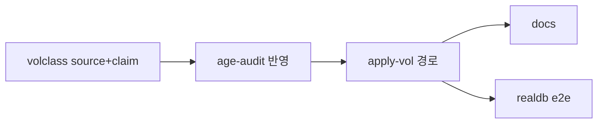

# v1.40.0 — 낡음 잔여 플랜(claim×변동성 매핑·출처 축·적용 경로)

상태: active

**Goal:** claim→vol 기본값 매핑(제안만)·변동성 출처 축(SuggestVolClassForSource)·`--apply-vol` 승인 적용 경로를 스키마 불변으로 출하한다.
**Spec:** docs/plans/2026-11-28-flint-v1400-staleness.md(감사 3건 반영판)
**Detail:** contracts · **Target-min:** 7 · **Branch:** `superlite/v1400`(현 main a981066)

**Global constraints:** 스키마 불변·자동 면제 신설 금지(EffectiveScoreFor·maintain_recall 감쇠 판정 무변경 — 매핑은 suggested_vol 제안만·승인 적용 시에만 vol 태그 효과). 오버라이드는 기존 vol 태그 우선(매핑은 미태깅 행 기본값). 신규 수치는 thresholds 등록+meta 오버라이드만. 주석 금지·TDD·합성 픽스처만·exit 계약 불변.

```mermaid
%% schedule
gantt
  title Predicted schedule (mm:ss)
  dateFormat X
  axisFormat %M:%S
  section lane 1
  T1 volclass 출처+claim 매핑 :t1, 0, 102s
  T2 age-audit 제안 반영 :t2, 102, 102s
  T3 apply-vol 적용 경로 :t3, 204, 102s
  T4 문서·계약 :t4, 307, 102s
  section lane 2
  T5 실DB e2e :t5, 307, 102s
```

critical path: T1 → T2 → T3 → T4 (6.8 min) · peak width 2 · predicted build 6.8 min · predicted total ≈ 10.3 min

**File structure:** lib/ops/volclass.go(ForSource 신규)·lib/ops/maintain_recall.go(제안 반영+적용 경로)·lib/cli/maintain.go(--apply-vol 등록)·lib/store/thresholds.go(신규 키)·문서 4종·tests.

### T1 volclass 출처+claim 매핑 · Complexity 4 · Est. context 26k
**Owns:** lib/ops/volclass.go, lib/ops/volclass_v1400_test.go(신규)
**Produces:** `SuggestVolClassForSource(topic string, tags string, source string) -> string` — 기존 SuggestVolClass 위임+출처 기본값(human/correction→immutable 우선·import·vault→conditional·agent/빈값→현행 규칙). claim→vol 기본값 표 상수(decision→immutable·procedure·lesson→conditional·event→immutable)·`ClaimDefaultVol(claim string) -> string`. e.g. SuggestVolClassForSource("회로 정리","" ,"human") → "immutable"; ClaimDefaultVol("procedure") → "conditional"
**Review Focus:** `TestForSourceHumanImmutable`, `TestForSourceImportConditional`, `TestForSourceAgentKeepsRules`(동일 입력 동일 출력 — 기존 SuggestVolClass 동등), `TestClaimDefaultVolTable`
**Steps:** 1 failing test, 2 FAIL, 3 implement, 4 PASS

### T2 age-audit 제안 반영 · Complexity 4 · Est. context 30k
**Owns:** lib/ops/maintain_recall.go, lib/ops/maintain_recall_v1400_test.go(신규)
**Consumes:** SuggestVolClassForSource (T1) · ClaimDefaultVol (T1)
**Produces:** age-audit의 `suggested_vol` 산출이 기존 vol 태그 없는 행에서 claim 기본값(ClaimDefaultVol)과 출처(origin 전달 가능 시 ForSource)을 우선 참조 — 오버라이드 순위: 기존 vol 태그 > claim 기본값 > 출처 기본값 > 현행 키워드 규칙. e.g. claim=decision 미태깅 행 → suggested_vol:"immutable"
**Review Focus:** `TestSuggestedVolClaimDefault`(claim 우선·미태깅 행만), `TestSuggestedVolExistingTagWins`(기존 태그 우선), `TestDecayCircuitUnchanged`(EffectiveScoreFor 회귀 — 감쇠 판정 무변경 단언)
**Steps:** 1 failing test, 2 FAIL, 3 implement, 4 PASS

### T3 apply-vol 적용 경로 · Complexity 5 (O-1) · Est. context 34k
**Owns:** lib/ops/maintain_recall.go(적용 경로), lib/cli/maintain.go(등록), lib/wire/registry_test.go, lib/ops/maintain_recall_v1400_test.go(같은 파일 확장)
**Consumes:** suggested_vol 제안 (T2)
**Produces:** `maintain --recall-audit --apply-vol --yes` — 제안 목록의 vol 태그를 `:vol:x:` 규약 병합으로 갱신(태그 병합 갱신·supersede 아님·repo 경유)·`--yes` 없으면 dry-run 목록만. e.g. --apply-vol --yes 3건 제안 → 3행 태그 병합·dolt 커밋 1회
**Review Focus:** `TestApplyVolRequiresYes`(없으면 dry-run), `TestApplyVolMergesTags`(병합·기존 태그 보존), `TestApplyVolRepoRoute`(쓰기 Repo 경유)
**Steps:** 1 failing test, 2 FAIL, 3 implement, 4 PASS

### T5 실DB e2e · Complexity 3 · Est. context 24k
**Owns:** tests/staleness_v1400_test.go(신규)
**Consumes:** --apply-vol 경로 (T3)
**Produces:** 전용 엔진 왕복: 합성 seed(claim 4종·미태깅)→age-audit 제안(claim 기본값 확인)→--apply-vol --yes→태그 병합 확인→회귀(감쇠 판정은 승인 적용된 태그로만 변화). FLINT_REALDB_REQUIRED 준수.
**Review Focus:** `TestRealDBV1400ApplyVol`
**Steps:** 1 failing test, 2 FAIL, 3 implement, 4 PASS

### T4 문서·계약 · Complexity 3 · Est. context 24k
**Owns:** docs/TUNING.md, docs/contracts/cli.md, flint-plugin/skills/flint/SKILL.md, README.md, README.ko.md
**Consumes:** --apply-vol (T3) · 제안 반영 (T2)
**Produces:** TUNING §2 신규 키(있으면)·contracts/cli.md --apply-vol 계약·매핑 표·SKILL 한 줄·README 2종. docs-sync green.
**Review Focus:** `TestDocsSyncContracts`, 개인 데이터 0건
**Steps:** 1 failing contract test, 2 FAIL, 3 implement, 4 PASS

**Rulings:**
- Ruling: 자동 면제 신설 없음(감사 HIGH 반영) — event 면제는 승인 적용된 태그로만.
- Ruling: SuggestVolClass 기존 시그니처 유지·ForSource 분리(감사 MEDIUM).

**Review Focus (probe plan):** lib/ops(CLI — state[승인제·dry-run]·protocol[exit])·tests(state[태그 병합])·lib/ops volclass(library — numeric 없음·state[우선순위]).

**Self-review:** 기획 3 판정↔태스크(①T1·T2 ②T1 ③T3) 매핑·플레이스홀더 0·동시 실행 파일 비공유.
**Spec coverage:** §1 판정1=T1+T2·판정2=T1·판정3=T3·§3 기준=T4·T5·§2 계약=Global constraints·§4 비목표 준수.
