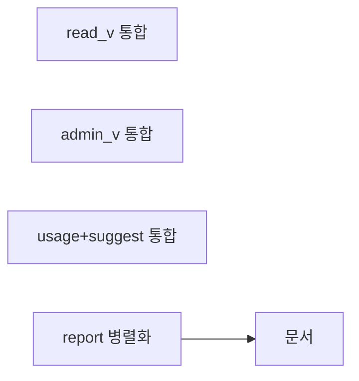

# v1.41.0 — 품질 청산 플랜(테스트 통합·report 병렬 잔여)

상태: active

**Goal:** 버전 접미 테스트 4도메인 통합(v1.28 4조)·report 잔여 순차 구간 병렬화를 출하한다.
**Spec:** docs/plans/2026-11-28-flint-v1410-quality.md(감사 APPROVED·발견 반영판)
**Detail:** contracts · **Target-min:** 7 · **Branch:** `superlite/v1410`(현 main 1dcc06c)

**Global constraints:** 대상 집합은 `_v숫자_` 접미 정확 매칭(read_v*·admin_v*·usage_v*·suggest_v*)·비접미 파일(reads_*·readhot_*·hot_kreads_* 등) 제외. 함수명 불변·테스트 수 불변(go test -list 전후 카운트 동일 단언). 도메인별 순차 커밋. 테스트 삭제 금지(통합만). report 골든 출력 무변화. 주석 금지·개인 데이터 불침투·TDD(이동은 컴파일+카운트로 검증).

```mermaid
%% schedule
gantt
  title Predicted schedule (mm:ss)
  dateFormat X
  axisFormat %M:%S
  section lane 1
  T1 read 계열 통합 :t1, 0, 102s
  T5 문서·계약 :t5, 102, 102s
  section lane 2
  T2 admin 계열 통합 :t2, 0, 102s
  section lane 3
  T3 usage+suggest 통합 :t3, 0, 102s
  section lane 4
  T4 report 병렬화 :t4, 0, 102s
```

critical path: T4 → T5 (3.4 min) · peak width 4 · predicted build 3.4 min · predicted total ≈ 6.9 min

**File structure:** lib/knowledge/read_*_v*_test.go→read_versions_test.go 확장·lib/db/admin_*_v*_test.go→admin_versions_test.go(신규)·lib/cli+knowledge usage/suggest_v*→2파일·lib/ops/report.go·lib/cli/profile.go·문서 3종.

### T1 read 계열 통합 · Complexity 4 · Est. context 30k
**Owns:** lib/knowledge/read_versions_test.go(기존 확장), lib/knowledge/read_v*_test.go 파일들(삭제·내용 이동)
**Produces:** read_v* 계열(_v숫자_ 접미 정확 매칭 — reads_*·readhot_*·hot_kreads_* 제외)을 lib/knowledge/read_versions_test.go로 병합. 함수명 불변·go test -list 카운트 전후 동일. e.g. 통합 후 `go test ./lib/knowledge -list 'TestRead' | wc -l` 동일·read_v* 파일 잔여 0
**Review Focus:** `TestReadVersionsCountInvariant`(전후 카운트 동일), 통합 후 lib/knowledge 전 green
**Steps:** 1 카운트 캡처, 2 이동, 3 카운트 단언+green
**Notes:** lib/db·lib/query의 read_v* 파일이 있으면 도메인 패키지 내 파일로 각각 통합(패키지 경계 준수).

### T2 admin 계열 통합 · Complexity 4 · Est. context 26k
**Owns:** lib/db/admin_versions_test.go(신규), lib/db/admin_v*_test.go 파일들(삭제·이동)
**Produces:** admin_v* 계열 통합·카운트 불변. lib/db 전 green.
**Review Focus:** `TestAdminVersionsCountInvariant`, lib/db 전 green
**Steps:** 1 카운트 캡처, 2 이동, 3 카운트 단언+green

### T3 usage+suggest 통합 · Complexity 3 · Est. context 24k
**Owns:** lib/cli/usage_versions_test.go(기존 확장), lib/knowledge/suggest_v*_test.go(삭제·read_versions_test.go로 이동)
**Produces:** usage_v*(lib/cli)·suggest_v*(lib/knowledge) 통합·카운트 불변·양 패키지 green.
**Review Focus:** `TestUsageSuggestCountInvariant`, 양 패키지 green
**Steps:** 1 카운트, 2 이동, 3 단언+green

### T4 report 병렬화 · Complexity 5 (O-1) · Est. context 34k
**Owns:** lib/ops/report.go, lib/cli/profile.go, lib/ops/report_v1410_test.go(신규)
**Produces:** collectDaily 선행 순차 제거(결과 구조체 분할로 out.Effect 소유권 분리·기존 4병렬 errgroup에 편입)·lib/cli/profile.go 메타 읽기 2건(writeThresholds·metaKV) errgroup 병렬. 페이즈3·Diagnose 순차 유지. 골든 출력 무변화(기존 report_parallel_v1910_test.go 순차 오라클 준용). e.g. collectDaily 완료 후 report 출력 바이트 동일
**Review Focus:** `TestCollectDailyParallelGolden`(출력 무변화), `TestProfileMetaParallel`(2건 병렬·결과 동일)
**Steps:** 1 failing test, 2 FAIL, 3 implement, 4 PASS
**Notes:** 소유권 분할 시 daily:% 이중 쿼리 통합 고려(정보성). 데이터 정합 우선.

### T5 문서·계약 · Complexity 2 · Est. context 18k
**Owns:** docs/PERF.md, docs/contracts/cli.md, README.md, README.ko.md
**Consumes:** report 병렬화 (T4)
**Produces:** PERF 문서 갱신(collectDaily 병렬화 측정·메타 2건 병렬)·README 2종 표 갱신(있으면). docs-sync green.
**Review Focus:** `TestDocsSyncContracts`, 개인 데이터 0건
**Steps:** 1 확인, 2 갱신, 3 green

**Rulings:**
- Ruling: 테스트 통합은 함수명·수 불변(v1.28 4조·컴파일+카운트 이중 강제).
- Ruling: 이동 태스크의 "TDD"는 카운트 캡처→이동→카운트 단언+전 green 형태로 대체(함수 신규 없음).

**Review Focus (probe plan):** lib/knowledge·db·cli(테스트 통합 — state[카운트 불변])·lib/ops·cli(병렬화 — state[골든 무변화]·numeric[없음]).

**Self-review:** 기획 판정 1↔T1·T2·T3·판정 2↔T4·수용 기준↔T5+전태스크·플레이스홀더 0·동시 실행 파일 비공유(T1~T3 패키지 상이·T4 별개).
**Spec coverage:** §1 판정1=T1~T3·판정2=T4·판정3(이월)=비목표·§3 기준=Global+T5·§2 계약=Global constraints.
