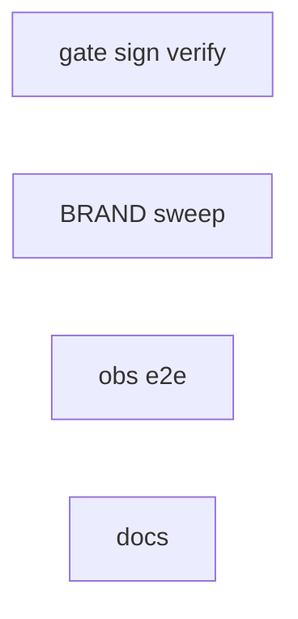

# v1.42.0 — 표면·배포 플랜(서명 게이트·이름 스윕·관측 e2e)

상태: active

**Goal:** release_gate 서명 검증 편입·BRAND.md 이름 스윕 갱신·read_events_n 트리거 합성 e2e를 출하한다.
**Spec:** docs/plans/2026-11-28-flint-v1420-surface.md(감사 3건 반영판·104078a)
**Detail:** contracts · **Target-min:** 5 · **Branch:** `superlite/v1420`(현 main)

**Global constraints:** 게이트 서명 검증 대상=직전 태그 자산(`gh release download`)·cosign.pub 공백/cosign 미설치 시 명시적 스킵(차단 아님). 이름 스윕은 BRAND.md 기록 갱신만(실제 결과 변경 금지). e2e는 합성 시드 ≥200/<200 두 경로·격리 원칙. ADR-0014(비밀키 Secrets·공개키만 취급). 주석 금지·개인 데이터 불침투·TDD.

### T1 release_gate 서명 편입 · Complexity 4 · Est. context 26k
**Owns:** scripts/release_gate.sh
**Components:** 1 · **Tests:** 수리 후 게이트 실행으로 검증
**Produces:** 게이트에 서명 검증 단계 추가: `gh release download -p 'checksums.txt*'`(직전 태그) → `cosign verify-blob --key lib/cli/cosign.pub --insecure-ignore-tlog` — 성공 시 "sign-verify OK"·cosign.pub 공백/cosign 미설치 시 "sign-verify skipped (…)" 경고 후 계속(차단 아님)·실패 시 exit 1. e2e 후에 실행(기존 순서 유지).
**Review Focus:** 수리 후 `bash scripts/release_gate.sh` — cosign 설치 환경에서 sign-verify OK·미설치 환경에서 skip 경고 확인
**Steps:** 1 게이트 실행(전), 2 편입, 3 게이트 실행(후·두 경로)
**Notes:** cosign v2.6.0(CI 고정과 동일)·`--insecure-ignore-tlog`는 CI와 동일 플래그.

### T2 BRAND.md 스윕 갱신 · Complexity 2 · Est. context 14k
**Owns:** docs/BRAND.md
**Components:** 1 · **Tests:** docs-sync green
**Produces:** 이름 충돌 스윕 표 갱신: 날짜를 오늘로·GitHub+brew 2표면 확인 기록(기존 표 형식 승계). 결과 변경 금지(관측만).
**Review Focus:** `TestDocsSyncContracts`
**Steps:** 1 확인, 2 갱신, 3 green

### T3 관측 e2e · Complexity 3 · Est. context 22k
**Owns:** tests/trigger_v1420_test.go(신규)
**Components:** 1 · **Tests:** slow
**Produces:** 합성 시드 2경로(≥200/<200)에서 `flint report --days 14`의 `read_events_n`·effect 산출 단언 — 트리거 판정의 데이터 경로 검증(임계값 자체는 문서 룰링·코드 아님). FLINT_REALDB_REQUIRED 준수.
**Review Focus:** `TestReadEventsNThresholdPaths`
**Steps:** 1 failing test, 2 FAIL, 3 implement, 4 PASS

### T4 문서·계약 · Complexity 2 · Est. context 14k
**Owns:** docs/contracts/cli.md, README.md, README.ko.md
**Consumes:** T1(게이트 편입)
**Produces:** README 2종 표 갱신(있면)·contracts에 게이트 서명 검증 언급(있으면). docs-sync green.
**Review Focus:** `TestDocsSyncContracts`, 개인 데이터 0건
**Steps:** 1 확인, 2 갱신, 3 green

**Rulings:**
- Ruling: 게이트 서명 검증은 직전 자산(이번 버전 .sig는 발행 후에만 존재).
- Ruling: e2e는 두 경로 데이터 산출 단언(임계값 판정은 문서 룰링·코드 아님).

**Self-review:** 기획 판정 1↔T1·2↔T2·3↔T3·문서↔T4·플레이스홀더 0·동시 실행 비공유.
**Spec coverage:** §1.1=T1·§1.2=T2·§1.3=T3·§3 기준=T4+전태스크.
