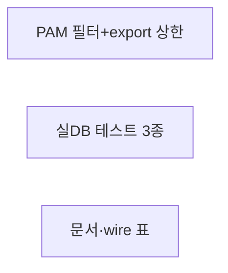

# flint v1.4.1 — R22 감사 발견 수정

**Goal:** R22 3각도 감사(잔여·성능/의존성·문서) 발견 중 9건 수정.
**Architecture:** 기존 파일 내 수정. 신규 파일 없음.
**Spec path:** docs/plans/archive/2026-11/2026-11-15-flint-v1410.spec.md
**Detail:** contracts · **Target-min:** 5
**Global constraints:** TDD(실패 실증)·계약 불변(지정 예외만)·개인 데이터 금지.

```mermaid
%% schedule
gantt
  title Predicted schedule (mm:ss)
  dateFormat X
  axisFormat %M:%S
  section lane 1
  T1 PAM relation 필터·export 상한 :t1, 0, 127s
  section lane 2
  T3 문서·wire 표 7건 :t3, 0, 127s
  section lane 3
  T2 SUPERLITE_REAL 테스트 3종 :t2, 0, 102s
```

critical path: T1 (2.1 min) · peak width 3 · predicted build 2.1 min · predicted total ≈ 5.6 min

### T1 PAM relation 필터·export 상한 · Complexity 4 · Est. context 26k
**Owns:** lib/knowledge/export_pam.go, lib/knowledge/export_pam_test.go, lib/cli/export.go, lib/cli/export_test.go
**Components:** 2 · **LOC owned:** 40 · **Tests:** fast · **Model:** sonnet
**계약:**
- A1: FormatPAM relations 발행 전 emitted id 집합(문서에 실릴 memories의 "flint:N") 구축 — From·To **양쪽 다** 집합 내인 relation만 발행(허참조 차단 — R22-A 실경로: 손작성 jsonl pending superseder). 회귀: pending superseder 시나리오에서 relation 부재 단언.
- B2: RunExport 조회 결과 행 수에 import와 동일 상한(export_import_max_rows) 적용 — 초과 시 exit 3·오류 JSON {max,count}(import 오류 형식 준용). 조회 자체가 전행 로드라 상한은 조회 후 즉시(완전 해결은 v1.5 스트리밍 — 주석 명시). 회귀: 상한 초과 exit 3.
**Test:** 각 red 실증 → green. slow: FLINT_TEST_DSN 대량 없이 경계값(==max 통과·+1 초과).

### T2 SUPERLITE_REAL 테스트 3종 · Complexity 3 · Est. context 22k
**Owns:** lib/cli/cli_test.go, lib/cli/compact_test.go, lib/cli/import_migrate_test.go, lib/cli/backup_test.go, lib/cli/conf_floor_wire_test.go, lib/cli/done_v0180_test.go
**Components:** 1 · **LOC owned:** 25 · **Tests:** slow · **Model:** sonnet
**계약 (R22-A 처방):**
- (i) delegatingFake.Close() no-op化(소유권 t.Cleanup) — 2커맨드 이상 테스트 closed pool 해소.
- (ii) 해시 잔재: TestCompact·TestImportFormatRoutingDispatch payload에 t.Name() 고유화.
- (iii) TestRestoreDecryptsEncrypted: RestoreFn stub 유지로 복호 경로만 검증(실 restore SQL 아님 — 주석).
**Test:** SUPERLITE_REAL=1 + FLINT_TEST_DSN으로 해당 5종 green(-count=2 멱등).

### T3 문서·wire 표 7건 · Complexity 3 · Est. context 24k
**Owns:** lib/wire/run.go, lib/wire/usage_registry_test.go, docs/PLAN.md, Makefile, docs/contracts/cli.md
**Components:** 2 · **LOC owned:** 40 · **Tests:** fast · **Model:** sonnet
**계약:**
- C2: HelpSummary에 import·profile·pending·update·tuning 5종 추가·"supersede"를 maintain 인자 표기로 정정(maintain --supersede). **완전성 가드 신설**: HelpSummary ⊇ usageOrder 전 항목 단언 테스트(usage_registry_test.go).
- C1: PLAN "27종(25+2)"→"28종(26+2)".
- C3: usage_registry_test 주석 24→26+2.
- C4: Makefile "41종"→"docs 패키지 전체 58종 중 정규식 매칭"(표현 정정).
- C5: docs-sync를 go test ./docs 전체 실행으로 전환(정규식 제거 — 17종 게이트 편입. 시간 영향 확인).
- C6: cli.md에 export·import 계약 추가(5형식·--out 사이드카·상한 exit 3 — 기존 표 형식 2-3줄).
**Test:** make docs-sync·wire 테스트 green·완전성 가드 red→green.

## Review Focus (전체)
- **state:** A1 2패스 필터·상한 경계.
- **protocol:** exit 3 오류 형식 준용.
- **encoding:** cli.md 표 형식.

**Probe entry:** run=go test ./lib/... ./docs/... -count=1
