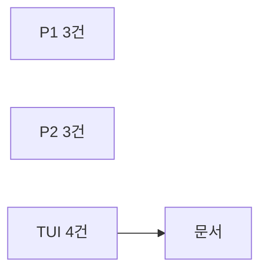

# flint v1.5.3 — 에이전트 CLI 신뢰 + TUI 품질 소형

**Goal:** 에이전트 관점 CLI P1 3건·P2 3건 + TUI 백로그 소형 4건.
**Spec path:** docs/plans/archive/2026-11/2026-11-16-flint-v1530.spec.md
**Detail:** contracts · **Target-min:** 5
**Global constraints:** TDD·기계 채널 JSON 키 불변(error 값 확장 허용)·
개인 데이터 금지·P3는 미포함.

### T1 P1 — 파괴 가드·인자 검증·exit 통일 · Complexity 4 · Est. context 28k
**Owns:** lib/cli/setup.go, lib/cli/setup_test.go, lib/knowledge/read.go, lib/knowledge/read_test.go, lib/knowledge/done.go, lib/ops/maintain.go, lib/wire/run.go, lib/cli/exit_contract_v101_test.go, lib/cli/maintain_test.go, lib/cli/maintain_v0130_test.go, lib/cli/maintain_v093_test.go, lib/ops/sessionlabel_v102_test.go, lib/wire/wire_test.go
**Components:** 3 · **LOC owned:** 80 · **Tests:** fast · **Model:** sonnet
**계약:**
- teardown: 기본 dry-run(계획 안내만 출력·exit 0) — 실행은 `--yes` 필수(maintain --invalidate 관례). JSON 안내에 무엇이 내려가는지 명시.
- read: `-` 접두 미인식 인자 → exit 3 unknown flag (기존 "--" end-of-options 규칙·positional query 불변).
- exit 통일: unknown command→3·done usage 오류→3(현 0)·maintain bare usage→3(현 1). 전 커맨드 exit_contract 테스트 동반 갱신.
**Test:** 각 red(현행 동작 실패 단언)→green·exit 표 전수 갱신.

### T2 P2 — 제로히트·usage 타입·approve 안내 · Complexity 3 · Est. context 24k
**Owns:** lib/knowledge/read.go, lib/knowledge/read_test.go, lib/knowledge/read_v0420_test.go, lib/knowledge/read_v1200_test.go, lib/knowledge/thresholds_once_f6_test.go, lib/wire/run.go, lib/wire/run_test.go, lib/knowledge/approve.go, lib/knowledge/approve_test.go, lib/cli/read_v096_test.go, lib/cli/read_v0100_test.go, lib/cli/read_v0140_test.go, lib/cli/read_v0150_test.go, lib/cli/read_v0163_test.go, lib/cli/read_status_v0120_test.go, lib/cli/metrics_test.go, tests/regression/schema_upgrade_order_v06_test.go, README.md, README.ko.md, docs/TUNING.md
**Components:** 3 · **LOC owned:** 40 · **Tests:** fast · **Model:** sonnet
**계약:**
- read 제로히트: exit 1+무출력 → **exit 0 + `{"hits":0,...}` (--json) / 침묵 (텍스트)** — SKILL.md 예외 기재 제거(T1과 동일 파일: T1 완료 후 적용).
- 오류 타입: usage/flag 오류의 `error:"internal"` → **`error:"usage"`** (필드에 허용 플래그 예시 포함) — ErrLine 구조 불변·값만. 최소 적용: unknown flag류 공통 경로(wire).
- approve 오류 메시지에 usage(`--id N [--supersede OLD]`) 포함.
**Test:** 제로히트 exit 0·usage 타입 단언·approve 안내. red→green.

### T3 TUI 소형 4건 (백로그 #133) · Complexity 4 · Est. context 30k
**Owns:** lib/tui/pending.go, lib/tui/pending_test.go, lib/tui/report.go, lib/tui/report_test.go
**Components:** 2 · **LOC owned:** 150 · **Tests:** fast · **Model:** sonnet
**계약:**
- 협폭 클리핑: 키 안내 40컬 축약표기(q 표시 유지)·nonInteractiveHint wrap·상세 origin wrapDetailBody 재사용.
- pending 필터: FilterValue에 ID 포함("#9001" 검색) — strconv 포맷.
- supersede 지연 로드: targetList 진입 시 상시 → `s` 키 시점 로드(seam 유지·로딩 상태 라인).
- stale 후보: supersede 성공 시 targetList에서 old.ID 제거.
- 액션 실패 원인: approve/supersede sink JSON의 error/message 파싱해 status 라인에 표시("exit 3"만 폐지).
**Test:** 각 red→green + 기존 회귀·pty 스팟(리뷰에서).

### T4 문서 · Complexity 2 · Est. context 18k
**Owns:** docs/HISTORY.md, docs/versions_test.go, docs/contracts/cli.md, README.md, README.ko.md, flint-plugin/skills/flint/SKILL.md, docs/PLAN.md
**Components:** 1 · **LOC owned:** 40 · **Tests:** slow · **Model:** sonnet
**계약:** HISTORY v1.5.3 항목+계약행 TestVersion0153Milestone{v1.5.3, agent}·cli.md(teardown --yes·read exit·usage 타입·제로히트 exit 0)·SKILL.md 제로히트 예외 기재 제거·README 양어 배지 라인 외 불변·PLAN v1.5.3 한 줄.
**Test:** make docs-sync·go test ./docs green.

## Review Focus
- **protocol:** exit 전수 표·error 값 확장(하류 파서 호환).
- **state:** 지연 로드 경합·stale 제거.
- **encoding:** 협폭 wrap.

**Probe entry:** run=go test ./lib/... ./docs/... -count=1
