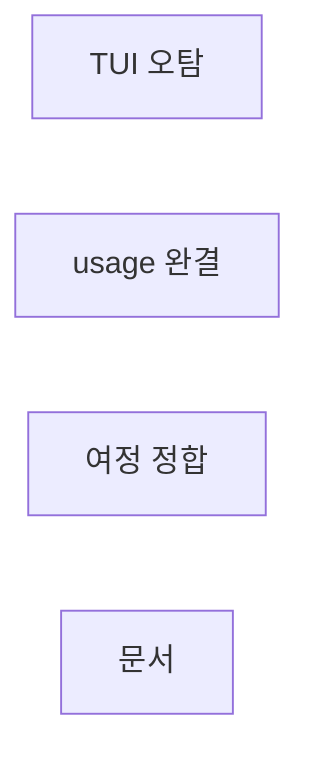

# flint v1.5.5 — R29 감사 (TUI 오탐·usage 완결·여정 정합)

**Spec path:** docs/plans/archive/2026-11/2026-11-16-flint-v1550.spec.md
**Detail:** contracts · **Target-min:** 4
**Global constraints:** TDD·기계 채널 불변·개인 데이터 금지.

### T1 TUI 터미널 판정 교정 · Complexity 3 · Est. context 20k
**Owns:** lib/tui/tui.go, lib/tui/tui_test.go
**Components:** 1 · **LOC owned:** 20 · **Tests:** fast · **Model:** sonnet
**계약:** isTerminal을 charmbracelet/x/term(이미 의존 트리 내) `term.IsTerminal(os.Stdout.Fd())`로 교체 — /dev/null(char device) 오탐 폐지. FLINT_NO_TUI 1층 유지. 회귀: stdout을 /dev/null로 리다이렉트한 실행(테스트 헬퍼 또는 os/exec 서브프로세스)에서 bare 커맨드가 플래그 경로(현행 출력)로 폴밋 단언·exit 3이 아님.
**Test:** red(현행 ModeCharDevice로 /dev/null 오탐)→green.

### T2 usage 완결 · Complexity 3 · Est. context 24k
**Owns:** lib/knowledge/pending.go, lib/cli/pending.go, lib/cli/export.go, lib/cli/profile.go, lib/cli/setup.go, lib/cli/report.go, lib/knowledge/hot.go, lib/knowledge/brief.go, lib/knowledge/compact.go, lib/ops/nudge.go, lib/knowledge/write.go, lib/wire/run.go, lib/wire/run_test.go, lib/cli/usage_type_v154_test.go
**Components:** 3 · **LOC owned:** 60 · **Tests:** fast · **Model:** sonnet
**계약:**
- A2: 5사이트(pending·export·profile·setup/teardown·report --tui 조합) unknown-flag → wire.UsageErrorf+플래그 안내.
- A5: hot·brief·compact·nudge unknown flag exit 3(현재 완전 무시 exit 0) — 무효 인자 조용한 성공 폐지. `write --help`류: write가 stdin 대기 전 플래그 오류 안내 — --help/-h 감지 시 usage 안내 exit 0.
- A4: `-h`/`--help` 전역 별칭(help 동일·exit 0) — 라우팅 선행(--version 관례 준용).
**Test:** 표 구동 확장(usage_type_v154 표에 행 추가)·각 red→green.

### T3 여정 정합 3건 · Complexity 3 · Est. context 22k
**Owns:** lib/cli/export.go(T2와 공유 — T2 후 순차), lib/cli/export_test.go, lib/knowledge/import.go, lib/knowledge/import_test.go, lib/cli/setup.go(T2와 공유), lib/cli/setup_test.go
**Components:** 3 · **LOC owned:** 40 · **Tests:** fast · **Model:** sonnet
**계약:**
- B1: export --format pam 요약 행수를 문서 발행 수(total_memories·pending 제외) 기준으로 — stderr "exported N rows (pam, M bytes)"의 N을 포맷터 반환 발행 수로 조정(포맷터가 발행 수 반환하도록 시그니처 또는 계산 조정 — 최소 변경).
- B3: import --format 미지정 + 경로 확장자 .jsonl/.pam → 각 마이그레이션 모드 자동 진입(안내 1행). 미지정+기타 확장자는 기존 규칙 변환 + empty 결과에 `hint: "--format jsonl|pam for migration"` 키(additive).
- B4: setup compose 시작 전 5434 점유 감지 → 경고 1행(진행은 유지).
**Test:** 각 red→green.

### T4 문서 · Complexity 2 · Est. context 18k
**Owns:** docs/HISTORY.md, docs/versions_test.go, docs/contracts/cli.md, docs/PLAN.md
**Components:** 1 · **LOC owned:** 30 · **Tests:** slow · **Model:** sonnet
**계약:** HISTORY v1.5.5+계약행 TestVersion0155Milestone{v1.5.5, terminal}·cli.md: usage 타입 실제 전 목록 확정(잔여 없음 명시)·bare flint 실측 정정(usage 단독·exit 1)·-h/--help·hot류 unknown flag 3·pam 행수 기준·import 확장자 감지·DB 다운이 인자 검증에 선행한다는 우선순위 1줄(A3)·/dev/null 판정. PLAN 한 줄.
**Test:** make docs-sync·go test ./docs green.

**Probe entry:** run=go test ./lib/... ./docs/... -count=1
