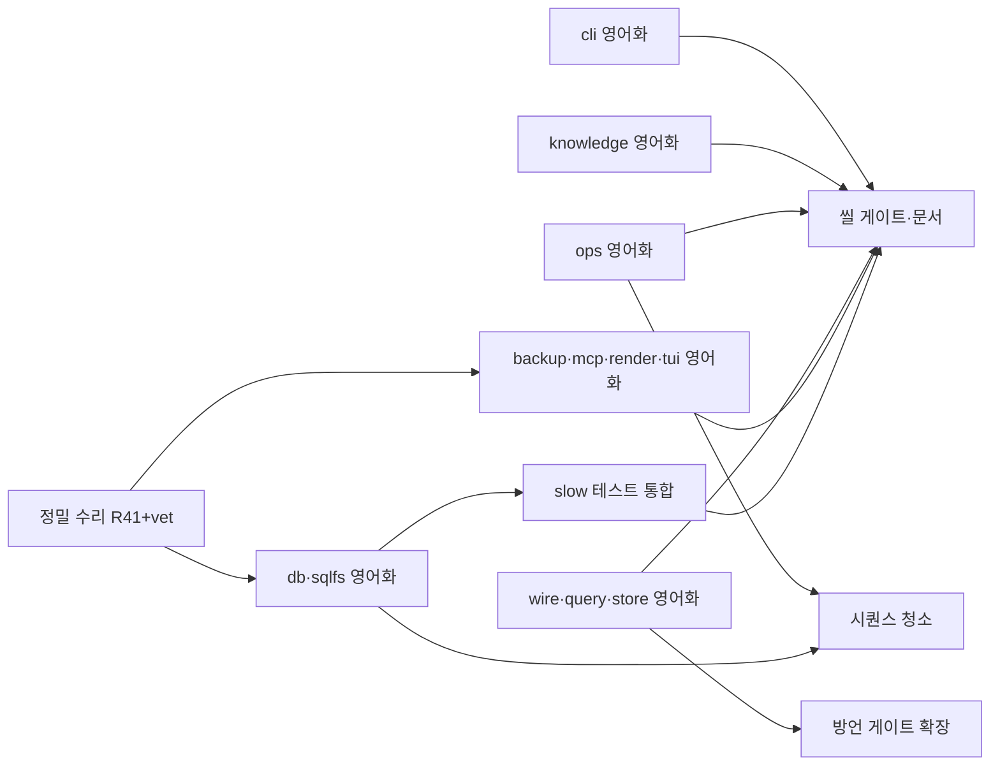

# flint v1.10.0 — 품질/위생: 주석 영어화·테스트 정리·시퀀스 청소

**Spec path:** docs/plans/archive/2026-11/2026-11-18-flint-v1100.spec.md
**Detail:** contracts · **Target-min:** 11
**Global constraints:** TDD·행동 불변(주석 전용 diff·출력·exit 그대로)·개인 데이터 금지·v1.9.0(v12 스키마) 머지 후 개시·release-gate 통과.

```mermaid
%% schedule
gantt
  title Predicted schedule (mm:ss)
  dateFormat X
  axisFormat %M:%S
  section lane 1
  T1 정밀 수리 — R41 Low 3건 + vet unkeyed 4건 :t1, 0, 102s
  T5 lib/db·lib/sqlfs 주석 영어화 :t5, 102, 102s
  T8 slow 실DB 테스트 통합 :t8, 204, 102s
  T11 언어 씰 게이트 + 문서·버전 v1.10.0 :t11, 307, 102s
  section lane 2
  T2 lib/cli 주석 영어화 :t2, 0, 102s
  T7 lib/backup·lib/mcp·lib/render·lib/tui :t7, 102, 102s
  T9 flint_verify 잔여 시퀀스 청소 :t9, 204, 102s
  section lane 3
  T3 lib/knowledge 주석 영어화 :t3, 0, 102s
  T10 방언 게이트 패턴 확장 검토 :t10, 102, 102s
  section lane 4
  T4 lib/ops 주석 영어화 :t4, 0, 102s
  section lane 5
  T6 lib/wire·lib/query·lib/store 주석 영어화 :t6, 0, 102s
```

critical path: T1 → T5 → T8 → T11 (6.8 min) · peak width 5 · predicted build 6.8 min · predicted total ≈ 10.3 min

**File structure:** lib/**/*.go(주석 영어화 — 패키지별 분할)·lib/wire/comment_language_gate_test.go(신규 언어 씰)·lib/db/sequence_cleanup.go(신규 고아 시퀀스 정리)·lib/ops/doctor.go(고아 시퀀스 체크)·.claude/skills/verify-flint/SKILL.md(Cleanup 절)·docs/HISTORY.md·VERSION.

### T1 정밀 수리 — R41 Low 3건 + vet unkeyed 4건 · Complexity 1 · Est. context 14k
**Owns:** docs/HISTORY.md, lib/db/history.go, lib/db/asof_query.go, lib/tui/maintain_test.go, lib/tui/pending_test.go
**계약:** ① HISTORY v1.8.1 "reused by audit and other callers" → "reused by audit"(EscapeLike 비테스트 호출은 lib/ops/audit.go:130 유일 — 정의 lib/query/read.go:109). ② lib/db/history.go:4-5 "asof·audit이 이직 대상" → v1.8.0 완료 상태 서술로 정정(이미 Store 인터페이스로 소비). ③ lib/db/asof_query.go:46-49 동치 서술 범위를 "안내 문구 랩 동치(원문 wrapViewColumnMismatch 이관)"로 정확화. ④ maintain_test.go:504·pending_test.go:855 WindowSizeMsg 리터럴 4곳 키 필드({Width:, Height:})로 — `go vet ./lib/tui/...` 경고 0.
**Test:** go vet ./lib/tui/... 경고 0·lib/db·lib/tui 패키지 테스트 green·HISTORY 근거 문구 실측(EscapeLike 호출부 grep).

### T2 lib/cli 주석 영어화 · Complexity 4 · Est. context 32k
**Owns:** lib/cli/**/*.go
**계약:** lib/cli 전체(비테스트·테스트 — 약 2,598개 한글 주석 라인)를 의미 보존 영어로. 기계 치환 금지 — 계약·근거·경고 문장의 정보가 온전히 남는다. 코드 라인·문자열 리터럴 불변(비주석 라인 diff 0). gofmt 적용.
**Test:** 패키지 테스트 green·git diff가 주석 라인만·한글 잔여 라인 0(grep [가-힣] 주석 라인).

### T3 lib/knowledge 주석 영어화 · Complexity 4 · Est. context 34k
**Owns:** lib/knowledge/**/*.go
**계약:** T2와 동일 원칙(약 2,910 라인). 스펙 참조("spec §" 인용)는 영문 스펙 경로 표기를 유지해 원천 추적 가능.
**Test:** T2와 동일.

### T4 lib/ops 주석 영어화 · Complexity 4 · Est. context 32k
**Owns:** lib/ops/**/*.go
**계약:** T2와 동일 원칙(약 2,572 라인). doctor 등록표·thresholds 관례 주석의 계약 표현 정확 승계.
**Test:** T2와 동일.

### T5 lib/db·lib/sqlfs 주석 영어화 · Complexity 4 · Est. context 26k
**Owns:** lib/db/**/*.go, lib/sqlfs/**/*.go
**계약:** T2와 동일 원칙(약 1,577 라인). 방언 SQL 바이트 동치 주석·스키마 버전 이력 주석은 수치·버전 오기 없이 승계.
**Consumes:** T1 정정된 history.go·asof_query.go 주석
**Test:** T2와 동일·slow 실DB 계열 green(격리 DSN).

### T6 lib/wire·lib/query·lib/store 주석 영어화 · Complexity 3 · Est. context 22k
**Owns:** lib/wire/**/*.go, lib/query/**/*.go, lib/store/**/*.go
**계약:** T2와 동일 원칙(약 1,240 라인). dialect_gate_test.go의 게이트 설명 주석도 영문화(패턴 분해 조립 구조는 불변).
**Test:** T2와 동일.
**Test:** lib/wire 방언 게이트 green.

### T7 lib/backup·lib/mcp·lib/render·lib/tui 주석 영어화 · Complexity 3 · Est. context 22k
**Owns:** lib/backup/**/*.go, lib/mcp/**/*.go, lib/render/**/*.go, lib/tui/**/*.go
**계약:** T2와 동일 원칙(약 1,344 라인).
**Consumes:** T1 키 필드 교정된 tui 테스트 파일
**Test:** T2와 동일·go vet ./lib/tui/... 경고 0 유지.

### T8 slow 실DB 테스트 통합 · Complexity 3 · Est. context 26k · Tests: slow
**Owns:** lib/db/slow_consolidated_test.go, lib/db/*_test.go
**계약:** lib/db 슬로우(실DB) 계열 런타임 실측(-v per-test 시간) 후 중복 시나리오·장시간 케이스 통합 — 동일 스키마 상태를 반복 조성하는 케이스를 하나의 시나리오로 묶어 조성 비용을 공유. 삭제 케이스의 단언은 전부 승계(커버리지 손실 0 — 단언 대조표를 테스트로 남김). 통합 전·후 총 런타임 실측을 HISTORY에 기록. 주석은 영어 작성.
**Test:** 통합 후 lib/db 전체 green(격리 DSN·flock)·단언 승계 대조 테스트·총 런타임 감소.

### T9 flint_verify 잔여 시퀀스 청소 · Complexity 3 · Est. context 24k · Tests: slow
**Owns:** lib/db/sequence_cleanup.go, lib/db/sequence_cleanup_test.go, lib/ops/doctor.go, .claude/skills/verify-flint/SKILL.md
**계약:** 잔여 39개(R40 기록 — 현행 스키마 serial은 8개)의 누출원 조사: 마이그레이션 이력에서 폐기·개명된 테이블 시퀀스 특정. CleanupOrphanSequences(ctx, st) — 현행 스키마 소유 시퀀스·감사 시퀀스·telemetry 4종(telemetryStageSeqs, lib/db/repo.go:503) 화이트리스트 제외 존재 확인 후 DROP(멱등). doctor 체크 등록표에 잔여 수 보고 추가. verify-flint 스킬 Cleanup 절에 청소·잔여 0 검증 절차 추가. 신규 주석은 영어.
**Test:** slow — 고아 시퀀스 합성 조성(가짜 시퀀스 CREATE) → 청소 후 잔여 0·화이트리스트 시퀀스 무변경·재실행 멱등·doctor 보고 수 일치.

### T10 방언 게이트 패턴 확장 검토 · Complexity 2 · Est. context 18k
**Owns:** lib/wire/dialect_gate_test.go
**계약:** `dolt_` 접두 전반 확장 검토 — 진단·쓰기 방언(dolt_remotes·dolt_status·dolt_reset)의 lib/db 밖 코드 라인 잔여를 실측하고 오탐(안내 문자열·테스트 픽스처의 비SQL 언급)을 통제 가능한 패턴(예: 백틱 SQL/quoted string 내 등장)으로 좁혀 확장. 불가 판정이면 오탐 근거를 게이트 주석에 기록하고 현행 4패턴 유지. 신규 주석은 영어.
**Consumes:** T6 영문화된 dialect_gate_test.go
**Test:** 게이트 green(확장 시 분류기 합성 트리 테스트에 진단 방언 케이스 추가)·lib 전체 테스트 green.

### T11 언어 씰 게이트 + 문서·버전 v1.10.0 · Complexity 2 · Est. context 20k
**Owns:** lib/wire/comment_language_gate_test.go, VERSION, README.md, README.ko.md, flint-plugin/.claude-plugin/plugin.json, docs/HISTORY.md, docs/versions_test.go, docs/PLAN.md
**계약:** comment_language_gate_test.go(신규) — lib/**/*.go 주석 라인(//·/* */)에 한글이 있으면 file:line 실패(문자열 리터럴·식별자 제외 — 방언 게이트 스캐너 관례 승계, 합성 트리 분류기 테스트 포함). v1.10.0 동기 — 배지·하이라이트(주석 영어화·테스트 런타임 감소·시퀀스 청소)·HISTORY(누출원 조사 결과·런타임 전후 실측 포함)·계약행 TestVersion01100Milestone{v1.10.0, hygiene}·PLAN 갱신. make docs-sync·release-gate green.
**Test:** 씰 게이트 green·go test ./docs·release-gate OK v1.10.0.

**Review Focus:** docs+library — file(비주석 라인 diff 0·주석 라인 정보 보존 샘플 검증), state(시퀀스 화이트리스트·멱등), protocol(테스트 통합 후 단언 승계 대조), numeric(런타임 실측·잔여 시퀀스 수). 위험: 기계 치환으로 계약 뉘앙스 소실·테스트 통합 중 단언 누락·게이트 오탐(문자열 리터럴 한글).

**Probe entry:** run=go vet ./lib/tui/... · run=grep -rn "//.*[가-힣]" lib --include="*.go" | wc -l · run=go test ./lib/wire/ -count=1

**Self-review:** 스펙 8요구 → T1(3·4) T2-T7(1) T8(5) T9(6) T10(7) T11(2·8). 플레이스홀더 없음. 파일 소유 충돌 없음(번역 태스크 패키지 배타·T1 선행 엣지·T8/T9/T10은 번역 후 신규·지정 파일 편집). T9·T10이 신규 파일에 영어 주석 작성 조건으로 씰 게이트(T11)와 비동기 — T11 엣지는 번역 완료만 조건.

**Ruling:** 게이트 씰로 한국어 주석 영구 차단 - 오픈소스 기여자 진입장벽 해소가 개인 작성 속도보다 우선 - 비용: 이후 한글 주석 기여는 게이트에 걸림(의도된 정책).
**Ruling:** 시퀀스 청소는 doctor 보고+함수 제공, 자동 실행은 마이그레이션 경로에 두지 않음 - 연결 시점 자동 DROP의 working-set 교란 위험이 즉시성보다 큼 - 비용: 정리는 명시 절차(스킬) 필요.
