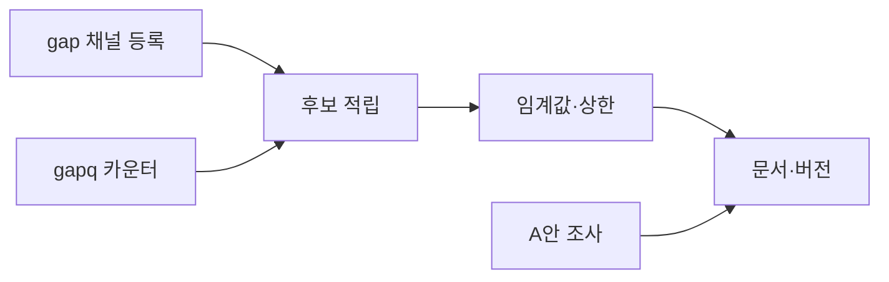

# flint v1.12.0 — 지식 격차 후보: 회상 실패·반복 쿼리 통합 (파이프라인 2단계)

**Spec path:** docs/plans/archive/2026-11/2026-11-21-flint-v1120.spec.md (요구 1·2는 단일 메커니즘으로 병합 — 브레인스토밍 룰링)
**Detail:** tests · **Target-min:** 7
**Global constraints:** TDD·쿼리 본문 비영속 원칙(후보 적립 시에만 절단·살균 원문 요약 공개)·비간섭(조용히·주입 없음)·기계 채널 불변·개인 데이터 금지·언어 씰(주석 영어).

**리서치 근거** (v112-research 2026-11-20): 외부 선행 사례 부재(군집화의 개인규모 단순화=정규화 쿼리 카운트)·owned_miss 1차 트리거(보유 탐색 실패 — unowned는 DB 공백 노이즈)·suggestQuery는 정규화 아님(실제 정규화: lib/query/suggest.go NFKC)·쿼리 본문 비영속 → meta 해시 카운터 필수·승격 게이트 필수(Letta 자기강화 함정).

### T1 gap 채널 등록 · Complexity 2 · Est. context 18k
**Owns:** lib/knowledge/write.go, lib/knowledge/write_test.go, lib/db/usage.go, lib/ops/report.go, flint-plugin/plugin_v06_test.go, flint-plugin/skills/flint/SKILL.md
**계약:** sourceRegistry에 `gap` 추가 — **v1.11.2 체크리스트 ①~④ 전항 수행**: 등록표 파생(usage·에러)·plugin 미러 목록·RecordUsageCount kind "dup_gap"·report dailyFlatFields+ReportDay.DupGap. correction(v1.11.0) 구조 복제·태그는 자동 아님(gap 후보는 T3가 부착).
**Test:** 등록 통과·미등록 거부·파생 가드·미러·kind·report 회귀.

### T2 gapq 카운터 · Complexity 3 · Est. context 24k
**Owns:** lib/knowledge/read.go, lib/knowledge/read_test.go, lib/db/usage.go, lib/db/usage_test.go
**계약:** read 완료 경로에서 회상 격차 카운트 — ① 트리거: zero_reason='owned_miss' 한정(unowned는 DB 공백 노이즈 — 리서치 근거·게이트 확인) ② 키: `gapq:` + sha256( NFKC(살균(TruncateRunes(query, 80))) + 소문자 + 공백접기 ) — lib/query/suggest.go NFKC 재사용·살균은 render.Text 경유 ③ meta flat 카운터 — 키 `daily:gapq:<hash>:<YYYY-MM-DD>`(PruneDaily 정규식 자동 만료·일별 리셋 의미: 당일 3회 실패 = 강신호, 격일 분산은 약신호로 간주 — 게이트 리뷰 룰링) ④ 조용히 실패(§13).
**Produces:** `BumpGapQuery(ctx, st Store, sanitizedQuery string) (count int64, ok bool)` e.g. `"데모 쿼리"` → gapq:<hash> +1 → 3
**Test:** owned_miss/zero-hit 양경로 카운트·동일 쿼리(대소문자·공백·NFKC 동치) 동일 키·상이 쿼리 상이 키·살균 경유([flint] 마커 제거)·bump 조용히.

### T3 후보 적립 · Complexity 3 · Est. context 26k · Tests: slow
**Owns:** lib/knowledge/write.go, lib/knowledge/write_test.go, lib/cli/write_v1120_test.go
**계약:** BumpGapQuery 반환 count가 임계(T4) 도달 시 격차 후보 적립 — ① payload: topic `격차 후보: <정규화 쿼리 60룬>`, summary `회상 실패 N회 — 지식 격차 후보`, confidence 0.4, 태그 `gap-candidate`, source `gap` ② 중복: content_hash 승계 — 기존 **pending** 동일 해시면 요약의 N 갱신(UPDATE 연산·supersede 아님)·**active는 갱신 제외**(승격 확정 지식 무결 — NOOP)·미존재 시 ADD(pending). gap_daily_max는 신규 ADD만 카운트(갱신 미소비 — correction 관례 승계) ③ 적립 시에만 절단·살균 원문 노출(비영속 원칙 최소 침투) ④ 상한(T4) 초과 시 조용히 skip+경고 1행.
**Consumes:** T1 등록·T2 BumpGapQuery(ctx, st Store, sanitizedQuery string) (count int64, ok bool)
**Test:** 단위(임계 도달 적립·갱신·상한·confidence 0.4) + e2e slow(격리: 3회 read 실패 → pending 후보 → approve → 회상 태그·원문 절단 확인·카운터 리셋 여부 — 리셋 아님·갱신 지속).

### T4 임계값·상한 · Complexity 2 · Est. context 18k
**Owns:** lib/store/thresholds.go, lib/wire/threshold_meta.go, lib/wire/threshold_meta_test.go, docs/TUNING.md
**계약:** `gap_query_threshold`(기본 3)·`gap_daily_max`(기본 10) 등록(41→43항목) — correction 2키 관례 복제·TUNING 행.
**Test:** 기본·오버라이드·frozen 갱신.

### T5 A안 조사 · Complexity 2 · Est. context 16k
**Owns:** docs/RUNBOOK.md
**계약:** A안(하네스 훅 기반 교정 자동 감지) 실현 가능성 조사 기록 — Claude Code UserPromptSubmit·SessionStart 등 훅 가용성·프라이버시 제약(전체 발언 캡처 금지와 양립성)·권장 아키텍처 초안 — RUNBOOK 파이프라인 절 부록(v1.14 판정 자료). 구현 없음.
**Test:** 문서 정합(docs-sync).

### T6 문서·버전 v1.12.0 · Complexity 2 · Est. context 18k
**Owns:** VERSION, README.md, README.ko.md, flint-plugin/.claude-plugin/plugin.json, docs/HISTORY.md, docs/versions_test.go
**계약:** v1.12.0 동기 — 하이라이트(knowledge pipeline step 2 — recall-failure gap candidates)·HISTORY(병합 룰링·리서치 근거 인용·A안 조사 링크)·계약행 TestVersion01120Milestone{v1.12.0, gap-candidates}. release-gate.
**Test:** go test ./docs·release-gate OK v1.12.0.

**Review Focus:** state(카운터 동시성·meta flat 경합)·numeric(임계·상한·해시 동치)·protocol(채널 계약·exit)·privacy(쿼리 본문 비영속·살균). 위험: 카운터-적립 비원자(병렬 세션 이중 적립 — content_hash dedup가 최종 방어)·NFKC 동치 오탐·대소문자 언어별.

**Probe entry:** run=go run ./cmd/flint write knowledge --source gap · run=go run ./cmd/flint read 데모 --limit 3

**Self-review:** 스펙 6요구 → T1(채널) T2+T3(1·2·3 병합 메커니즘) T4(4) T5(5) T6(6). 플레이스홀더 없음. usage.go 공유로 T1→T2 직렬 강제·write.go는 T1→T3 순차·read.go는 T2 단독.

**Ruling:** 스펙 요구 1·2 병합 — 회상 실패와 반복 모두 동일 격차 신호(정규화 카운트 단순화·리서치 정당) - 임계 2개→1개 - 비용: 신호 구분 통계 부재.
**Ruling:** source `gap` 신규 — gap-candidate 태그로 source 구분 불가 시 계량·필터 불능 - v1.11.2 체크리스트 4항 전수 수행 - 비용: 채널 5종.
