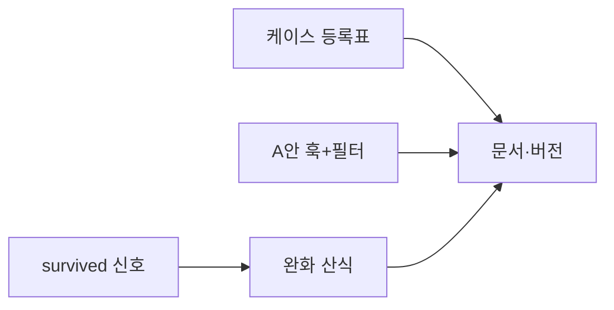

# flint v1.14.0 — 파이프라인 3단계: A안 훅 감지·survived 완화·케이스 등록표

**Spec path:** docs/plans/archive/2026-11/2026-11-21-flint-v1140.spec.md (게이트 반영 예정)
**Detail:** tests · **Target-min:** 7
**Global constraints:** TDD·비간섭(무매칭 시 DB 쓰기 0·전체 발언 캡처 금지)·기존 계측 파생만(신규 테이블 금지)·주석 영어·개인 데이터 금지.

**리서치 근거** (v114-research): UserPromptSubmit stdin 전체 수신·plugin hooks.json 등록 가능·exit 0 무출력=비간섭. survived=동일 (knowledge_id, session) 재회상(knowledge_reads 파생). **T5 유실 발견**: v1.12.0 A안 부록이 RUNBOOK 부재(머지 손실 의심) — 본 버전에서 복구.

### T1 케이스 등록표 · Complexity 3 · Est. context 22k
**Owns:** lib/knowledge/pipeline.go, lib/knowledge/pipeline_test.go
**계약:** 6케이스 Go 등록표(케이스명·입구 신호·source·태그·confidence·구현 버전) — 교정B안(correction·0.7·v1.11.0)·교정A안(동일·v1.14.0)·회상실패/반복(gap·0.4·v1.12.0 병합)·검증된성공(survived 관측·v1.14.0)·MCP 도구 호출(mcp·v0.2.6 계열·관측 경로)·세션증류(hook·0.5·v0.27)·수동(manual·지정). 검증된성공은 source 없는 관측 — 등록표 7케이스·sourceRegistry 정합은 source 보유 케이스만 대상. 문서 매트릭스 파생 + 계약 테스트(등록표↔sourceRegistry 정합).
**Test:** 등록표 완전성·source 정합·파생 문서 스냅숏.

### T2 A안 훅+로컬 필터 · Complexity 4 · Est. context 30k
**Owns:** flint-plugin/hooks/hooks.json, flint-plugin/hooks/correction_filter.sh, flint-plugin/hooks/correction_filter_test.sh, lib/knowledge/write_test.go, Makefile
**계약**: ①hooks.json에 UserPromptSubmit 등록(기존 훅 패턴 승계·`|| true` 비간섭) ②로컬 필터 스크립트: stdin 프롬프트에서 교정 마커 정규식(한국어 "그게 아니라/틀렸어/아니야"·영어 "actually/no, /that's wrong" 등 최소 집합) 매칭 → 매칭 조각만 `flint write knowledge --source correction`(confidence 0.4·태그 자동) 적립·비매칭 exit 0 무출력·**DB 쓰기 0 보장**(flint 호출 자체를 안 함) ③상한은 correction 채널 기존(correction_daily_max) 재사용 ④온/오프: 환경변수 FLINT_CORRECTION_HOOK(기본 on·off 시 즉시 exit 0).
**Test:** 합성 프롬프트 재현율(매칭/비매칭)·비간섭(무출력·무호출)·off 동작. 셸체크 관례. **CI 등록**: Makefile ci 타깃에 `bash flint-plugin/hooks/correction_filter_test.sh` 행 추가(게이트 내 상시 실행).
**go/no-go**: 재현율 실측 후 기준 미달 시 미구현 종결(스펙 유연 조항).

### T3 survived 신호 · Complexity 3 · Est. context 24k · Tests: slow
**Owns:** lib/knowledge/survived.go, lib/knowledge/survived_test.go
**계약:** 동일 (knowledge_id, session) knowledge_reads 2회 이상 = survived (kind 상관없이 read·hot 전부 카운트 — 회상 노출 자체가 신호) — 세션 내 재회상 카운트 파생(기존 계측·SQL 조인). `SurvivedCounts(ctx, st, ids) (map[int]int, error)` 노출.
**Test:** slow — 동일 세션 2회 → 1·타 세션 → 0·회상 없음 → 0.

### T4 완화 산식 · Complexity 3 · Est. context 24k
**Owns:** lib/knowledge/hot.go, lib/knowledge/hot_test.go, lib/knowledge/brief.go, lib/store/thresholds.go, lib/wire/threshold_meta.go, lib/wire/threshold_meta_test.go, docs/TUNING.md
**계약:** `survived_decay_relief`(기본 0=비활성·meta 오버라이드) 등록(45→46) — 순수함수 EventEffectiveScore(감쇠식)에 survived 파라미터 확장: `count − max(0, rate×days − survived×relief)`·외부 max(0,·) 클램프 유지(relief 0시 기존과 완전 동치). EffectiveScoreFor(vol 래퍼)는 시그니처 승계만. 소비자 3곳 승계(hot·brief·decay-audit — survived 카운트는 랭킹 시 조회·지연 허용 범위 조사 후 최소).
**Test:** relief 0 동치·완화 단조·오버라이드.

### T5 문서·버전 v1.14.0 · Complexity 2 · Est. context 20k
**Owns:** VERSION, README.md, README.ko.md, flint-plugin/.claude-plugin/plugin.json, docs/HISTORY.md, docs/versions_test.go, docs/RUNBOOK.md
**계약:** v1.14.0 동기·**RUNBOOK A안 부록 복구**(v1.12.0 T5 내용+구현 결과·판정 기준 충족 서술)·케이스 매트릭스(등록표 파생)·계약행 TestVersion01140Milestone{v1.14.0, pipeline-complete}.
**Test:** go test ./docs·release-gate OK v1.14.0.

**Review Focus:** privacy(프롬프트 비영속·매칭 최소)·state(survived 조인)·numeric(완화 산식 동치)·protocol(훅 계약). 위험: 오탐 프롬프트·훅 타임아웃·survived 조인 비용.

**Probe entry:** run=go run ./cmd/flint maintain --age-audit · run=go run ./cmd/flint read 데모 --limit 3

**Ruling:** A안 조건부 go — 공식 훅 스펙 확인·합성 재현률 실측 후 기준 미달 시 미구현 종결(스펙 유연) - 비용: 오탐 가능(pending+0.4 완화).
**Ruling:** survived_decay_relief 기본 0(비활성) — 발행 시점 동작 불변 원칙·완화는 opt-in - 비용: 기본 무효.
**Ruling:** T5(v1.12.0) A안 부록 유실 복구를 T5에 포함 — 머지 충돌 손실 추정 - 비용: 없음.
