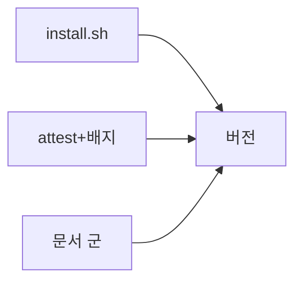

# flint v1.15.0 — 배포·신뢰·마케팅 기반

**Spec path:** docs/plans/archive/2026-11/2026-11-21-flint-v1150.spec.md (룰링 반영: 2b cosign 이중 도입 **불필요 — 기존 키 서명 유지**·`actions/attest-build-provenance` 추가로 대체·brew formula→**cask 가이드**로 교정)
**Detail:** tests · **Target-min:** 5
**Global constraints:** 주석 영어·개인 데이터 금지·실측 수치 인용 금지(구조 근거만)·스크립트는 check_personal·셸체크 관례.

**리서치 근거** (v115-research): cosign 키 서명·id-token 권한 기존 구현(ADR-0014·flint update 소비) — keyless 이중은 비용만. attest-build-provenance가 2026 표준(slsa-generator deprecated). install.sh zoxide 패턴+checksums.txt 검증(업계 평균 초과). brew formula deprecated→cask.

### T1 install.sh · Complexity 3 · Est. context 26k
**Owns:** scripts/install.sh, scripts/install_test.sh, Makefile
**계약:** zoxide 패턴(uname 감지·releases/latest 자산 선택·~/.local/bin + 재정의 플래그·PATH grep 안내) + **checksums.txt 동반 다운로드·sha256 검증**(shasum 우선·sha256sum 폴백 — Linux 최소 이미지·자산 1개만 받았으므로 해당 라인 필터 또는 --ignore-missing)(리서치 권고 — 해시 박제 아님). Doltgres 전제·바이너리 무요구 명시. err/ensure 관례. 셸 테스트(매핑·실패 경로·checksum 불일치 거부) make ci 등록.
**Test:** 셸 테스트 스위트.

### T2 attest+배지 · Complexity 2 · Est. context 20k
**Owns:** .github/workflows/ci.yml, README.md, README.ko.md
**계약:** deploy 잡 말미 `actions/attest-build-provenance`(subject-path 바이너리) — **권한에 `attestations: write` 추가 필수**(기존 contents·id-token만으론 403)·attest 실패는 발행 후속이므로 부드러운 실패 허용(continue-on-error 아님 — 잡 레드가 정직)·README 상단 **동적 배지로 교체**(정적 버전 배지는 기존 하이라이트와 별개 유지 — release 배지 행을 동적 actions badge로)·`gh attestation verify` 안내 1줄.
**Test:** workflow YAML validate(validate_yaml·CI 자체).

### T3 문서 군 · Complexity 3 · Est. context 26k
**Owns:** SECURITY.md, CONTRIBUTING.md, .github/ISSUE_TEMPLATE/bug.md, .github/ISSUE_TEMPLATE/feature.md, README.md, README.ko.md, docs/RUNBOOK.md
**계약:** ①SECURITY.md(취약점 보고 경로·지원 버전·비간섭 원칙) ②CONTRIBUTING(make ci 로컬 검증·플랜 관례 링크) ③ISSUE 템플릿 2종 ④README 설치절 정비 — 4경로(install.sh 원라인·go install·수동+checksum 검증 명령·cask 가이드[formula/cask 결정 사유])·퀵스타트 3커맨드·아키텍처 텍스트 다이어그램·**"왜 안전한가" 절**(비간섭 5원칙·로컬·오프라인·데이터 소유 — 구조 근거만)·EN/KO 대응 ⑤RUNBOOK 설치 절 링크.
**Test:** docs-sync·check_personal.

### T4 문서·버전 v1.15.0 · Complexity 1 · Est. context 14k
**Owns:** VERSION, flint-plugin/.claude-plugin/plugin.json, docs/HISTORY.md, docs/versions_test.go
**계약:** v1.15.0 동기·계약행 TestVersion01150Milestone{v1.15.0, distribution}. release-gate.
**Test:** go test ./docs·release-gate OK v1.15.0.

**Review Focus:** file(스크립트 정확·검증 우회 없음)·protocol(install 경로)·privacy(근거 서술). 위험: install.sh 파싱(자산명 매칭)·checksum 우회 경로.

**Probe entry:** run=bash scripts/install.sh --help · run=go run ./cmd/flint read 데모 --limit 3

**Ruling:** cosign 이중 불필요 — 기존 키 서명(ADR-0014) 유지·attest-build-provenance만 추가(2026 표준·저비용) - 비용: 검증 도구 2종 안내.
**Ruling:** brew formula→cask 교정 — goreleaser 2026 deprecation·결정 사유 문서화 - 비용: formula 경로 안내 불가.
